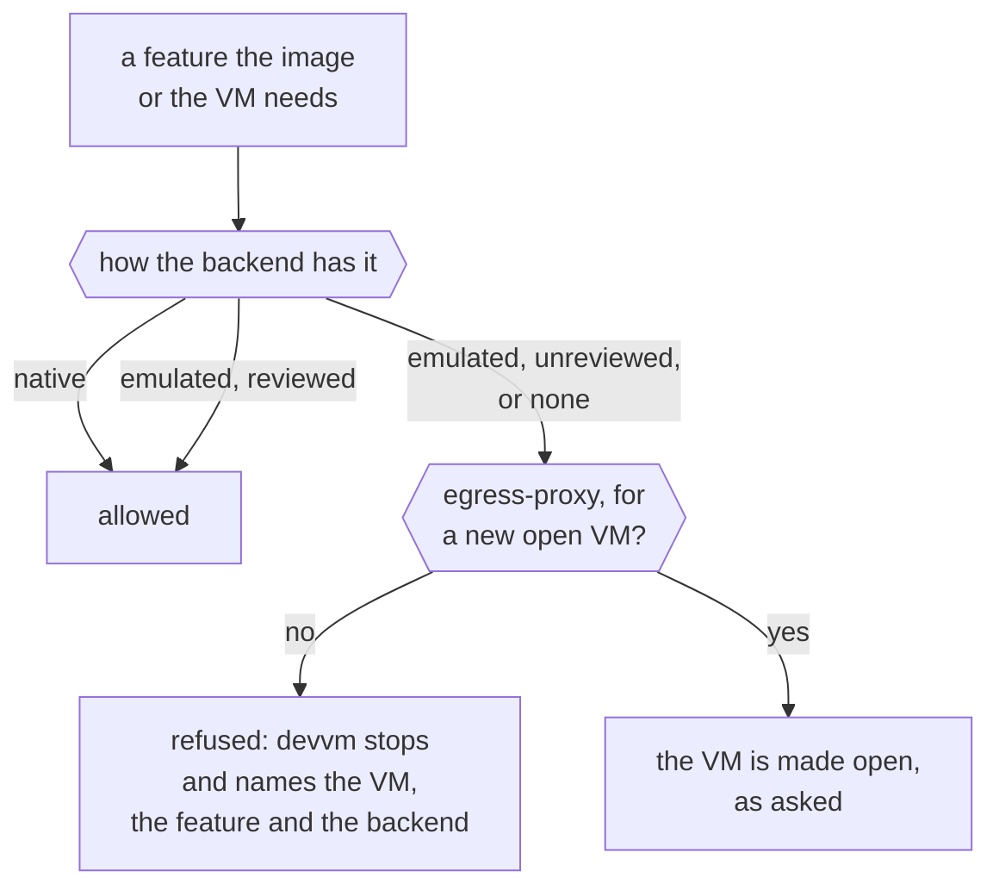

# Backends

This page explains how a backend gives devvm what it needs to run a VM, what devvm does when a backend lacks something, and how devvm names VMs. devvm runs its VMs on [Lima](../backends/lima.md), and another backend would plug in the same way, through the features below ([how a backend plugs in](../contributing/index.md#how-a-backend-plugs-in)).

## What a backend does

A backend has four roles, and every backend has all of them:

- **The host:** it says what it needs that this machine lacks, which `devvm doctor` reports, how long a VM's name can be, where its VMs live, and which folders hold their disks, so devvm can check the free space before a step that writes them.
- **Images:** it builds images and the shared tools' images, keeps the images, and names the files of its own that it puts into base, which base's key hashes.
- **Machines:** it makes, starts, stops, renames and deletes VMs, runs commands and shells in them, and says how ssh and devvm's port forwarder reach them. It also says how a VM runs now: which start it's on, whether that start is confined to the VM's proxy, and the file the VM's proxy and forwarder follow, which ends them when the process that runs the VM ends.
- **Housekeeping:** it says how much disk its VMs and caches take for `devvm space`, lists the VMs with devvm's label that this devvm has no state for, and lists and deletes devvm's share of its own caches for `devvm gc --caches`. A backend that can't tell one of these returns nothing, so devvm shows no size or deletes nothing.

A backend may also keep files of its own for a VM besides the VM, which `devvm gc --orphans` deletes once the VM is gone. Lima keeps none.

## Features

Each thing devvm needs from a backend is a feature, such as building images, mounting the project folder or confining a VM to its proxy. `devvm doctor` lists them as "features" too, but they aren't the base image features you choose with `devvm setup`. Each backend declares how it has each feature:

- **native**: the backend does it itself.
- **emulated**: devvm builds it from other parts of the backend.
- **none**: the backend can't do it.

A backend lists every feature, the ones it lacks too, and devvm refuses to use a backend that leaves one out, so a new feature makes each backend say how it has it. Some features are built on others: `ports-all` on `ports`, `agent-toggle` on `agent-forwarding`, and `link` on `ssh`. A backend has such a feature no better than the one it's built on, so the feature is emulated wherever its base is emulated, and none wherever its base is none.

devvm uses an emulation only once its review has passed, and until then it refuses the emulation. A review takes a [design note](design.md#emulated-features), a threat check with the security-audit skill, and end-to-end checks that prove the guarantee.

`devvm doctor` lists Lima's features, and `devvm doctor --json` those of every backend devvm has. Both show an emulation whose review hasn't passed as `unreviewed`.

### The feature table

| Feature | What it is | Lima |
| --- | --- | --- |
| `build-image` | build images from the layer and feature scripts | native |
| `build-confinement` | builds reach the internet but not the host's loopback, or nothing | native: Seatbelt on macOS. On Linux, QEMU's `restrict=on` confines a build with no network, but a build with the internet reaches the host's loopback ([details](lima.md#confinement)) |
| `from` | `base` from a container image (`--from`) | native: devvm converts the image to a disk |
| `clone` | a project VM from an image | native: an APFS copy-on-write copy on macOS, and a qcow2 overlay on Linux ([details](lima.md#clones-and-overlays)) |
| `project-mount` | the project folder, read-write | native: virtiofs on macOS, and 9p on Linux |
| `agent-folders` | agents' host folders, read-only | native: read-only mounts, enforced by the host |
| `tools-share` | the shared tools, read-only | native: a read-only mount, enforced by the host |
| `egress-proxy` | network traffic only through devvm's proxy | native: Seatbelt on macOS, and on Linux QEMU's `restrict=on` with a `guestfwd` to the proxy ([details](lima.md#confinement)) |
| `ssh` | ssh for editors | native: Lima's ssh forward and config |
| `ports` | the listed ports forwarded to the host's loopback | emulated (reviewed): devvm's forwarder over Lima's ssh, for the listed ports alone, with Lima's own forwards off ([details](lima.md#ports)) |
| `ports-all` | every port forwarded, servers on the VM's loopback included | emulated (reviewed): the same forwarder, for whatever listens in the VM from port 1024 up, and never a port the host has ([details](lima.md#ports)) |
| `agent-forwarding` | ssh-agent forwarding, chosen when the VM is made | native |
| `agent-toggle` | turning a VM's ssh-agent forwarding on or off later | native |
| `cpus` | a VM's CPUs | native |
| `memory` | a VM's memory | native |
| `disk` | a VM's disk size | native: it grows but never shrinks |
| `docker-layer` | the [docker layer](../using/images.md#built-in-layers): Docker's engine running in the VM | native |
| `nix-layer` | the [nix layer](../using/images.md#nix): Nix's daemon and its store in the VM, with builds in Nix's sandbox | native ([details](images.md#the-nix-layer)) |
| `link` | links between VMs: a program in one VM reaches a port another VM publishes, by name | native: a link session of devvm's own over Lima's ssh, with remote forwards to `127.77.0.0/16` alone ([details](ports.md#links-between-vms)) |

`egress-proxy` is what every [network tier](../safety/network.md#network-tiers) but open needs. The open tier needs no feature of its own: every backend must let a VM on its own network (`NetDirect`) reach a port on the host's loopback and set the guest's proxy settings from the confinement (`Confinement.GuestProxy`, `ProxyURL`), which the conformance suite checks (`checkProxyURL`), because every VM's proxy carries its requests. So a backend without `egress-proxy` still has open VMs, and devvm refuses every other tier on it in one line (`net_tier_backend`).

### What each backend emulates

On Lima, devvm emulates forwarding ports, both the listed ones and every one, through its forwarder, and the emulation is reviewed ([port forwarding](ports.md)). Everything else on Lima is Lima's own.

The forwarder is devvm's own on every backend, never a backend's. A backend that has `ports` turns its own forwards off, and devvm's forwarder reaches a running VM's sshd the way the backend's `SSH` says, which is a user, a key and a port. devvm refuses that target unless it's on this machine's loopback, `127.0.0.1`, with the same check it uses for links and the ssh config (`vmssh.FromTarget`). devvm reads which ports the VM forwards from its state, chooses which of them are free, pins the VM's host keys for its current start and starts the forwarder, which follows the backend's lifeline for the VM.

## Missing and unreviewed features

devvm checks each feature an image or a VM needs this way:

Before devvm builds an image, makes or starts a VM, or changes a VM's settings, it checks that the backend has every feature the image or the VM needs. The backend itself is behind the same check: every time devvm asks it to build an image or the shared tools, make a VM or start one, devvm checks the features that request needs before the backend sees it, so a request that skipped the first check is refused too. When the backend lacks one, devvm stops and names the VM, the feature and the backend (`backend_lacks`). It does the same for a feature the backend only emulates when that emulation's review hasn't passed (`backend_unreviewed`). devvm never falls back to something weaker, so a VM on a confined tier never starts with an open network.

To get the feature, use a backend that has it. A VM keeps its backend, so that means making a new VM.

A new VM's tier is the one exception, because allowlist is the default, and [When a backend lacks something](../backends/index.md#when-a-backend-lacks-something) says what devvm does instead.

## What a start changes

A backend makes a VM as devvm asks, and then changes it only when it starts. Each time devvm starts a stopped VM, it tells the backend what the VM's state asks for, which is its size, the agent folders in devvm's agent store and whether it forwards your SSH agent, together with how the VM is confined. The backend compares that with the VM it has and changes only what differs, so a start that changes nothing leaves the VM's config as it was. Nothing changes a stopped VM's config between starts, so `devvm size` and `devvm ssh-agent` save what you ask for in the VM's state, and the VM gets it when it next starts.

A running VM is left as it is, and devvm says what changes when it next starts. Its ports aren't the backend's, so `devvm ports` changes them at once, and a running VM's forwarder starts again with the new ones ([port forwarding](ports.md#its-process-and-files)). A disk can't shrink, so a start that asks for a smaller disk than the VM has fails before the backend changes anything (`disk_shrink`).

Which ports a VM forwards stays in the VM's state alone, and the backend never hears of them. The backend keeps only what it needs for the start it made, such as Lima's record of the hostagent it started confined ([confinement](lima.md#confinement)).

## VM names

A project VM's name is `devvm-<folder>-<hash>`. The folder part is up to 20 characters of the folder's name, in lowercase, with characters other than letters and digits turned into dashes, and the hash part is 14 hex digits of a hash of the folder's path. devvm takes a name as a project VM's only when it has that form, so a name in a state file or a backend's list whose folder part has any other character, or starts or ends with a dash, isn't a project VM's.

A backend may need shorter names, and then devvm cuts the folder's part to fit. When fewer than 4 characters of it would fit, devvm refuses (`vm_name_no_room`). On Lima the room for a name depends on the Lima home's path, because Lima keeps each VM's ssh socket under it, so there the fix is a shorter Lima home (`lima_home_too_long`, [limits](../backends/lima.md#limits)).

Only a new VM gets a name, which fits the limit of the backend that makes it. devvm finds a folder's VM by the state that records the folder's path, in the VM's folder in devvm's data folder (`vms/<hash>/`, named by the hash that ends the VM's name), so an existing VM keeps the name and the backend its state records, whichever backend new VMs get, and keeps them when its folder moves ([a moved folder](overview.md#a-moved-folder)).

## Which backends a launch asks

A launch asks a backend about its VMs only when some VM's state names that backend. It asks them to write the [ssh config](../using/ssh.md) and to check the SSH agent's folders. So a backend that no VM uses never runs during a launch, even when it isn't running or isn't installed ([a VM's backend](../backends/index.md#a-vms-backend)).

