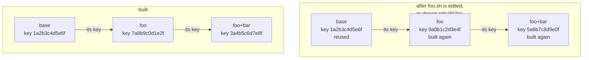

# Images and caching

This page explains how devvm builds images and shared tools, how it keys and caches them, and how it checks what they start from: Ubuntu's cloud image, a container image from `--from`, and each tool's downloads. [Images and tools](../using/images.md) covers choosing, rebuilding and cleaning up images, and [Starting from a container image](../using/from.md) covers `--from`.

## Building

devvm builds each image in a VM of its own, and that VM then is the image:

1. For base, devvm makes a new VM from [Ubuntu's cloud image](#ubuntus-cloud-image) with `base.yaml`'s settings, or, with `--from`, from a container image [converted into a disk](#how-its-converted). A layer's VM is a copy of its parent image.
2. The VM starts confined, and it forwards no ports. What a build with the internet reaches of the host depends on the backend: on macOS, Lima keeps it out of the host's loopback, and on Linux it reaches the host's loopback too, as [Lima](lima.md#confinement) describes.
3. The script runs. For base, that's `assets/layers/base.sh` and then the [features](../using/customizing.md) you chose, and for a layer, it's the layer's script.
4. The VM stops. devvm writes the image's record last, `~/.local/share/devvm/images/<key>/record.json`, with its name, its chain, what base started from and its digest, its C library, the glibc version of a `--from` base with glibc, when the build finished and the version of the devvm that built it (`made_by`). The record is JSON that only devvm writes, and devvm ignores fields it doesn't know, so a newer devvm's record still reads.

While the VM is being built, it already has the image's final name, so devvm holds a lock for each image it builds, `~/.local/share/devvm/images/locks/<key>`, from before it looks for the image until the record is written. Another devvm that builds the same image waits for that lock and says so (`image_build_waiting`) after 3 seconds, and once it gets the lock, it finds the image built. An image without a record is unfinished only when its lock is free, so devvm then deletes it and builds it again (`image_leftover`). While the lock is held, the image is `building`, and `devvm gc`, `devvm rebuild` and `devvm images rm` leave it alone (`image_building`). The lock is an OS lock on an open file, which the system releases when its devvm ends, however it ends, so a crash never leaves an image looking like it's still being built. devvm deletes the lock file together with the image's folder.

Nothing from the host is mounted into a build, because layer scripts run third-party installers, which mustn't see your files. Behind a company proxy, a build on Lima goes through a proxy of devvm's on this machine for that build alone, which goes through the company proxy. The scripts' commands get only that proxy's address, with a password devvm makes for the build, so neither the build nor its image ever has the company proxy's password ([a company proxy](design.md#a-company-proxy)). A build gets base's size fitted to the host, which the images built on base, and their VMs, keep ([base's size](#bases-size)).

## Keys and caching

devvm builds images in layers and caches them, as Docker does. `base` comes first, and each layer is built on its parent, so `foo+bar` is `bar` on `foo` on `base`. A layer starts from its parent and runs its script inside it, and devvm stores it under a key, which is a hash of everything that goes into it. When an image with that key already exists, devvm uses it, and otherwise it builds one.

| Image | Its key hashes |
| --- | --- |
| `base` | the backend, `assets/base.yaml`, `assets/prelude.sh`, `assets/layers/apt.sh`, `assets/layers/base.sh`, the chosen features that devvm has, in order (each name and its script, `assets/features/<name>.sh`), its rebuild counter, and with `--from`, the image, its digest and the scripts that convert it; on Lima, the Ubuntu cloud image pinned on this machine (its release, file and SHA-256), base's disk size, and the user that a `--from` conversion puts in the image (its name, uid and home folder) with the converted disk's size |
| a built-in layer | its parent's key, its name, `assets/prelude.sh`, `assets/layers/apt.sh`, its script (`assets/layers/<name>.sh`) and its rebuild counter |
| a custom layer | its parent's key, its name, `assets/prelude.sh`, `assets/layers/apt.sh`, its script (`~/.config/devvm/layers/<name>.sh`) with the prelude before it, and its rebuild counter |

devvm puts together each image's recipe once, as the ordered list of steps its build runs. A step is a script with its name, its arguments and whether it runs as root. Each script in a recipe that runs with bash, devvm's own and a custom layer's alike, starts with devvm's prelude, `assets/prelude.sh`, which [the scripts' prelude](#the-scripts-prelude) describes, so the recipe holds the prelude and the script together. The recipe of `base` starts with the backend's own steps, which say what the backend makes `base`'s disk from. On Lima, those are the Ubuntu cloud image pinned on this machine, base's disk size and `base.yaml`, and with `--from`, the conversion's scripts too, `build.sh` with its arguments. Then come `apt.sh begin`, `base.sh`, the chosen features' scripts and `apt.sh end`, while a layer's recipe is `apt.sh lists` and then its own script. The key hashes that recipe, and the backend is given the same recipe and runs it as it is, so nothing reaches a build that its key doesn't hold, apart from base's packages: those are the ones its key recorded at its first build, or the mirror to record them from, which [base's packages](#bases-packages) describes. A chosen feature without a script isn't in the recipe, and devvm warns about it (`unknown_feature`) when it builds `base`. The user's CAs and a company proxy's variables are added to each step while it runs and taken out again, so they aren't in the recipe, and the image keeps none of them. A build's CPUs and memory aren't in it either, because the host's size doesn't change what an image holds, but base's disk size is, because the disk is part of the image ([base's size](#bases-size)).

A key is the first 12 hex digits of a SHA-256. Each input goes into the hash with its length, so different inputs never hash the same bytes. An image's record keeps its chain, which is the key of each image it's built on, from `base` up.

Each key hashes its parent's, so a new key anywhere in the chain changes the key of every image above it:

This means:

- When you edit a script, its layer and every layer above it rebuild the next time they're used, and the layers below are reused.
- Each backend builds its own images and never uses another backend's.
- With `--from`, base's key has the image's [digest](#digests), so when the tag moves to a new image, base and everything on it rebuild.
- A layer whose script is gone hashes as missing, so its images don't match any more.
- Nothing else counts. Features you haven't chosen change no key, and neither do policy files (`*.policy`), which the proxy reads at run time and which never go into an image.

An image whose key doesn't match its inputs any more is stale. It stays until it's deleted ([cleaning up](../using/images.md#cleaning-up)), and the next use builds a new one.

## Rebuilding

`devvm rebuild` works through the rebuild counter, which each image's key hashes. The counters are in `~/.local/share/devvm/images/rebuilds.json`, one for each backend, each image that base starts from, as `--from` gives it, and each image, so a rebuild on one backend leaves the other backends' images and their VMs as they are, and so does a rebuild from another container image. A rebuild writes a new value into its counter, made of the time and a random part, so the image gets a new key, and so does every image built on it. A rebuild of base on Lima also pins the newest [Ubuntu cloud image](#ubuntus-cloud-image) first, while a rebuild of a `--from` base looks up its container image's digest again and keeps the cloud image pinned. The counters can't be in an image's folder, because a counter is an input to the key that names that folder. A devvm changing a counter holds a lock, `~/.local/share/devvm/images/locks/rebuilds`, while it reads the file and writes it whole, so two rebuilds at once both keep their new values. devvm lists those images first (`rebuild_replaces`). After the build, it deletes every stale image that no VM uses, which includes the old image and those built on it, and they're built again, on the new image, the next time they're needed. On Linux hosts, an image whose disk VMs are overlays of stays, and devvm says which VMs use it.

A VM keeps the image it was made from, and its state keeps that image's chain. When a key in the chain changes, after an edited script or a rebuild, devvm warns on each launch that the VM is outdated (`vm_outdated`) and leaves the VM as it is ([outdated VMs](../using/images.md#outdated-vms)). `devvm update` makes the same check, comparing each image's key in the recorded chain with its key as it is now, and when one differs, it makes the VM again from the same image name ([making a VM again](overview.md#making-a-vm-again)). Otherwise, when the VM also had the newest shared tools, it says the VM is current (`vm_current`). Shared tool images have keys of their own, which [building tools](#building-tools) describes, and they're never in the chain, so newer shared tools alone don't lead `devvm update` to make the VM again.

## Ubuntu's cloud image

On Lima, base starts from a dated release of Ubuntu 26.04's cloud image (`release-YYYYMMDD` on cloud-images.ubuntu.com), which devvm pins on this machine the first time it builds base. devvm's own files hold only the release, 26.04, and Ubuntu's cloud image key, `assets/layers/ubuntu-cloud.gpg` (fingerprint `D2EB44626FDDC30B513D5BB71A5D6C4C7DB87C81`), so nothing in devvm needs moving when Ubuntu publishes a new image.

To pin an image, devvm reads the list of dated releases at cloud-images.ubuntu.com and takes the newest one whose checksums list an image for the host:

- The release's `SHA256SUMS` must carry a valid signature from Ubuntu's cloud image key, in its `SHA256SUMS.gpg`. No other key counts. devvm checks the signature itself, with the standard library's RSA and SHA-2, so it needs no `gpgv` or other program. When the signature is missing or doesn't check out, devvm refuses the release (`ubuntu_bad_signature`), and it never falls back to an older release for that reason.
- The host's image, `ubuntu-26.04-server-cloudimg-arm64.img` or `-amd64.img`, must be listed with a SHA-256 of 64 hex digits. A release that lists none is passed over for the next older one, and when no release has one, devvm stops (`no_ubuntu_release`).
- When devvm can't read the list, it stops (`ubuntu_unreachable`), and nothing is pinned.

devvm records the pin in `~/.local/share/devvm/images/ubuntu.json`: the release, the image's file name, its SHA-256 and when it was pinned. One devvm pins at a time, holding `~/.local/share/devvm/images/locks/ubuntu`, so two first builds pin the same image. Every later build of base on this machine uses the pinned image without looking anything up, so it needs no network for the image once Lima has it cached, and Lima checks the download against the pinned SHA-256. A pin for another architecture, such as in a data folder copied from another machine, counts as none, and the next build pins one for this host. A `--from` base's conversion boots the pinned image too, and pins one only when none is.

An image devvm pinned in the same run that doesn't boot, so that the backend fails to start base's build VM, gets one second chance. devvm says so (`origin_no_boot`), pins the newest release older than it, which it checks the same way, and builds base on that, so a broken new release of Ubuntu's doesn't stop new machines' first builds. The older release is what stays pinned. devvm tries this once a run, and never for an image that was pinned before the run, because that one booted then. The build VM that didn't boot stays, stopped, as a [failed build](../using/troubleshooting.md#a-build-fails) does.

The pin is part of base's recipe, so base's key hashes the release, the file and its SHA-256, and a new pin makes a new base. base's record keeps the address and SHA-256 of the image it was built from. Ubuntu removes its dated releases after a few months, so a base built from one that's gone can still be used, but building it again needs Lima's cached copy of the image.

## Base's settings and pins

Base's size is 4 CPUs, 8 GiB of memory and a 100 GiB disk, which devvm sets in its own code, and it fits the CPUs and memory to the host ([base's size](#bases-size)). On Lima, `assets/base.yaml` holds base's other VM settings. `assets/layers/base.sh` installs base, and the optional [features](../using/customizing.md) you chose follow it.

Each download in `assets/layers/base.sh` is pinned to a version and a SHA-256 at the top of the script, and the build fails if a checksum doesn't match. Each feature pins its downloads in the same way, at the top of its script, `assets/features/<name>.sh` in the repo, which is built into devvm. apt's packages are pinned per image key, as [base's packages](#bases-packages) describes.

### The scripts' prelude

`assets/prelude.sh` comes first in each script that a build runs with bash: `assets/layers/base.sh` and `apt.sh`, the built-in layers and features, your own layers, `assets/shared-tools/build.sh`, and a `--from` conversion's `assets/oci/build.sh`. devvm puts it before the script on the script's standard input, and for the conversion, in the copy of `build.sh` that it writes into the conversion's own temporary folder, so no copy of either is kept anywhere else. The prelude sets no shell options and runs only `uname` and `command -v`. It gives the script three things:

- `$devvm_arch` is the VM's architecture as the pins name it, `arm64` or `amd64`. On any other architecture, the prelude stops the script.
- `$devvm_libc` is the VM's C library, `musl` on Alpine, where `apk` is, and `gnu` everywhere else.
- `devvm_sha TOOL` prints TOOL's pinned SHA-256 for this VM, which is the script's own `TOOL_sha256_<arch>_musl` on musl when the script pins one, and its `TOOL_sha256_<arch>` otherwise. A script that pins none for this VM gets an error that names the pin.

The prelude goes in as one line, `eval $'…'`, which holds the whole file in bash's ANSI-C quoting, and that line takes the place of the script's `#!` line. Each of the script's lines then keeps its number in bash's errors and in `$LINENO`, and a script without a `#!` line gets the prelude's line before its first, so its lines are one further down. A build's exports for a company proxy and for your CAs go on that same first line, before the `eval`, so they don't move the script's lines either.

Each of devvm's scripts that uses the prelude checks that it came first, with `: "${devvm_arch:?}"` for each variable it reads, so it stops at once when run without it. The key of each image and tool image whose build runs one of these scripts hashes the prelude with the script, so a change to the prelude rebuilds every image and every shared tool image. `bootify.sh`, which runs with the container image's own `sh`, and `kernel.sh` don't get it.

Your own layer gets the prelude in the same way, so it can pin its downloads as devvm's scripts do and pick them with `devvm_sha`, which [Customizing's example](../using/customizing.md#example-mailpit) shows. The prelude runs first, so a name your script sets or defines afterwards, `devvm_arch` or `devvm_sha` included, is your script's from then on, and a script that never uses the prelude runs just as it would without it. Your layer's step in its image's recipe holds the prelude and your script together, so a change to either one rebuilds that image and the images above it.

## Base's packages

base's recipe runs `assets/layers/apt.sh begin` as root before `base.sh`, and `apt.sh end` after the last feature. Both are steps of the recipe, so base's key hashes the script. What the build gives the script in `/var/cache/devvm/packages/in` decides where apt's packages come from:

- **A first build of a key records them.** devvm sends `in/mirrors`, which holds the mirror that [`ubuntu-mirror`](../using/settings.md#an-ubuntu-mirror) sets, or nothing. `apt.sh begin` points each of the image's sources at an apt `mirror+file:` list of that mirror and then the source's own archive (`archive.ubuntu.com`, or `ports.ubuntu.com` on arm64), so apt tries them in that order, and it keeps every package it downloads. apt also installs phased updates (`APT::Get::Always-Include-Phased-Updates`), which Ubuntu otherwise rolls out to only some machines at first, so it always takes the newest version that the lists have. apt checks the archive's signature with Ubuntu's archive key, which the image has, whichever mirror answers. At the end, `apt.sh end` moves each downloaded package to `out/<sha256>.deb` and writes its entry from apt's package lists, which apt checked against that signature, to `out/Packages`. The script fails the build when the lists have no entry with the file's SHA-256. It also copies each `InRelease` file and package list that apt used to `out/<n>.InRelease` or `out/<n>.Packages`, so devvm can check them on this machine. apt keeps those lists uncompressed while base builds (`Acquire::GzipIndexes "false"`), as they're signed.
- **Every later build of the key replays them.** devvm sends the files the key recorded, from its cache, and `in/Packages`, their entries, each naming its file. `apt.sh begin` moves the image's sources aside and gives apt only that folder, so `base.sh` and the features install exactly what the first build did, with no network for them.
- **A `--from` base gets neither.** Its packages come from the container image's own sources as they are when it builds, and they aren't pinned.

Both ends put the image's own sources back, remove devvm's apt settings, empty apt's cache and delete the package lists, so a first build and a replay make the same image. A VM made from it fetches lists when you run `sudo apt update`, and each layer's recipe starts with `apt.sh lists`, as root, which fetches them from the image's own sources when there are none, so a layer's script installs as it would on any Ubuntu. `apt.sh` turns apt's retries off and makes a source that sends nothing for 30 seconds fail, and when no source answers, it exits 75, which the backend reports as `build_sources_unreachable`, not as a script that failed.

The backend sends the build's input into the VM as a tar stream before the first step, and after the last step it hands devvm a tar stream of `out/` and deletes the folder (`backend.Packages`). On Lima, both run as root over `limactl shell`. What comes back is the build VM's, so devvm checks it before it keeps anything (`packages_refused`). It takes only regular files named `Packages`, `<64 hex digits>.deb`, `<n>.InRelease` or `<n>.Packages`, each package's content must hash to its name, and each entry must name a file that came back with the size and SHA-256 the entry gives, with no file left over. Each `InRelease` file is at most 4 MiB and all of them 32 MiB, and each package list is at most 512 MiB, with lines of at most 1 MiB and entries of at most 4 MiB, and all the lists 2 GiB. A name that comes back twice is refused.

devvm doesn't take the build VM's word for the entries, because anything with root in that VM could write them. It checks each `InRelease` file's clearsigned signature itself, in Go, against Ubuntu's archive key, which devvm's own files hold (`assets/layers/ubuntu-archive.gpg`, fingerprint `F6ECB3762474EDA9D21B7022871920D1991BC93C`), and refuses one that doesn't check out or isn't one of the suites an Ubuntu 26.04 image's sources name: `resolute`, `resolute-updates`, `resolute-security` and `resolute-backports`, never `resolute-proposed`. It tries at most 4 signatures in each file, because each one hashes the whole file. It also refuses an `InRelease` whose `Date:` is older than the archive state the pinned cloud image was built from, because Ubuntu's `InRelease` files carry no `Valid-Until`, so a mirror that stopped updating still serves validly signed ones. The release pocket, `resolute`, which Ubuntu stopped changing at release, must be dated no earlier than that day, 2026-04-23 (`ubuntu.Released`). Every other pocket (`resolute-updates`, `resolute-security`, `resolute-backports`) must be dated no more than a day before the pinned release's date (`release-YYYYMMDD`). devvm names the mirror that [`ubuntu-mirror`](../using/settings.md#an-ubuntu-mirror) sets (`packages_stale_mirror`), or Ubuntu's archive when none is set (`packages_stale`). devvm compares the lists with the cloud image's date, not with today's, so a mirror that's behind, or one that's lying, can't serve lists older than that, but a mirror that fell behind after that date can still give base packages older than Ubuntu's, which is why [`ubuntu-mirror`](../using/settings.md#an-ubuntu-mirror) should name only a mirror you trust to keep up. Each package list must have the SHA-256 and size that a verified `InRelease` gives for one of its `Packages` lists, which devvm checks before it reads the list, and each package's SHA-256 must be in one of those lists, as the same package, version, architecture and size that apt's entry says. devvm then keeps the archive's own entry for the package, not apt's.

devvm also checks that each package is the newest version that apt would install, because whatever has root in the build VM could hand back only the lists it chooses, such as the release pocket's, and record an older version than `resolute-updates` or `resolute-security` has. A recording must give back the `InRelease` files of `resolute-updates` and `resolute-security` with lists for the architectures whose lists have the recorded packages, such as `binary-arm64`, so another archive's `InRelease`, such as `archive.ubuntu.com`'s on arm64, where `ports.ubuntu.com` has the lists, doesn't count. For each `InRelease` it gives back, it must also give back every package list that the file gives for those architectures, in every component (`main`, `restricted`, `universe` and `multiverse`). An empty list is the one exception, because it lists nothing. When one is missing, devvm names the suite and keeps nothing (`packages_lists_missing`). devvm then refuses a recorded package when the release pocket's list, `resolute-updates`' or `resolute-security`'s has a newer version of it for that architecture, and it names the package, both versions and the suite (`packages_not_newest`). `resolute-backports` doesn't count, because apt installs its packages only when you ask for them (its `InRelease` says `NotAutomatic`). devvm orders versions as `dpkg --compare-versions` does, in Go (`ubuntu.CompareVersions`): the epoch first, then the upstream version, then the Debian revision, with letters before other characters and `~` before everything, even the end, so `1.0~rc1` is older than `1.0`.

A recording that gives back no packages needs no lists. devvm writes the files into a folder of the build's own in the cache while it checks them, and once the image is built, it moves each into the cache, `~/.local/share/devvm/packages/<sha256>.deb`, and writes the key's set, `~/.local/share/devvm/packages/sets/<key>.json`: each package's name, version, architecture, SHA-256, size and entry. A file the cache already has under that name is kept only when its checksum still matches it; devvm replaces a changed one with the build's copy and notes that in the run log. That happens before the image's record, under a lock, `~/.local/share/devvm/images/locks/packages`, and a build that fails keeps nothing.

A key's set is written once, and the cache holds each file under its own SHA-256, so a build can't change what another key installs. Before a replay, devvm reads each of the set's files and checks its SHA-256 and size, and it refuses to build when one is gone or changed (`packages_missing`), so it never records the key's packages again. [`devvm rebuild base`](#rebuilding) gives base a new key, which records anew. `devvm gc` deletes the sets of keys that are neither base's key as it is now nor an image the backend has, and then, holding the lock, the package files that no set names then, so a set recorded meanwhile keeps its files. It also deletes a build's own folder of what it gave back that's over a day old, which a build that was killed leaves.

## Base's size

devvm fits base's CPUs and memory to the host with one rule that every backend uses. Base gets its 4 CPUs, or the host's count when the host has fewer, because a Lima `vz` VM given more CPUs than the Mac has can start so slowly that its ssh never comes up, as [Lima's issue](https://github.com/lima-vm/lima/issues/1621) reports. Base gets its 8 GiB of memory, or half the host's whole GiB when 8 GiB would leave the host less than 2 GiB, because a VM asking for all of the host's memory doesn't start.

- **Lima** passes the fitted size to `limactl create` as `--cpus` and `--memory`, and base's 100 GiB disk as `--disk`, for base and for the VM that converts a `--from` image. The images built on base are clones of it, so they and their VMs keep that size. A new VM's disk is never smaller than base's, because disks can't shrink.

A size you set with `--cpus`, `--memory` or `devvm size -g` replaces the fitted one. devvm checks that size against the same rule, so it refuses more memory than the host's whole GiB less 2, or half of them on a host of 4 GiB or less, and the fitted memory always passes ([size](../using/ports-size.md#size-and-ports)). The fitted size isn't in image keys, because the host's size doesn't change what an image holds.

base also drops the server extras that Ubuntu's cloud image comes with, which are snapd, multipath, ModemManager, udisks, firmware updates, crash reporting, tracing tools, kernel headers, and apt's background updates and upgrades. That saves 0.9 GB of disk and 100 MB of memory per VM, and the everyday tools stay ([base](../using/images.md#base)).

## The desktop layer

The built-in [`desktop` layer](../using/images.md#desktop)'s script is `assets/layers/desktop.sh`, and its allowlist is `assets/layers/desktop.policy`, which has no rules, because the layer downloads nothing of its own and its packages come from the distribution's archive, which base's allowlist has. base's image has no package lists, so the layer's `apt.sh lists` step fetches them first, and its packages are the archive's as they are when the layer builds, which aren't pinned. On `--from alpine`, the script installs Alpine's own packages, which aren't pinned either. Besides Xfce and TigerVNC, the script writes `/usr/local/bin/devvm-desktop`, which [`devvm desktop`](desktop.md#in-the-vm) runs in the VM. The layer needs no backend feature of its own, because it runs on any VM that can build an image and reach its ssh.

## The docker layer

The built-in [`docker` layer](../using/images.md#built-in-layers)'s script is `assets/layers/docker.sh`, embedded in devvm, and its [allowlist](../safety/network.md#allowlists) is `assets/layers/docker.policy`. The script pins the checksum of the signing key of Docker's apt repository and each package's version at the top. On `--from alpine`, it installs Alpine's own packages, which aren't pinned. Running Docker's engine in a VM is a backend feature of its own, `docker-layer` ([features](backends.md#features)).

## The nix layer

The built-in [`nix` layer](../using/images.md#nix)'s script is `assets/layers/nix.sh`, and its allowlist is `assets/layers/nix.policy`. The script pins Nix's release tarball, the direnv binary and nix-direnv's `direnvrc` at the top, each with its version and SHA-256, which are per architecture for Nix and direnv, and fetches them with `devvm-fetch`. `scripts/bump.sh nix direnv nix-direnv` moves them. Nix's version is the one nixos.org's installer fetches, at least 2.35.3, which fixes the scripted installer's store ownership (GHSA-hf6w-2rg9-v84g) and the daemon's store corruption through `repair` (CVE-2026-110450). Nix's newer releases come with another installer, from artifacts.nixos.org, so the layer's pins change shape when it moves to one of them.

The script runs the tarball's own installer as `install --daemon --yes --no-channel-add`, which copies the tarball's store into `/nix`, downloading nothing, makes the `nixbld` build users and, under systemd, starts `nix-daemon`. On OpenRC, which a base `--from alpine` runs, the script adds a service of devvm's, `/etc/init.d/nix-daemon`, to the default runlevel and starts it, and before the install it adds Alpine's `xz`, unpinned, which GNU tar needs for the tarball. Nix's own binaries are static or linked against the C library in its store, so they run on musl. Its extra settings turn on flakes and the `nix` command and keep `trusted-users = root`, so only root can choose caches and signing keys. They also set `sandbox = true` and `sandbox-fallback = false`, so a build fails where the kernel can't sandbox it, rather than run outside the sandbox without a word. The installer writes any proxy variables it finds into a systemd drop-in for the daemon, which would put a build's proxy into the image, so the script runs it without them. It points Nix at the system's CAs, which hold devvm's and yours. After the install, the script checks that every path in the store is root's, and it fails otherwise.

It also adds Nix's default profile to the end of sudo's `secure_path`, through `/etc/sudoers.d/devvm-nix`, so `sudo nix` works, and appends Nix's profiles to the `PATH` that `BASH_ENV` gives shells that read no profile. direnv goes into `/usr/local/bin` and nix-direnv into `/usr/local/share/nix-direnv`. A file in `~/.config/direnv/lib` loads nix-direnv and puts each project's direnv layout under `~/.cache/direnv/layouts`, named by a hash of the project's path, so its cached dev shell and garbage collector roots stay in the VM's home and out of the project folder. direnv's shell hook is in `~/.bashrc.d/direnv.sh`, which bash loads before `mise.sh`, and since each hook puts itself first in `PROMPT_COMMAND`, direnv's runs after mise's, and a dev shell's `PATH` comes before the shared tools'.

The daemon doesn't read `/etc/environment`, so the [VM's setup](network.md#the-vms-setup) gives it the VM's proxy on every tier, in a drop-in of its own under systemd, or else in `/etc/conf.d/nix-daemon`, which OpenRC reads for the service. The setup also puts the [shared Nix cache](network.md#the-shared-nix-cache) first in Nix's substituters, in `/etc/nix/devvm-cache.conf`. It removes both files from a VM whose environment names no proxy. Running the layer is a backend feature, `nix-layer` ([features](backends.md#features)), and building it also needs the feature, so a backend without it refuses `devvm build nix`. With `sandbox-fallback = false`, every Nix build fails in a VM that can't make the kernel namespaces that Nix's sandbox needs.

## How it's converted

With `--from`, devvm turns the container image into a disk in a throwaway VM, `devvm-oci-build`, which it makes from Ubuntu's cloud image with `base.yaml`'s settings and base's size. No Docker is needed:

1. [crane](https://github.com/google/go-containerregistry/tree/main/cmd/crane) downloads exactly the [digest](#digests) in `base`'s key, for this machine's architecture, and flattens its layers. crane is pinned like every download: its version and SHA-256 are at the top of `assets/oci/build.sh`, checked with `sha256sum`.
2. `assets/oci/bootify.sh`, in a chroot of the image, adds what a container lacks to boot as a VM: a kernel and initramfs, an init system (systemd, or OpenRC on Alpine), cloud-init, sshd and sudo, and your user in the VM. Your user has your uid, so `bootify.sh` first removes a user of the image's that has it, such as Ubuntu's own `ubuntu` (uid 1000, the uid a Linux host's first user usually has).
3. `mke2fs` writes the image's files into a raw ext4 disk, and `base` grows it to base's 100 GiB disk.

`build.sh` also writes down the image's C library, from its `/etc/os-release`, and for a glibc image, its glibc version, which `getconf GNU_LIBC_VERSION` prints in a chroot of the image. devvm checks both, keeps them in the record of `base` and of every image on it (`libc` and `glibc`), and checks each shared tool against that glibc version ([building tools](#building-tools)).

devvm then deletes the build VM and creates `base` from the disk, booting its kernel and initrd directly. One conversion runs at a time, because each holds a lock, `~/.local/share/devvm/oci-build.lock`, so another devvm's conversion waits for it and says so (`oci_waiting`) after 3 seconds. The lock is an OS lock on an open file, which the system releases when its devvm ends, however it ends, so a devvm that crashed never keeps another from converting.

## Digests

`base` is keyed by the container image's digest, not its tag. When devvm builds, it asks the image's registry for the digest anonymously, with a `HEAD` request for the image's manifest, which doesn't count against Docker Hub's pull limit. When the registry asks for a token, devvm gets one from the registry's token service, at an `https` address only. The digest goes into `base`'s key, and devvm records it for each container image in its cache, `~/.local/share/devvm/cache/from-digests.json`, and in the record of each image it builds on that base. An existing VM's state records what its base was made from (`from`).

For a VM made with `--from`, devvm tells whether the VM is outdated from the container image's digest that it last recorded, without looking anything up. When devvm makes the VM again, the build looks up the digest as every build does, so a tag that has moved since gives the VM the container image's newer version too, and a pinned digest stays as it is ([outdated VMs](../using/images.md#outdated-vms)).

The cache may be deleted at any time. Without it, devvm takes the digest from the record of the newest base built from the same container image, so every key stays as it was, and images stay current until a lookup finds that the tag has moved. The next lookup writes the cache again.

devvm refuses a reference it can't read (`bad_from`). When it can't reach the registry, it uses the digest it recorded last, with a warning (`from_cached_unreachable`), and with none recorded, it fails (`from_unreachable`). [Tags and digests](../using/from.md#tags-and-digests) covers when a moved tag rebuilds base, how `@sha256:` pins an image, and how devvm reads a reference.

## The image is untrusted

The container image's own code runs as root in the build VM, so devvm treats what it writes as hostile:

- The build VM is [confined](lima.md#confinement) like any build with the internet, which it needs for crane, so on macOS it can't reach this machine's loopback, though on Linux it can. It mounts three folders of the conversion's own temporary folder, `devvm-oci.<random>`, and nothing else. `oci/` holds the conversion's scripts, which devvm writes there from [its own files](install.md#devvms-own-files) for this build alone, and the VM mounts it read-only. `guest/`, also read-only, holds only `ca.sh`, and devvm writes and mounts it only when there are [company CAs](#a-companys-ca-in-builds). `vm/` is the one writable folder, and devvm writes nothing there itself except an [image only Docker has](#images-only-docker-has), before the VM starts. The scripts sit beside `vm/`, never inside it, so what the image writes can't replace them on this machine.
- devvm checks what comes out once the build VM is gone. Each file must be a regular file, because a link could point Lima at a file on this machine. The kernel command line can hold only letters, digits, spaces and `=,./:_-`, because it goes into Lima's config. The C library must be `gnu` or `musl`. The disk must be raw ext4 as `mke2fs` writes it into a new file, its first 1024 bytes zero and an ext4 superblock after them, because another format, such as qcow2, can name a file on this machine as its backing file, and its header would sit in those first bytes. A `glibc` file must be a regular file before devvm reads it, because a link could name a FIFO on this machine, and the read would wait. devvm refuses anything else (`convert_bad_output`), and it doesn't create `base`.
- devvm deletes the build VM and the temporary folder, with the scripts it wrote there, however the run ends, Ctrl+C included.

## Images only Docker has

When the registry doesn't give devvm the image ([images only Docker has](../using/from.md#images-only-docker-has)), devvm keys `base` by Docker's image ID instead of a digest. devvm exports the image with `docker save` into the build VM's folder, where crane reads it, and it checks that the export is the image it looked up. The image is saved by name, so if the tag has moved since, for example after a rebuild, devvm stops and asks you to run it again. devvm only asks Docker about images, with `docker image inspect`, `docker info` and `docker save`.

## Versions

devvm doesn't pin the shared tools' versions ([shared tools](../using/images.md#shared-tools)). Instead, `assets/shared-tools/mise.toml` says which releases to follow, which is the latest of each tool, and Node 24. The first time a tool is needed, devvm resolves it to upstream's newest release and writes that into the tools lock, `~/.local/share/devvm/mise.lock`, with each download's checksum for every platform that VMs run (Linux, with glibc and with musl). Builds install exactly the lock's versions and check them against those checksums. Resolving needs this machine to be online once, and until it has been, devvm says so (`tools_need_resolve`).

mise's registry decides where a tool comes from, and a mise release can change its choice, so `assets/shared-tools/mise.toml` names the backend of every tool that isn't one of mise's own `core:` tools in its `[tool_alias]` table. Claude Code, Codex, pnpm and uv come from their GitHub releases through [aqua](https://aquaproj.github.io/), and opencode comes from its GitHub releases directly (`github:anomalyco/opencode`), because only that gives musl VMs opencode's own musl build. pi comes from its GitHub releases directly too (`github:earendil-works/pi`), one Bun-built program for each platform, which the build checks against the SHA-256 the lock records for it, as it checks every tool's. Its releases have no musl build, so mise locks the glibc download for musl as well, and `tools.HasBuilds` refuses pi for a musl VM before any build (`tool_glibc_only`), as `image.ToolDef.GlibcOnly` marks it. Without the alias, mise's registry would take opencode 2 from npm, which has no download for each platform. The step back locks the older versions from the backend that the newest came from, and every project VM's mise config gets the same `[tool_alias]` table, so the VM's mise finds each tool where its image came from.

The resolving runs on this machine with a mise of devvm's own. That mise is a pinned release, which devvm downloads once into `~/.local/share/devvm/cache/mise/<version>` and checks against its SHA-256 before it runs it (`mise_checksum`). A download that gets no answer, loses it partway or gets a 408, 429 or server error is tried again up to three times, after one second and then twice as long each time, and any other answer fails it at once (`mise_download_failed`). devvm never uses the mise you have installed, and nothing it does reaches your own mise config. Each run of that mise gets temporary folders for its data, cache, state and config, which devvm deletes afterwards, so `cache/mise/<version>` holds only the binary. `devvm gc` deletes the folders of other versions (`Versions.StaleMise`), unless one changed in the last hour.

Sometimes a tool's newest version isn't published for every platform yet, for example when a release is still uploading, when a tag has no release, or for a few days after a Node release until its musl builds appear. A version counts as published only where its lock entry has a download with a checksum, since mise checks the download against it. devvm then takes the newest of the next five older versions that is published everywhere, and says so (`tool_stepped_back`). When none of them is, devvm says that too (`tool_no_download`). The next check tries the newest version again.

A new VM gets the lock's versions, and devvm checks the lock again first when the last check was more than a day ago. When a check fails, devvm uses the versions it found last (`tools_check_failed`). When `assets/shared-tools/mise.toml` changes, as it can in a devvm upgrade, devvm resolves the tools again. A VM lists its tool images in its state, so a newer version never changes a VM that has an older one. Older versions that no VM has are unused, and `devvm gc` deletes them.

## Building tools

devvm builds the tool images that a VM's shared tools need when it makes the VM, after its image, and when `devvm tools add`, `devvm tools update` or `devvm update` gives a VM new ones, unless the share already has them (`Launch.buildTools`). `devvm build` builds images alone, never tool images. Each tool image builds in a throwaway VM of its own, one after another, which devvm makes from a base image and confines like an image build. Which base it makes the VM from depends on the C library the images are for, because any VM whose tools need an image's key mounts it:

- **glibc:** devvm's own base from Ubuntu's cloud image, on the VM's backend, whatever base the VM has. A VM on a `--from` Debian or Ubuntu image gets images built there too, so the container image's code never runs in the build of images that other VMs mount. When that base isn't built yet, devvm says so (`tools_need_own_base`) and builds it first, pinning the cloud image on its first build as usual ([Ubuntu's cloud image](#ubuntus-cloud-image)).
- **musl:** the VM's own `--from` base, as it is now, because musl builds need Alpine. Its key hashes that base's digest, so the images are only ever another VM's on the same container image. `devvm tools add`, `devvm tools update` and `devvm update` build that base first, looking up its digest, so the keys they work out are those of the base that the images build in.

Before a build, devvm reads the record of the base it's about to clone and refuses to build in it unless it's the base the images are for (`tools_wrong_base`): `base` from Ubuntu's cloud image for glibc, and for musl a `--from` base with the digest that the images' keys hash. A tool's installer can run anything in its VM, as root too, so a VM and a folder for each tool are what keep one tool from writing into another tool's image, whose key doesn't hash it. A build VM gets its one tool and version, and it never sees the share. It writes into a folder of its own, `~/.local/share/devvm/tools-build.<random>`, which devvm deletes once that tool is done. Lima mounts that folder at boot and goes on when the mount fails, so the build script waits up to 60 seconds for the tools lock that devvm put in the folder, mounting the folder again while it isn't mounted. If the lock never appears, the build fails, naming the folder and the mount's last error. devvm then checks that each image is a plain file and not a link (`tool_bad_output`), moves it into the share and writes its record beside it, never through a name the VM could have planted.

A glibc build also measures the newest glibc version that each tool needs, because each upstream download is built against a glibc of its own and doesn't run on an older one. After installing the tool, the build script reads the version needs of every ELF program and library in it with `readelf`, which base's `build-essential` installs, and writes the newest `GLIBC_` version they name into `<image>.glibc`, or nothing when none needs one. It leaves out folders named `testdata`, because Go's has ELF files from other systems that nothing runs. devvm takes that file only as a plain file holding one version (`tool_bad_output`) and keeps the version in the image's record (`glibc`). Before it gives a VM its tools, devvm compares each image's version with the glibc of the VM's `--from` base, and an older base refuses the tool, naming it and both versions (`tool_needs_glibc`). It checks the same way when `devvm tools add`, `devvm tools update` or `devvm update` gives an existing VM tools, against the glibc its state recorded when it was made. A base from Ubuntu's cloud image has no glibc version in its record, so its tools aren't checked, and a musl base gets musl builds, which need no glibc. Only one build at a time writes to the share, because each holds the share's lock, `~/.local/share/devvm/tools.lock`, outside the share that VMs mount. Another devvm waits for it, saying so (`share_waiting`) after 3 seconds, until the build ends or you press Ctrl+C. The lock is an OS lock on an open file, so the system releases it when its devvm ends, however it ends, and a devvm that crashed or that you killed never leaves another one waiting.

Each tool image is named `<tool>-<version>-<key>.erofs`. Its key hashes the tool's entry in the tools lock (its version, its downloads and their checksums), `assets/shared-tools/build.sh` with [the prelude](#the-scripts-prelude) before it, the `[settings]` table of `assets/shared-tools/mise.toml`, the version of mise that `assets/layers/base.sh` pins, the C library the image is built for, the base it builds in (devvm's own for glibc, and for musl the digest of the `--from` base), and the backend's format. The build VM is made from base, so base's mise is the one that installs the tool, and a new mise builds every tool image it installs again. A tool that `build.sh` installs itself, without mise, doesn't have mise's version in its key, because mise doesn't install it: rustup installs rust, and dotnet comes from Microsoft's own archive ([dotnet's download](#dotnets-download)). The tests check that `base.sh` pins the same mise as the one devvm runs on the host, with the same Linux checksums. devvm reads the lock as TOML and hashes what the tool's entry says, the entry of the version the image installs, so a mise that writes the same lock in another order, with other spacing or quoting, leaves every key as it is. The settings are in the key because they change what mise installs, such as `python.compile`, and the key reads what they say in the same way, so a comment or another way of writing the same settings leaves it as it is. Lima's format is `build.sh`'s own, compressed EROFS, which adds nothing to the key. A new version, a new download, an edited build script or a changed setting builds the image again, and a base with a different C library, such as Alpine's musl, gets an image of its own, and so would a VM on another backend. Every glibc image's key names devvm's own base, because glibc images build only there, so a VM on Ubuntu's base and one on a `--from` Debian image share them. A musl image's key has its base's digest, so when the container image's tag moves to a new image, its VMs' next tools build again in the new base. When the lock has no download of a tool for the VM's platform, devvm doesn't build it and says to try again later (`tool_unbuilt`).

An image is base and its layers alone, and a VM's shared tools are a list in its state (the `tools` section's `names`) beside its image. `build.Names` refuses a shared tool's name in an image name (`tool_not_layer`), so `devvm build`, `devvm rebuild` and `devvm images rm` refuse one, because shared tools aren't images and their versions come from the lock.

### dotnet's download

mise resolves dotnet's version like any tool's, but it locks the version alone, without a download, because its installer runs Microsoft's install script, which nothing pins. So devvm adds each platform's SDK archive to the lock itself (`withSDKDownloads` in `internal/tools/dotnet.go`). For each dotnet entry that lacks a platform's download, it fetches the channel's list of releases, `https://builds.dotnet.microsoft.com/dotnet/release-metadata/<channel>/releases.json`, over HTTPS and capped at 32 MB, and it records that platform's `dotnet-sdk-<rid>.tar.gz` with its SHA-512. It keeps a file only when its URL is under `https://builds.dotnet.microsoft.com/dotnet/` and its hash is 128 hex digits, and a version that Microsoft doesn't list gets no download, so devvm doesn't build it. The image's key hashes that lock entry, its URLs and checksums included, as it does every tool's.

`build.sh` gets the URL and the SHA-512 from devvm and downloads the archive with `devvm-fetch`, which checks a 128-character checksum as a SHA-512 and any other as a SHA-256, and which deletes the file and fails when the sum differs. The script unpacks the archive and checks that `dotnet --list-sdks` names the locked version. The SDK's folder is read-only in VMs, so the script puts a `userlocal` marker in its `metadata/workloads/<band>` folder, for its feature band (10.0.400 for 10.0.403), which makes `dotnet workload install` install into `~/.dotnet` in the VM. In the VM, `sync.sh` writes the shared SDK's folder into `/etc/dotnet/install_location`, where .NET's programs look for an installed runtime, so global tools find it in every shell and not only those that mise activates, and it sets mise's `dotnet.isolated`, which gives each SDK a folder of its own, so the shared one runs from its image.

The trust root is Microsoft's `releases.json`, read over HTTPS, which is the same model as the upstream checksums that mise locks for the other tools. An SDK that a project's `global.json` asks for is different: mise installs it in the VM with Microsoft's install script, which checks only HTTPS and the download's size, and it stays in that VM's home, so no image or other VM gets it.

## A company's CA in builds

Build VMs trust the CA certificates in `~/.config/devvm/ca` ([a company's CA](../using/settings.md#a-companys-ca)) while they build, and images never keep them. [Network tiers](network.md#a-companys-ca) describes how devvm reads them and how `assets/guest/ca.sh` installs them.

A build's `ImageSpec.Trust` holds two scripts made from `ca.sh`, which run as root: `Add`, which writes the certificates from heredocs to a temporary folder and installs them, and `Remove`, which is `ca.sh` without a folder. Each script of the build, `build.sh` of a tools build too, also gets the Trust's `Env` at its start, which exports `trust.Env`, so its tools find the CAs, and nothing of that is written in the VM. The backend puts it there, as it does the build's proxy variables. Each backend runs `Add` before anything in the build VM downloads, and `Remove` once the scripts are done, before the VM stops:

- **Lima:** `Add` runs right after the start, through `sudo sh`, then base's or the layer's scripts, then `Remove`, before the final `sync` and the stop.
- **Lima with `--from`:** the conversion's build VM, which is deleted afterwards, also runs `Add`. `oci/build.sh` gets `ca.sh`, from devvm's `guest/` folder mounted read-only, and runs it in the image's chroot with the CAs before `bootify.sh` and without them after it, so that Alpine's `apk` reaches its HTTPS mirrors. The converted base then builds as Lima's does.
- **Shared tools:** `ToolsSpec.Trust.Add` runs before `build.sh`. devvm deletes the build VM and keeps only its output folder, so it needs no `Remove`.

An image is therefore the same with or without CAs, which is why its key holds none of them, and a tool image's key stays its lock entry, `build.sh`, mise's settings, the C library and the base it builds in. When there are CAs, the build's numbered steps include the two scripts. A layer script that copies the system's bundle elsewhere keeps that copy.

**End-to-end checks** (`tests/e2e`, `images`): a layer built with a test CA in the folder trusts it while its script runs, keeps its key once the folder is emptied, and a copy of its image booted without devvm has none of devvm's CA files.

## The share

devvm builds each tool version once for each backend and C library into a read-only image (EROFS) in `~/.local/share/devvm/tools`, with its record next to it in `<image>.json`. The record is JSON that only devvm writes, with the image's SHA-256 (`sha256`), its C library (`libc`), for glibc the newest glibc version it needs (`glibc`), for musl the digest of the base it was built in (`base`), its backend's format (`format`), the backend that built it (`backend`), when it was moved in (`built`), the version of the devvm that built it (`made_by`) and, once retention finds that no VM has it, since when (`idle_since`). The share holds only the images and their records, and Lima's images are compressed. That folder is mounted read-only in every VM at `/mnt/devvm-tools`, and each VM mounts the images its tools need at `/opt/devvm/tools/<tool>/<version>`, at boot and on every launch. A VM can't change the shared images, even as root.

A tool that doesn't mount fails the launch (`tools_unmounted`). mise's `auto_install` stays on for a project's own version files, so without this check a tool that isn't mounted would download into the VM on first use without a word. The VM's mount script, `devvm-tools`, tries every image in the VM's list. It leaves out the empty mount point of one that fails, lists each failed image in `/run/devvm/tools-unmounted` and exits non-zero, which fails the launch's setup. The setup removes that list before anything else it runs, so a list left from the VM's boot isn't read after a failure that has nothing to do with the tools. devvm then reads the first 16 KiB of that list from the VM, and it gives up after 10 seconds, because root in the VM could make the read hang. It counts only a whole line that is one of the VM's own tool images from its state, so the error shows devvm's own names, never the VM's text. devvm reads the list with a command of its own because the setup's output goes straight to the run log, and a pipe for reading it would keep devvm waiting on any process that the setup left running.

At boot the same failure fails only the `devvm-tools` service, and the boot goes on. Either way, the launch's setup runs the mount script again and stops on the failure.

## Listing and cleaning up

[Listing images](../using/images.md#listing-images) describes the columns of `devvm images`. An `unfinished` image is a build that didn't finish, so it has no record, and a `building` image has no record yet because another devvm holds its [lock](#building). A tool image's `STATE` compares it with the tools lock and with the VMs' state:

- `current` is the tools lock's version, for the C library of the base that new VMs get, which `--from` changes, and for musl, for that base's digest.
- `in use` is another version, which a VM has in its state.
- `unused` is neither.
- `not built` is the lock's version of a tool that the share has other versions of.
- `not installed` means the share has nothing of that name's.

Listing never resolves the tools lock. Before there is a lock, no tool image is current, and the tool images that no VM has show no state.

A tool image's name doesn't say which backend and C library it's built for, so `LIBC` comes from its record, which also names the backend that built it, as `devvm images --json` shows in `backend`. An image without a record shows `-`, and has no `backend` or `libc`.

`devvm images rm` deletes images with their records. `devvm gc` deletes stale and unfinished images with their records, and unused tool images with theirs. With `--tool-images`, it also deletes the current tool images that no VM's state lists and that have a record (`Share.NoVM`), however recently they were built.

A VM's launch builds its tools before it records them in its state, and a new VM can also pick a tool that was built long before and that no VM has, so deleting current tools needs a reliable sign that no VM is being made. That sign is the making lock, `~/.local/share/devvm/making.lock` (`Dirs.MakingLock`, held through `tools.Making`). Each devvm that makes a VM holds it shared from before it picks the VM's tools, and `devvm tools add`, `devvm tools update` and `devvm update` hold it until the VM's state lists the new tools. A new VM's devvm keeps it until just before the VM's first shell. Any number of devvms hold it at once, on every backend, because it's taken before the backend does anything. `devvm gc --tool-images` and retention's `tools.unused-age` (`retainTools`) take it exclusively without waiting (`flock` with `LOCK_NB`), after the share's lock, and hold it until they're done, so no VM picks its tools between their list and their deletions. A devvm that starts to make a VM meanwhile waits, and says so (`making_waiting`) after 200 ms. In a terminal, gc holds it while it asks. Every tool image build (`Share.Build`) runs for one of those devvms, under the making lock, and holds the share's lock while it builds and moves the images in, so gc, which takes the share's lock first, waits for a build in progress and then finds the making lock held until the VM's state lists what it built.

When a VM is being made, `devvm gc --tool-images` keeps every current tool image that no VM's state lists and names them (`gc_tools_making`), after the same filters, and deletes the rest of its list. Retention deletes no tool images in that run and leaves their records' `idle_since` as it is, then applies its other settings. The lock is an OS lock on an open file, which the system releases when the last descriptor closes, so a devvm that crashes or is killed lets go of it. Its descriptor is close-on-exec, so neither the processes devvm starts (a Lima host agent, a proxy) nor the shell that takes devvm's place inherit it. gc and retention never wait for it, so they can't block, and the order the two locks are taken in can't deadlock: a devvm making a VM takes the making lock and then the share's, and gc and retention take the share's and only try the making lock. Retention at a command's start doesn't wait for the share's lock either: while another devvm holds it, as a tool build does, that run deletes no tool images (`ShareBusy`), and they wait for the next day's run.

When a tool image that a new VM's state lists is gone by the VM's setup, `devvm-tools` can't mount it, the setup fails with `tools_unmounted`, and the VM and its state stay, because only an interrupt undoes a new VM. Every launch of the VM fails the same way until `devvm tools update` builds the missing images, as `Launch.buildTools` builds whatever the share lacks.

gc holds the share's lock throughout, so no tool build or `devvm tools update` changes the share meanwhile. A tool image is unused only when compared with the tools lock, so before there is a lock, gc deletes none. Because `current` is for the C library of the base that new VMs get, the musl tool images of an Alpine VM are unused once it's gone, unless you give gc that `--from`.

gc also trims the [shared Nix cache](network.md#the-shared-nix-cache) to its cap, deleting its least recently used files under the lock that the VMs' proxies take, and with `--nix-cache`, it deletes all of the cache's files. `devvm images` ends with what the cache takes of its cap when it holds anything.

## Free space

Before each build and each new VM, devvm checks the free space on the disk that will hold it, and [free space](../using/ports-size.md#free-space) lists what each step needs. devvm checks the disk that holds the images and VMs, which is the disk of devvm's Lima home. Shared tool images come out into devvm's data folder, so a tools build also checks that folder's disk, which needs 0.5 GiB and 0.25 GiB for each tool, rounded up: 1 GiB for one tool and 3 GiB for all ten. When devvm's data folder is on a small temporary disk, such as a tmpfs `/tmp` on Linux, devvm checks that disk.

The numbers leave a margin over what each step took when devvm's tests measured the free space before, during and after it. Most of a step's space is only needed while it runs. On Lima on macOS, base took about 1 GiB with Ubuntu's cloud image already downloaded, and downloading the image takes up to another 0.9 GiB. base's features add up to 2.5 GiB. A build of all ten shared tools took 6 GiB at its peak and kept 1.5 GiB of images. On macOS, an image built on another and a new VM take only what they write. On Linux hosts, an image and the VM that builds shared tools start as a full copy of their parent's disk, but a new VM's disk holds only its own changes. A VM then grows as you work in it, and its disk never shrinks.

