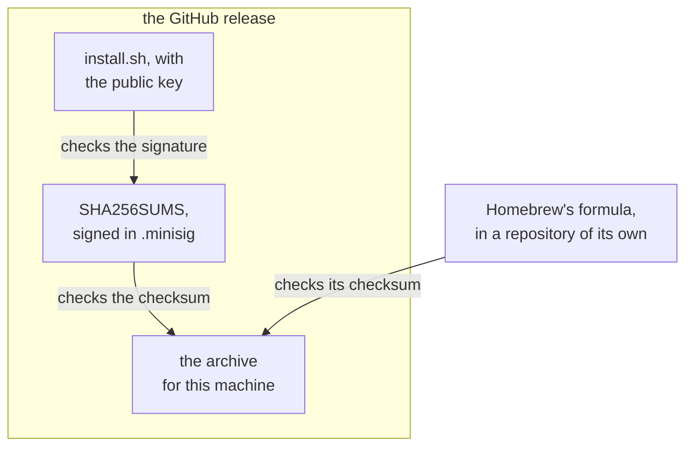

# Installing and updating

This page explains what devvm's install script downloads and checks, what `devvm doctor` checks and what `devvm doctor --json` reports, where devvm keeps its own files, what happens to older versions when you upgrade, and how `devvm upgrade` checks and installs a release. [Installing](../getting-started/install.md) and [Upgrading and uninstalling](../using/upgrading.md) cover the commands you run.

## The install script

The script installs the release it comes with, or the one that `--version` names, which may be a prerelease, such as `0.2.0-rc.1`. Without either, it installs the latest release, never a prerelease. Before it downloads anything, it checks whether Homebrew installed devvm, which it does when `brew` is on `PATH`. The check never runs `brew`, because Homebrew can download its own Ruby when it runs. Instead, the script looks for a version folder in `Cellar/devvm` in each place Homebrew keeps its Cellar: the folder next to the `brew` it found on `PATH` (`<brew's folder>/../Cellar`), `HOMEBREW_CELLAR` and `HOMEBREW_PREFIX/Cellar` when they're set, and the Cellar in `/opt/homebrew`, `/usr/local` and `/home/linuxbrew/.linuxbrew`. When Homebrew has devvm, the script stops with an error that says to run `brew upgrade devvm`, or `brew uninstall devvm` first, and exits with status 1, in a terminal or without one. `--force` skips this check. Then it installs in four steps:

1. It downloads the archive for this machine and the release's `SHA256SUMS`, over HTTPS only. The archive is `devvm-<version>-<os>-<arch>.tar.gz`, where the OS is `darwin` or `linux` and the processor is `arm64` or `amd64`. On Apple silicon, the script picks `arm64` even when it runs under Rosetta.
2. It checks the signature of `SHA256SUMS`, then the archive's checksum, as [the signature](#the-signature-and-what-it-trusts) describes. When either check fails, it installs nothing.
3. It puts devvm, which is one binary with its README, changelog and license, in `~/.local/lib/devvm/<version>`, and links `~/.local/bin/devvm` to it. When `~/.local/bin` isn't on `PATH`, the script says how to add it.
4. Unless you pass `--no-deps`, it runs `devvm doctor --json` and offers the [fixes](#devvm-doctor---json) that devvm reports, asking before each one. Then it runs `devvm doctor`, which shows doctor's warnings too, even when nothing is missing.

At the end, when `~/.local/bin` is on `PATH`, the script looks up which devvm `PATH` finds first with `command -v devvm`. It resolves that path's links and those of `~/.local/bin/devvm` with `readlink -f`, and when they differ it warns, naming the other copy's path and saying to remove it or to put `~/.local/bin` first. It only looks the other copy up and never runs it. When `~/.local/bin` isn't on `PATH`, the script prints only how to add it, so you don't get both.

`devvm doctor` makes the same check. It looks up `devvm` on `PATH`, resolves its links and those of the running binary, and when they differ it prints a warning naming both. It skips the check when no devvm is on `PATH`. The warning doesn't change its exit status, and `--json` lists it among the warnings rather than the problems, so the install script doesn't offer it as a fix.

## The signature and what it trusts

`curl … | bash` trusts everything in the release, and Homebrew checks the same archive against a checksum kept outside it. Both install the release's own binary, the one `SHA256SUMS` lists and its signature covers, and Homebrew installs only the binary from it:



The release's `SHA256SUMS` lists the checksums of its archives and of its `install.sh`, and it's signed in `SHA256SUMS.minisig`, made with the maintainer's minisign key. The key's public half is in the script and in `packaging/minisign.pub`. Without [minisign](https://jedisct1.github.io/minisign/) (`brew install minisign`), the script says so, prints the command to check the signature by hand, and checks only the checksum. A script that isn't from a release has no key, and it also checks only the checksum.

The signature catches an archive or a `SHA256SUMS` that someone replaced, which the checksum alone can't. It can't catch a release that was replaced whole, because `curl … | bash` runs the `install.sh` from that same release, key included, so the one-liner trusts GitHub's release files. Homebrew doesn't trust them, because the formula's checksum lives in a repository of its own, and a replaced GitHub release wouldn't match it. You can also download `install.sh`, read it and [check it](#checking-the-install-script) with the key from these docs before you run it, which catches a replaced release too, because that key doesn't come from the release.

### Checking the install script

The release key's public half is:

```text
RWSjzFsn7ETaijKJ2y7F4DtZobXmyv+LmdclJwZP/KmAkLUwOCzWF/2b
```

devvm's README and security policy show the same key. To check the install script with it, you need [minisign](https://jedisct1.github.io/minisign/) (`brew install minisign`). Download the script, `SHA256SUMS` and its signature from the release:

```sh
base=https://github.com/devvmhq/devvm/releases/latest/download
curl -fsSL -O "$base/install.sh" -O "$base/SHA256SUMS" -O "$base/SHA256SUMS.minisig"
```

Then check that the release key signed `SHA256SUMS`, check the script against it, and run the script once both checks pass:

```sh
minisign -Vm SHA256SUMS -P RWSjzFsn7ETaijKJ2y7F4DtZobXmyv+LmdclJwZP/KmAkLUwOCzWF/2b
shasum -a 256 -c --ignore-missing SHA256SUMS
bash install.sh
```

minisign prints `Signature and comment signature verified` and a trusted comment that names the release, as in `Trusted comment: devvm 0.1.0`, and `shasum` prints `install.sh: OK`. On Linux without `shasum`, `sha256sum -c --ignore-missing SHA256SUMS` does the same. When either check fails, don't run the script. The script takes the same options as `curl … | bash -s --`, as in `bash install.sh --yes`, and it still checks the signature and the archive's checksum itself, as [the install script](#the-install-script) describes.

## What devvm doctor checks

`devvm doctor` checks what [Lima](../backends/lima.md#requirements), devvm's backend, needs. It lists everything that's missing, each with what to do, which is the command that installs it when there's one to run. It then lists what Lima can do, which it calls Lima's [features](backends.md#features), each as `native`, `emulated`, `unreviewed` for an emulation that devvm refuses until it's reviewed, or `none`. It also says whether Docker is installed, which only `--from` with [an image only Docker has](../using/from.md#images-only-docker-has) needs. When `HTTPS_PROXY` is set and `~/.config/devvm/ca` has no CA certificates, it says that a proxy that inspects TLS needs its CA there ([a company's CA](../using/settings.md#a-companys-ca)).

It warns in these cases:

- another devvm comes first on your `PATH` ([one devvm](../using/upgrading.md#one-devvm)),
- the disk that devvm's images and VMs go on has less free space than building base needs ([free space](../using/ports-size.md#free-space)),
- this machine has less than the 8 GiB of memory or the 4 CPUs that devvm recommends ([requirements](../getting-started/install.md#requirements)),
- a line of your policy files isn't a rule, which VMs' proxies skip ([rules](../safety/network.md#rules)).

Then it says devvm has everything it needs, or it fails. The warnings never make it fail, so a small machine with everything installed passes.

## devvm doctor --json

`devvm doctor --json` prints what doctor finds as one JSON object, for scripts such as the install script, as [output for scripts](../using/command-line.md#output-for-scripts) describes. It prints nothing else, because its problems and warnings are in the JSON, and it succeeds whatever is missing. A failure that stops the check, such as a data folder devvm can't read, still goes to standard error and makes it fail.

- `backend` is the backend that doctor checked, `lima`, which every new VM gets.
- `problems` has what that backend is missing, each with its `key`, the `fix` command, and the `message` that `devvm doctor` prints for it. The `fix` is a command whose words are separated by spaces, without shell syntax, or `null` when there's none to run, for example when virtualization is turned off in the firmware.
- `warnings` has the messages of doctor's warnings, which have no keys, because there's nothing for a script to fix. They're about another devvm on `PATH`, low free space, a machine with less than 8 GiB of memory or fewer than 4 CPUs, and each line of `~/.config/devvm/policy`, `~/.config/devvm/layers/*.policy` and `~/.local/share/devvm/vms/*/policy` that isn't a rule (`policy_not_rule`).
- `docker` says whether Docker is installed, which only `--from` with an image that only Docker has needs.
- `features` has, for each backend, how it has each feature, as `native`, `emulated`, `unreviewed` or `none`. The example below shows two of Lima's features.

```json
{
  "version": 1,
  "backend": "lima",
  "problems": [
    {
      "key": "lima",
      "fix": "brew install lima",
      "message": "Lima isn't installed. Run brew install lima to install it."
    }
  ],
  "warnings": [],
  "docker": true,
  "features": {
    "lima": {
      "agent-forwarding": "native",
      "disk": "native"
    }
  }
}
```

These are the keys:

| Key | Missing | Fix |
| --- | --- | --- |
| `os`, `arch` | a host the backend runs on | none |
| `macos` | macOS at the backend's [minimum](../backends/lima.md#requirements) | none |
| `lima` | Lima at its [minimum](../backends/lima.md#requirements), working | `brew install lima` (`upgrade`, `reinstall`) with Homebrew, otherwise none |
| `qemu` | QEMU, on Linux | your package manager's install (apt, dnf, pacman or zypper), otherwise none |
| `kvm` | `/dev/kvm`, on Linux | none: turn on virtualization |
| `kvm-access` | access to `/dev/kvm` | `sudo usermod -aG kvm USER`, then log in again |
| `lima-config` | no Lima global configs in devvm's Lima home ([details](lima.md#a-lima-home-of-its-own)) | none: move them out |

The install script reads `problems` with `awk`, so it needs no JSON tool on this machine. It relies on the layout that devvm writes, with one field on each line, and it reads a problem's `key`, `fix` and `message` from their lines, with their escapes undone. It offers to fix three of these keys, asking first, and prints the message for the others:

- For `lima`, it runs the fix when there is one, which is Homebrew's. Without Homebrew, it offers Lima's latest release instead, which it checks against that release's `SHA256SUMS` and installs into `~/.local`.
- For `qemu` and `kvm-access`, it runs the fix when there is one, and the fix uses sudo. After you join the `kvm` group, the script doesn't run `devvm doctor`, because the group applies only to new logins, and it tells you to log out and back in first.

With `--yes`, the script answers yes to every question. Without a terminal and without `--yes`, it installs none of the fixes and says so.

## devvm's own files

devvm is one binary. Its own files are built into it, so a copy of it runs anywhere. They are `base.yaml`, base's scripts and policy, the features, the shared tools' config and build script, what devvm sends into VMs, and `--from`'s conversion. The binary is the only copy, and devvm never writes them to a folder of its own that outlives a run. Lima gets `base.yaml` on `limactl create`'s standard input, VMs' proxies read devvm's built-in policies from the binary, and `--from`'s build writes the conversion's scripts into its own temporary folder, which it deletes when the build ends. So editing a file on disk can't change devvm's built-in rules or what goes into an image.

## Upgrading

When the script installs a new version, it removes the older versions in `~/.local/lib/devvm`, except a version that a running VM's proxy, or QEMU on Linux, still runs. A later install removes that version once nothing runs it. A VM's proxy moves to the new version at the VM's next launch (`devvm` in its folder), and QEMU moves when the VM next starts.

## devvm upgrade

`devvm upgrade` installs a release in Go, with the same files and checks as the install script, and it never runs the script. It reads the newest release's version from where GitHub's `releases/latest` redirects, `releases/tag/v<version>`, as the script does, so it needs no API and has no rate limit. Every request goes over HTTPS, and a redirect to anything else is refused.

GitHub's `releases/latest` skips the releases marked as prereleases, which are the versions with a suffix, such as `0.2.0-rc.1`. devvm upgrade, the daily release check and the install script also refuse a prerelease there, so none of them installs or announces one as the newest release, and a prerelease is installed only when `--to` or the script's `--version` names it. A record of the daily check that names a prerelease counts as no record, and the next check replaces it. Versions compare as semver orders them: the numbers as numbers, a prerelease before its release, and a prerelease's suffix part by part, a number below a word and numbers as numbers, so `0.2.0-rc.9` comes before `0.2.0-rc.10`.

### How it tells how devvm was installed

It follows the links of the running binary's path, and it reads only that path, never running anything:

- It's the install script's when the binary is `devvm` in `<prefix>/lib/devvm/<version>`, with a release's version as the folder's name, and `<prefix>/bin/devvm` is a link that resolves to that same binary. The prefix comes from the binary's own path, so `DEVVM_PREFIX` needs no setting.
- It's Homebrew's when the path has `Cellar/devvm/` in it, a keg of Homebrew's.
- Anything else is another way. A devvm whose version isn't a release's, such as a checkout's pseudo-version or `(devel)`, was built from the source. One with a release's version that wasn't set when it was built, as `go install` gives, was installed with `go install`. One that has a release's version is a copy of a release somewhere else.

### The release key and the signature

The release key's public half is built into devvm from `packaging/minisign.pub`, the same file the script gets its key from, so devvm upgrade trusts the key in the devvm you have, never one that comes with the release. A build without that file has no key, and devvm upgrade refuses to install a release with it.

devvm checks minisign's signature itself. `SHA256SUMS.minisig` holds a signature and a trusted comment, each signed with the key. devvm accepts only minisign's default, prehashed signature, marked `ED`, which is Ed25519 over the BLAKE2b-512 hash of `SHA256SUMS`, and refuses the legacy one, marked `Ed`, over the file itself. The signature's key ID must be the release key's, and the global signature, Ed25519 over the signature followed by the trusted comment, must verify too. The trusted comment must be `devvm <version>`, as the release script writes it, so a `SHA256SUMS` signed for one release can't stand in for another's. Then the archive for this machine, `devvm-<version>-<os>-<arch>.tar.gz` for the binary's own OS and processor, must match its line in `SHA256SUMS`.

The archive is unpacked into `<prefix>/lib/devvm/.<version>.new.<pid>`, beside the version that runs. Only its one top-level folder and the regular files in it are unpacked, at most 512 MiB in all, and an archive with a link, a folder inside that one, or a path out of it is refused. devvm is unpacked with mode 755 and the other files with mode 644.

### Rollbacks

A server, or someone in the way of one, can offer an older release that's still properly signed. devvm upgrade refuses a newest release older than the running devvm, whatever the flags, and installs an older one only when `--to` names it, after a question that says it's older. When the running devvm is a prerelease, an older newest release is what's expected before the prerelease's own release is out, so devvm upgrade says so and installs nothing, without failing. It can't tell a server that keeps offering the release you already have from one with nothing newer, which is a limit of reading the newest release from the server.

### Switching the link

1. The unpacked folder's devvm runs with `--version`, which must print the release's version.
2. The folder is renamed to `<prefix>/lib/devvm/<version>`. A folder of that version from before is set aside first, and it's put back if a later step fails.
3. The link switches in one step: a new link to the new devvm is made beside `<prefix>/bin/devvm` and renamed over it, so the link is never missing or half made.
4. The new devvm runs again, through the link. When it fails, the link is switched back to the devvm that ran devvm upgrade, and the new folder goes.

Then devvm upgrade removes the other versions in `<prefix>/lib/devvm`, as the script does: it keeps the new version, the one that ran devvm upgrade, and any version that a running process's command line names, such as a VM's proxy, which it lists with `ps`. When `ps` fails, it keeps them all. An interrupted upgrade leaves a `.<version>.new.<pid>` folder at most. The next upgrade removes it once no process has that pid, so it never takes the folder of an upgrade that's still running, and the script's next install removes it too.

With Homebrew, devvm upgrade runs `brew upgrade devvm` into the run log, after asking, and checks nothing of its own, because Homebrew checks the source against the formula's checksum.

