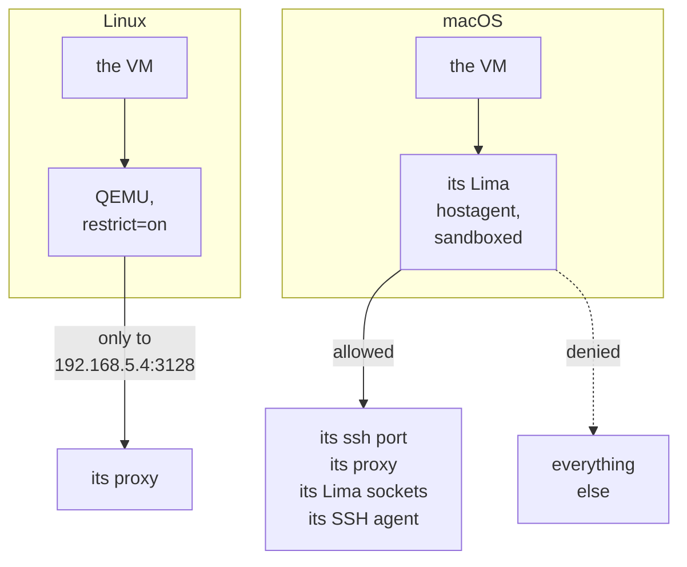

# Lima

This page explains how devvm runs its VMs on Lima: the Lima home it keeps them in, how it builds images and clones VMs from them, what it sets in each VM's config, how it confines VMs and builds, and how it forwards their ports. [Lima](../backends/lima.md) covers what you need to run it, `devvm limactl` and Lima's limits.

## A Lima home of its own

Lima merges `_config/default.yaml` and `_config/override.yaml` from its home into every VM it creates or starts. A network you set there for your own VMs would give a devvm VM a second network card with a route around its proxy, and an extra mount set there would go unnoticed. So devvm keeps its VMs in a Lima home of their own, `~/.local/share/devvm/lima`, whatever `LIMA_HOME` says ([devvm's Lima home](../backends/lima.md#devvms-lima-home) says what that means for you).

devvm refuses to start a VM while that home holds either file (`lima_global_config`), and it refuses a VM that has a network devvm didn't give it (`vm_has_networks`).

devvm runs `limactl` from its own data folder. When a config is invalid, Lima writes `lima.REJECTED.yaml` into the folder it runs in, and a project folder belongs to the VM to write.

## Clones and overlays

An image is a stopped VM in devvm's Lima home, named `devvm-img-<key>`. devvm makes base's from Ubuntu's cloud image with `base.yaml`, [base's size](images.md#bases-size) as `--cpus`, `--memory` and `--disk`, and `--mount-none`, and it gives `limactl create` the template on its standard input (`-`), from the binary, so no copy of `base.yaml` is on disk. With `--from`, it makes base's from the converted disk instead, and boots its kernel and initrd directly ([details](images.md#how-its-converted)). A layer's image is a clone of its parent's, also made with `--mount-none`, so a build mounts nothing from the host. A project VM is a clone of its image's VM, which devvm makes while the image is stopped.

- **macOS:** the clone's disk is an APFS copy-on-write copy. It shares the image's blocks until the VM writes them, so `du` overcounts it.
- **Linux:** Lima's disks are qcow2 files, and a clone would be a full copy. So a project VM's disk is a qcow2 overlay of its image's, readable only by you, which shares the image's blocks and holds only the VM's changes. An image's disk is read-only once it's built, and devvm can't delete an image while VMs' disks are overlays of it (`image_in_use`). devvm reads each VM disk's backing file with `qemu-img info -U`, which shares the disk with the QEMU of a running VM, because that QEMU's write lock refuses `qemu-img info` otherwise.

## What devvm sets on a VM

devvm sets these in each VM's Lima config:

- **Mounts:** the project folder (read-write), agents' folders (read-only), and the shared tools at `/mnt/devvm-tools` (read-only). Each folder but the tools is mounted at its host path. devvm mounts nothing else, and it leaves out the home folder that Lima's templates mount. On macOS, where Lima runs VMs with `vz`, the project folder's mount names the folder by the device and inode that devvm recorded when it made the VM, as `location: /.vol/<device>/<inode>` with `mountPoint` set to the folder's path. macOS's `/.vol` opens a folder by its device and inode, so Virtualization.framework shares the folder devvm made the VM for, wherever that folder is when the VM starts, and never follows a link put at its path ([an existing VM](overview.md#an-existing-vm)). Virtualization.framework then serves the share by the path the folder had at the start, so a folder moved back while the VM runs answers "Operation not permitted" in the VM until its next start. QEMU's 9p on Linux has nothing like `/.vol`, so there the mount is by the folder's path.
- **ssh:** agent forwarding on or off, and the host port. devvm chooses the port when it makes the VM and records it, so no other VM's forwarded ports take it. The port changes only when another program on the host has it, on any address, while the VM is stopped, or when the VM lists it to forward.
- **Ports:** none, because Lima's own forwards are off and devvm's forwarder forwards the VM's ports instead ([below](#ports)).
- **Size:** CPUs, memory and disk.
- **Guest environment:** Lima's `env:`, which Lima writes to `/etc/environment` at every boot. On every tier it holds the VM's proxy's address and its settings, and Lima doesn't pass the host's proxy settings in. A confined VM reaches the proxy as Lima's host address on macOS and as QEMU's `guestfwd` address on Linux, and an open VM reaches it at Lima's host address on both, which is this machine's loopback as Lima's network has it, with `host.lima.internal` added to its `NO_PROXY`. `limactl edit` sets the proxy's URL with a stand-in for the password (`devvm-proxy-password`), and devvm then replaces the stand-in in the VM's `lima.yaml`, which it rewrites with mode 600, so the password is in no process's arguments. Its `NO_PROXY` and `no_proxy` name the VM alone, and never its [links](design.md#links-between-vms), which its HTTP clients reach through the proxy, so links never change it. A start runs `limactl edit` only when the environment differs from the one the VM has, because it compares them first. That edit gives the VM new ssh host keys at its next boot, as any edit does, and devvm forgets a VM's host keys at every start and pins them again once it runs, so devvm's ssh config, its own connections and your editors keep working.

Lima changes only a stopped VM's config, so a change you make while the VM runs applies at its next start. When devvm makes a VM, the clone gets its mounts, agent forwarding, ssh port, ports rules and environment, and devvm then edits the VM's size where it differs from its image's. Each start of a stopped VM compares the VM's config, as `limactl list` shows it, with what the VM's state asks for and with how the VM starts. That covers its size, its project folder's path, which changes once the folder moved ([a moved folder](overview.md#a-moved-folder)), and on macOS the device and inode its mount names, its agents' folders, its agent forwarding, its ssh port, its environment, Lima's proxy settings, DNS and its ports rules. devvm then changes whatever differs in one `limactl edit`, and runs none when nothing does, because each edit gives the VM new ssh host keys at its next boot. Lima can't shrink a disk, so a start that asks for a smaller disk than the VM has fails before it changes anything (`disk_shrink`).

devvm leaves Lima's `mountInotify` off, so file watchers in the VM see only the changes made in the VM ([file watchers](../backends/lima.md#file-watchers)). With it on, Lima's hostagent watches the project folder on the host and, for each change there, changes the file's times in the guest as root, which raises an inotify event for the guest's watchers. The hostagent can't tell the VM's own writes from the host's, so it does this to every file the VM writes too, and on macOS the guest then sees such a file as root's for a moment. A command that writes a file and then changes its mode fails in that moment, and in a test on macOS, `git init` in the project folder failed 13 times in 30 with it on and never with it off. Lima also passes on no deletions, and it marks the setting as experimental.

## Confinement

A VM on a confined tier, internet, allowlist or none, reaches nothing but its proxy on the host, which applies its tier's rules, and even root in the VM can't get around that. Direct connections, DNS, UDP and connections to the host's own services fail at once, while forwarded ports, mounts and ssh keep working.

On each host, the VM's traffic passes through one process that devvm confines:

On macOS, devvm starts the VM's Lima process, its hostagent, under a macOS sandbox. That's `sandbox-exec` with a Seatbelt profile, `sandbox.sb` in the VM's run folder, `~/.local/share/devvm/vms/<hash>/run/`.

- The profile lets the process connect to the VM's ssh port and its proxy on the host's loopback, to the unix sockets in the VM's Lima folder (ssh's control socket and the VM's network), and to the ssh agent the VM forwards, which is yours or devvm's own. It connects nowhere else, so other sockets on the host, such as Docker's, stay out of the hostagent's reach. The profile limits only the network, so a compromised hostagent can still write your files, and through them run code as you.
- The profile lets the process listen only on the VM's ssh port, over TCP, and on unix sockets in the VM's Lima folder, so it can't open a port of the VM's on the host even if Lima ignored its rules ([ports](#ports)).
- Names resolve in the proxy, so Lima's own DNS server for the VM is off, the guest's DNS points at an address that nothing listens on, and lookups fail at once. The guest reaches the proxy at `192.168.5.2`, which is the host as Lima's network sees it.

On Linux, Lima starts every VM's QEMU through a wrapper that devvm writes (`~/.local/share/devvm/run/qemu/`) and that runs devvm. It runs QEMU in a namespace that makes `.git`'s hooks and config read-only, for a VM whose [.git protection](git-protection.md#on-linux-hosts) is on. For a confined VM, the wrapper adds QEMU's `restrict=on` to Lima's network, so no traffic goes in or out but Lima's own forwards. It also adds one address, `192.168.5.4:3128`, which QEMU connects to the VM's proxy. If Lima's QEMU arguments aren't the shape devvm expects, with one `-netdev user,id=net0,…` and no other network, the wrapper refuses to start QEMU (`qemu_refused`), so QEMU never runs unrestricted. DNS points at an address that nothing listens on, so lookups fail at once.

An open VM isn't confined: on macOS its hostagent runs without a profile, and on Linux the wrapper runs QEMU with Lima's network as Lima gives it, without `restrict=on` and without the `guestfwd`, as it does for a build with the internet. Its guest reaches its proxy at `192.168.5.2` and the proxy's own port on both hosts, because Lima's user-mode network, vz's and QEMU's alike, reaches the host's loopback at that address. Its `NO_PROXY` adds `host.lima.internal` and `192.168.5.2`, which the proxy on the host couldn't resolve as the VM does, Lima's DNS stays on, so names resolve in the VM, and `propagateProxyEnv` is off, so the guest gets no proxy settings of the host's.

A process can't leave its sandbox, so devvm records the hostagent it started (`started` in the VM's run folder) and checks that the VM still runs on it ([the self-check](network.md#the-self-check)). A VM started another way, such as with `limactl start`, runs unconfined, and `devvm ls` shows it as `unenforced`. The VM's proxy follows the hostagent's pid file (`ha.pid` in the VM's Lima folder) and exits with it. devvm writes the record only once `limactl start` returns, while the hostagent runs on its own from early in the start, so an interrupt during the start stops the VM ([how long a proxy runs](network.md#how-long-a-proxy-runs)). Interrupted before the hostagent answers, the VM is one Lima reports as `Broken`, which `limactl stop` refuses, so devvm stops a broken VM with `limactl stop --force`. A hostagent that runs without its driver yet is still starting QEMU, which writes its pid file only once it runs, and that can take seconds on a slow host, such as one with nested virtualization. Stopped with `--force` then, the hostagent would go and the QEMU it started would run on without it, so devvm waits up to 30 seconds for the driver first and then stops the VM as Lima reports it. A VM whose QEMU still runs without its hostagent holds its disk, so no new QEMU can start on it, and a start stops such a VM with `--force` first.

Builds are also confined, because they run code devvm didn't write. On macOS a build's Lima process runs under a profile that reaches either the internet but not the host's loopback, where other VMs' proxies and dev servers listen, or nothing at all. Behind a company proxy, a build with the internet also reaches one port of the host's loopback, its own proxy's ([a company proxy](design.md#a-company-proxy)). On Linux only a build with no network is confined. QEMU can't keep the internet while dropping the host's loopback, so other builds reach services on the host's `localhost`. Builds forward no ports. A build with the internet reaches your LAN on both hosts, this machine's own address on it included, because the macOS profile keeps only the loopback from it.

`sandbox-exec` is deprecated. If macOS drops it, devvm needs another way to confine the hostagent, and until then the self-check catches a VM that runs unconfined.

## Ports

devvm's forwarder forwards a Lima VM's ports by the rules that [Port forwarding](ports.md) sets out. On Lima this is an emulation, and it's reviewed ([design](design.md#ports-on-lima)). devvm doesn't use Lima's own forwards because they listen with `SO_REUSEADDR`, and on macOS such a forward takes `127.0.0.1:PORT` while a program on the host has `*:PORT`, along with that program's `localhost` connections.

So Lima forwards nothing. Each VM's `portForwards` are rules that ignore every guest port, TCP and UDP, on `127.0.0.1` (which also covers `::1`), `0.0.0.0` and `::`. Lima's own ssh is its VM driver's forward, not a rule, so it keeps working. devvm sets the rules when it makes the VM, and a start sets them again only where they differ, because any change gives the VM new ssh host keys at its next boot. On macOS, a confined VM doesn't rely on the rules alone, because its sandbox refuses the Lima process every port but its ssh port ([confinement](#confinement)).

Which ports a VM forwards is in the VM's state, which devvm's forwarder reads, so `devvm ports` changes the state and never the VM's Lima config, and the backend never hears of them. [Its process and files](ports.md#its-process-and-files) lists the forwarder's files and its log.

The forwarder isn't Lima's, and it runs only for project VMs. What Lima gives it is how to reach a running VM: Lima's ssh port on this machine's loopback, Lima's user, and Lima's key (`_config/user` in devvm's Lima home), which every VM there authorizes. The forwarder connects there with the host keys devvm pinned for the VM's current start, which the VM's ssh config checks too. Its lifeline is the VM's hostagent's pid file (`ha.pid`), so it ends when the hostagent does, and `devvm rm` deletes its files.

