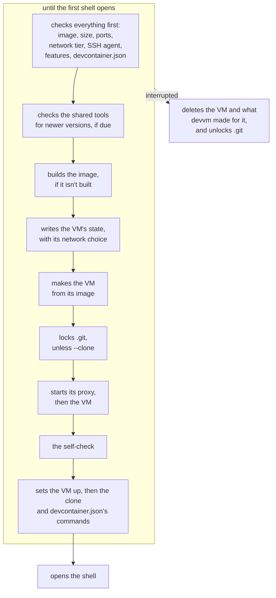

# Overview

This page explains what devvm does, step by step, when it makes, opens, changes, stops and deletes a VM, and how it keeps each VM's state. [Everyday commands](../getting-started/commands.md) and [Managing VMs](../using/vms.md) cover the same commands from your side, and [Settings and files](../using/settings.md) lists your settings.

## A new VM

When you run `devvm` in a folder that has no VM, devvm makes one in these steps:

1. devvm checks everything the new VM needs before it builds anything, because a build can take minutes. That covers the folder, its toolchains, agents and layers, which it shows in a list in a terminal when you give none of `--tools`, `--agents` and `--layers` ([what a new VM gets](../using/images.md#what-a-new-vm-gets)), the size, the ports, the network tier ([choosing a tier](../safety/network.md#choosing-a-tier)), the SSH agent, the backend's [features](backends.md#features) and what the folder's `devcontainer.json` says. Last, when the VM gets an agent and devvm saved an export of agents' history for this folder before, devvm offers the newest one, asking in a terminal with no as the default (`history_import_ask`) and naming `devvm history import` without one (`history_import_later`). Before any of it, devvm takes the folder's [creation lock](#locks), which it holds until it has recorded that it made the VM in step 5.
2. When the VM gets shared tools and the [daily check](../using/images.md#shared-tools) is due, devvm checks for newer versions of them.
3. devvm builds the image if it isn't built yet ([building](images.md#building)), then the VM's [shared tools](../using/images.md#shared-tools) that the share lacks.
4. devvm writes the VM's state, with the network choice in it, before it makes the VM. If a later step fails, the VM never starts without its network choice. devvm also clears what an earlier VM of this folder that was deleted some other way left behind: it stops that VM's proxy and link session and deletes the VM's folder in its data folder, with its own rules, its run files and its logs.
5. devvm makes the VM from its image. The VM mounts only the project folder, read-write, and the shared tools and its agents' settings folders from [devvm's agent store](../using/coding-agents.md#devvms-agent-store), read-only. With `--clone`, devvm doesn't mount the folder, and the VM gets its own clone of the repo instead ([working on a clone](../using/clone.md)).
6. Unless the VM is a `--clone` VM, devvm locks the folder's `.git` hooks and config ([`.git` protection](git-protection.md)). It warns when the repo's origin is an SSH remote and the VM has no SSH agent (`ssh_remote_hint`), and on Linux hosts it names the set-id files in the folder, including those an earlier VM of this folder made. When the VM forwards your SSH agent, devvm checks that the agent has keys.
7. devvm starts the VM's [proxy](network.md#the-proxy), then the VM, confined to the proxy on every tier but open.
8. The [self-check](network.md#the-self-check) runs, before the setup and the shell. Then, when you said yes to the export devvm offered, devvm warns when the tier that its `.folder` file records is less strict than the VM's, or when it records none (`history_import_less_strict`, `history_import_tier_unknown`), and streams it into the VM, whose own `tar` checks its paths and unpacks it as the VM's user ([importing history](../using/coding-agents.md#importing-history)), and a failed import only warns.
9. devvm sets the VM up ([the VM's setup](../using/coding-agents.md#the-vms-setup)) and makes it reachable [by name over SSH](../using/ssh.md). It makes a `--clone` VM's clone, or a workspace clone's repos, all in one command in the VM, then copies each repo's branches into it ([the copy into a clone VM](git-protection.md#the-copy-into-a-clone-vm)) and copies the folder's own files, and then runs the commands of the folder's [`devcontainer.json`](../using/devcontainer.md#commands).
10. devvm opens a shell in the VM in its own place, so devvm ends when the shell does. Without a terminal, the shell reads its commands from devvm's input.

Until the first shell opens, nothing of yours is in the VM yet. If you interrupt devvm before then, it deletes the VM, stops its proxy, deletes its pinned host keys and its folder, with its state, its own rules and its run files, takes the locks off `.git`, and for a `--clone` VM removes the repo's remote for it.

## Adding to a VM

When `devvm tools add`, or `devvm tools` in a terminal, adds shared tools to an existing VM ([adding to a VM](../using/toolchains.md#adding-and-removing-tools)), the tools it builds join the VM's state and are mounted as devvm then launches the VM, and nothing is installed on the VM's disk. A new agent's config folders are mounted as the launch matches the VM's agent folder mounts, which restarts a running VM after asking. `devvm tools` shows an existing VM's layers but can't change them, and `--tools`, `--agents` and `--layers` change nothing on an existing VM, because a layer goes onto the VM's disk, which only [making the VM again](#making-a-vm-again) changes.

## Making a VM again

`devvm layer add LAYER...` makes the folder's VM again from a new image, its own layers with the new ones on top, and keeps devvm's settings for it and its home folder ([adding layers to a VM](../using/images.md#adding-layers-to-a-vm)). `devvm layer rm LAYER...` makes it again from an image of its other layers, in their order ([taking layers out of a VM](../using/images.md#taking-layers-out-of-a-vm)). `devvm update` first moves the VM to the newest shared tools, the step `devvm tools update` takes (`Tools.update`), which needs no remake because the tools are mounted. Then it makes the VM again from the image it has, when that image or one below it has a new key, so the VM gets the image's new build ([outdated VMs](../using/images.md#outdated-vms)), and when the folder's `devcontainer.json` isn't the one the VM was made from, as [reading the devcontainer.json again](#reading-the-devcontainerjson-again) describes. An outdated VM without `--force` or a terminal is refused before the tools step, so a refusal changes nothing. The remake is one path in the VM's lifecycle, which takes the image to make the VM from, so each command only works out that image and its own refusals: `devvm layer add` names the layers the VM has already, `devvm layer rm` names those it lacks (`lacks_layers`) and refuses a name that's no layer's, though it takes out one of the user's whose script is gone, and `devvm update` says the VM is current (`vm_current`) when it had the newest tools and nothing in its chain changed, or names what changed (`vm_changed`) before it asks.

Before anything changes, devvm refuses a name that isn't a layer, a VM made for another folder, one whose creation didn't finish and, except for `devvm clone`, a `--clone` VM, and it checks that the VM's backend has every feature the VM needs with the new image (`Require`) and that the disk has room for a VM. Then it asks (`remake_confirm`, or `remake_confirm_clean_home` with `--clean-home`), and a parent folder's VM only in a terminal (`remake_parent_vm_ask`). The remake then goes in this order:

1. devvm builds the new image, as for a new VM.
2. It exports the agents' history as `devvm rm` does, unless `--no-export`, and saves the VM's home folder, unless `--clean-home`. The VM runs `tar --one-file-system --ignore-failed-read` in its home as its user, and devvm reads that stream on this machine and writes only what it keeps to `home.tar.gz` in the VM's folder ([the home folder's copy](design.md#the-home-folders-copy)). A failure in either keeps the VM as it was (`export_failed_kept`, `remake_home_failed`), but an export over 2 GiB only warns (`history_too_large`), and the remake goes on without one.
3. devvm records the remake in the VM's state (`remake`), stops the VM, its proxy and its link session, and has the backend rename the VM's machine to its aside name, `devvm-<hash>-old`, which is no project VM's name, so nothing else takes it for one. On Lima that's `limactl rename`, which keeps the old disk whole.
4. devvm makes the new machine by the VM's name from the new image, with what the state records: its project folder, its agents' folders, the tools share, its SSH agent, its size, its ports and its ssh port. It records that the new machine was made, and it keeps in the remake's section what the VM had of its base's `from`, its shared tools, its ports and its `devcontainer` section (`remake.was`), so an undo can give them back. It clears which of its `devcontainer.json`'s commands ran, so those that run once run again. Then it starts the VM as every start does ([an existing VM](#an-existing-vm), steps 4 to 8), which pins its new host keys.
5. devvm puts the saved home folder in, with `tar --skip-old-files` as the VM's user, so what the new image has stays the image's. The new machine is the VM from then on, so devvm records the new `image` and `chain`, and that the new machine is done.
6. devvm deletes the old machine and ends the remake, which removes the section, then deletes `home.tar.gz` and opens the VM as an existing VM, setting it up first. The proxy reads the VM's layers from its image, so the new layers' allowlists apply from then, and those of layers taken out no longer do, as what the proxy started with has changed ([the proxy](network.md#the-proxy)). The VM's `id`, its alias and every other field stay as they were ([a VM made again](design.md#a-vm-made-again)).

Until the new machine has the home folder in step 5, a failure or an interrupt runs the remake's cleanup (`remake_undone`). It deletes the new machine, renames the old one back, whose next start makes it what the state asks for, as every start does, records that the machine by the VM's name is the old one, gives the VM back the `from`, shared tools, ports and `devcontainer` section that step 4 kept, and ends the remake. When it can't, it warns (`remake_undo_failed`) and leaves the remake recorded. The section goes before `home.tar.gz` does, so the saved home folder is there for as long as the remake is recorded. After step 5, nothing deletes the new machine, and a failure to delete the old one leaves the remake recorded as done.

`devvm clone on` and `devvm clone off` make the VM again from the image it has, in the other clone mode, which the remake records (`remake.clone`), so a remake that didn't finish is finished in that mode ([switching a VM that exists](../using/clone.md#switching-a-vm-that-exists)). Before anything changes, `devvm clone on` checks the folder as `--clone` does, and after the question `devvm clone off` checks the clone as `devvm rm` does, unless `--no-clone-check`. In step 4 the new machine mounts the project folder, or mounts none of it and keeps the clone at the folder's path, and devvm records its mode when it records that the new machine was made. For the folder mounted, the mode comes with the `.git` protection a new VM gets. Before the new machine starts, devvm removes the repo's remote for the clone, keeping the work fetched from it as [saved branches](#saved-branches), and then locks `.git`, because git can't change a locked `.git/config`. After `devvm clone on`, devvm takes the `.git` locks off in step 6, once the old machine is deleted and it has checked `.git` as a launch that finds the VM stopped does. Undoing the remake sets the old mode back, takes off the locks the new machine got, and adds the remote back.

A devvm holds the VM's remake lock, `run/remake.lock` in the VM's folder, from when it finds the VM until the remake ends, and reads the VM's state again once it has the lock. A second devvm that would make the VM again or finish its remake meanwhile refuses (`remake_running`), so it never takes a remake that's still running for one that stopped.

A remake that's recorded while no devvm holds the lock didn't finish, because devvm was killed or its cleanup failed. The next `devvm`, `devvm layer add`, `devvm layer rm`, `devvm update`, `devvm clone on` or `devvm clone off` in the folder finishes it without asking (`remake_resuming`). When the new machine is done, devvm deletes the old one and ends the remake. When the old machine is still aside, or the new one was never made, so the machine by the VM's name is the old one, devvm puts the old machine back and makes the VM again from step 1. Otherwise the old machine is gone, and the new one, made or not, never ran a shell, so devvm checks the remake again as before step 1, deletes the new machine and makes it again from step 4 with the saved home folder, or without one, warning, when the file is gone (`remake_home_lost`). Meanwhile every other command that acts on the VM refuses (`remake_pending`), `devvm gc --orphans` never takes the VM for an orphan, though the backend may have no machine by its name, and `devvm rm` deletes the VM and its old machine too.

### Reading the devcontainer.json again

A VM's `devcontainer` section records more than the file's SHA-256 and what it maps to of the VM's own. It records which of the VM's parts came from the file and which from you, so that `devvm update` can replace only the file's. `parts` lists the toolchains and layers the file's features mapped to when devvm last read it, and `gave` lists those of them the VM got from the file alone. A part isn't the file's when `--tools` or `--layers` chose that part's list, when `devvm setup`'s layers have it, when the folder's other files call for it, or when you unchecked it in the list. `ports` lists the file's `forwardPorts`, and `ports_gave` lists those of them that devvm added to the VM's ports, as `devvm ports add` adds them, because your ports didn't forward them already and you didn't give `--ports`. `image` is the container image the file names, recorded only when the VM's base starts from it, and `from_flag` records that you gave `--from`, which wins over the file's image for as long as the VM exists.

When the folder's file isn't the one the VM was made from, because it changed, it's gone or it appeared, `devvm update` reads it again as a new VM's file is read and refuses what a new VM refuses (`devcontainer_reread`, or `devcontainer_gone` for a file that's gone). Then it works out what the VM is made again with:

- **Its parts.** devvm drops the parts in `gave` that the file no longer calls for, and adds the ones the file now calls for that weren't in `parts` and that the VM lacks (`devcontainer.Reread`). A part you took out stays out, and your own parts stay. Layers go into the new image's name, after the layers the VM keeps, and toolchains go into its shared tools.
- **Its base.** With `from_flag`, the base stays as it is, and devvm says the file's image is ignored. When the file names another image, devvm pins it to the digest its registry gives anyone, as for a new VM. When the file no longer names one, the base starts from `$DEVVM_FROM`, or else from Ubuntu's cloud image.
- **Its ports.** In the same way, devvm takes out the ports in `ports_gave` that the file no longer lists, with the rule `devvm ports rm` follows, and adds the ones it lists anew that the VM's ports don't already forward, with the rule `devvm ports add` follows (`filePorts`). A port you took out with `devvm ports rm` stays out, your own ports stay, and with every port forwarded nothing changes. A port of the file's that's part of one of your ranges counts as yours.
- **Its variables and commands.** The file's new ones replace the old ones, and the commands that run once run on the new disk.

The remake records all of this in its section (`remake.reread`): the new base's `from`, the shared tools, the ports and the new `devcontainer` section. After step 1 builds the new image from the new base, devvm builds the shared tools for that base, as for a new VM, and records their files there too, holding the lock that new VMs hold so that `devvm gc` keeps the tool images. In step 4 the VM gets all four, so the port forwarder starts with the new ports when the VM starts, and an undo gives back what it had. A remake that didn't finish keeps them, so it's finished with what the file said when `devvm update` read it.

## An existing VM

When you run `devvm` in a folder whose VM exists, devvm opens the VM as it is and starts it if it's stopped. Each time, it does these steps in this order:

1. devvm warns when an image the VM was made from has changed since, or when there are newer shared tools than the VM's, and both warnings name `devvm update`, which moves the VM to the newer tools and, after asking, makes it again from the changed image ([outdated VMs](../using/images.md#outdated-vms)). It also checks for newer tools once a day.
2. devvm ignores the options for new VMs, with a warning for each. The VM keeps its shared tools, which `devvm tools` changes, and its layers, which `devvm layer add` and `devvm layer rm` change. It keeps its network tier, which `devvm network` changes, and its `.git` protection, which `devvm git-protect` changes. It keeps its size, which `devvm size` changes, its ports, which `devvm ports` changes, and its SSH agent forwarding, which `devvm ssh-agent` changes. It also keeps its backend, and ignores `--from` and `--no-devcontainer`.
3. devvm warns when the folder's `devcontainer.json` isn't the one the VM was made from, and the warning names `devvm update`, which makes the VM again as the file says now ([details](../using/devcontainer.md#when-its-read)).
4. devvm asks the backend for the VM's status and config, once for the whole start. It compares the VM's [agent folder mounts](../using/coding-agents.md#mounts) with the folders in devvm's agent store and names the folders that changed. A running VM gets the new mounts when it next starts. When a running VM has changes waiting for its next start, such as these mounts, a new size, a change to its agent forwarding or the open tier given to it while it ran confined, devvm names them in at most two lines, one for each change (`next_start_size`, `next_start_agent`, `next_start_mounts`, `next_start_net_off`), or past two the first change and how many more (`next_start_more`). Then it asks once, in a terminal, whether to restart it now (`restart_now`), yes by default (`[Y/n]`) when the mounts are among the changes and no by default (`[y/N]`) otherwise. A yes stops the VM here, so the steps below start it with the changes, and a no leaves it running.
5. devvm checks `.git` ([on each launch](git-protection.md#on-each-launch)) and, on Linux hosts when it finds the VM stopped, names the set-id files in the folder. It skips both for a `--clone` VM, which mounts neither.
6. devvm checks that the backend can still give the VM what its state asks for: its tier's confinement, its ports and its [SSH agent forwarding](../using/ssh.md#agent-forwarding), and turning that forwarding on or off when the VM has it the other way. A backend that can't is refused before anything starts. When the VM forwards your agent, devvm checks that the agent has keys.
7. devvm starts the VM if it's stopped. The backend's start gives the VM what its state asks for: its size, the agent folders in devvm's agent store, its agent forwarding and its ports. It changes only what differs from the VM's config, together with what the VM's confinement needs, and it changes nothing on a running VM ([on Lima](lima.md#what-devvm-sets-on-a-vm)). When the VM uses devvm's own agent, devvm loads the keys that the agent lacks, whether the VM starts or runs already. A running VM keeps its proxy, unless what the proxy was started with has changed ([the proxy](network.md#the-proxy)), and a VM made open after it started confined stays confined to its proxy, which applies the open tier's rules, until it next starts. For a VM that runs on, devvm then says in one place what the VM gets only when it next starts, where that differs from what its state asks for: its size, its agent forwarding, its agent folder mounts and the open tier's direct network. It warns of each with the line that names it in step 4, then once that `devvm restart` applies them (`next_start`), which is also what `devvm size`, `devvm network` and `devvm ssh-agent` say for a running VM you don't restart.
8. The [self-check](network.md#the-self-check) runs, and devvm stops a VM whose confined tier isn't enforced.
9. devvm sets the VM up and opens the shell, as for a new VM. A `--clone` VM whose clone wasn't made yet gets it first. On the first launch after the VM started, the `postStartCommand` of the `devcontainer.json` that the VM was made from runs before the shell opens ([commands](../using/devcontainer.md#commands)).

Steps 4 to 8 are the one way devvm starts a VM, whatever the command, and only a launch matches the agent folder mounts in step 4. So `devvm host` and `devvm code`, an export, `devvm rm`'s check of a `--clone` VM and a remake's new machine check `.git`, check what the backend can give, start the VM with the size, agent folders, agent forwarding and ports its state asks for, and run the self-check in the same way. A new VM goes through steps 5 to 8 once it's made, and in step 5 devvm locks its `.git` and checks its folder as step 6 of [a new VM](#a-new-vm) says.

devvm never starts a VM whose creation didn't finish, because the VM would start without its tier (`vm_unfinished`). That happens when devvm was stopped after it made the VM but before it recorded the VM's tier. In a terminal and without `--no-input`, devvm asks whether to delete such a VM and make it again (`remake_unfinished`, `[y/N]`), and yes deletes it as `devvm rm` does, then makes the VM as for a folder without one. Otherwise, and for a parent folder's VM, devvm refuses, and `devvm rm` deletes such a VM.

devvm also never starts a VM on a project folder that was replaced after the finder found the VM. A parent folder's VM mounts a nested project folder too, so code in it can move the folder aside and put a link or another folder at its path. On Linux, Lima passes the path to QEMU as it is, and its 9p share follows a link when it opens the folder at the VM's start. On macOS, the Lima backend mounts the folder by the device and inode in the state's `folder` instead ([what devvm sets on a VM](lima.md#what-devvm-sets-on-a-vm)), so Virtualization.framework's virtiofs share opens the folder devvm made the VM for, wherever it is then, and never what replaced it. devvm checks the folder three times in a start of a stopped VM: before step 5's `.git` checks, which would otherwise act on what the link points to, just before the backend's start, and once the backend's start returns. Each check resolves the path's links (`filepath.EvalSymlinks`), which must give the same path, and compares the folder's identity, its device, inode and birth time, with the state's `folder`. A failed check before the start refuses it (`project_folder_changed`), and one after it stops the VM and its proxy and refuses (`project_folder_changed_stopped`). The backend's start returns once the VM has booted, so a VM stopped by the last check ran with what it mounted for as long as its boot took, on its own tier's network. A running VM's share never follows a link put in the folder's place later: QEMU's 9p share holds the folder it opened at the start, and Virtualization.framework's virtiofs share answers "Operation not permitted" for it, which the project section of the end-to-end tests checks on both. So a launch into a running VM checks nothing more than the finder did. On Linux, code that replaces the folder only for the moment QEMU opens it, and puts it back before the last check, stays unseen, and the VM keeps what the link pointed to until its next start. On macOS, the same swap leaves the VM with the project folder where it was moved to at the start, and once the folder is back, virtiofs answers "Operation not permitted" for it until the VM's next start, which the project section of the end-to-end tests checks.

`devvm` warns about the setup that allows this before it makes or opens a VM that mounts its folder (`project_in_vm_folder`). The finder walks the folders the VM's folder is inside, as it does for [a subfolder's VM](#a-subfolders-vm), and names the nearest one with a state of its own that was made for that folder and isn't a `--clone` VM. It reads only the states and asks no backend, so a stopped parent folder's VM counts too, because it writes to the folder whenever it runs. The warning comes once per run of `devvm`, and no other command gives it.

## Stopping a VM

`devvm stop` stops this folder's VM, then its [proxy](network.md#the-proxy), its [port forwarder](ports.md#its-process-and-files) and its link session. Once the VM is stopped, devvm applies the `.git` protection chosen with `devvm git-protect` while the VM ran, checks `.git` as a launch that finds the VM stopped does, and sets the locks that were waiting for the VM to stop ([on each launch](git-protection.md#on-each-launch)). On Linux hosts it also names the set-id files in the folder. It skips both for a `--clone` VM. Then devvm removes the VM's entry from the [ssh config](../using/ssh.md). A VM that's already stopped gets the same checks.

## Deleting a VM

`devvm rm` deletes this folder's VM and what devvm keeps for it: its state, its own allowlist and secret files, its network log, its `.git` locks, its pinned host keys and its ssh config entry. Other VMs, images and the project folder stay.

After the backend deletes the VM, devvm tears down the rest in one order, which `devvm gc --orphans` follows too. It stops the VM's proxy, port forwarder and link session first. Then it deletes what devvm keeps for the VM outside its folder: a clone's remote and the `.git` locks, other VMs' links to it and the links its group made, its pinned host keys, for `devvm gc --orphans` the backend's own leftovers, and the old machine of a [remake](#making-a-vm-again) that didn't finish. Then it deletes the VM's folder, with every file devvm keeps for it there, and last its ssh config entry.

For a `--clone` VM, devvm first checks the clone for commits that this repo hasn't fetched and for uncommitted changes, in the clone and in the worktrees inside it ([deleting the VM](../using/clone.md#deleting-the-vm)). It reads every repo of the clone in one command in the VM, a script sent with it that prints each repo's branches, its status and each linked worktree below the project folder with that worktree's status, as length-prefixed records. devvm reads at most 8 MiB of the answer, takes only whole records of the repos it asked for, each worktree's path clean, relative and below the folder, and any other answer fails the check, which keeps the VM. The repo's remote for the VM goes with the VM, and devvm keeps the work fetched from it as local branches, which [saved branches](#saved-branches) names. When the VM's image has an agent, devvm then exports the agents' history from the VM, starting it if it's stopped ([history](../using/coding-agents.md#history)), and it keeps the VM if the export fails. devvm reads the VM's export through a writer that stops at 2 GiB (`bounded`): past that, it stops the VM's command, deletes what it wrote and warns (`history_too_large`), and the delete goes on, as it does for a remake. `devvm rm` asks first in a terminal (`rm_confirm`), and where devvm can't ask it refuses unless `--force`, the question's refusal naming `--force` (`no_input`). `devvm rm --no-export` deletes the VM without the export, the clone's checks still run and ask only in a terminal, and a VM whose creation didn't finish gets neither, because it never ran.

### Saved branches

The local branches are named `saved/<remote>/<branch>`, after the remote, and devvm never overwrites a branch. If a branch named `saved/<remote>` exists, or one under it, or one it would sit under, devvm uses `saved/<remote>-2` instead, then `-3`, and so on up to `-99`. If none of those names is free, for example because a branch is named `saved`, `devvm rm` refuses before it fetches anything and keeps the VM. When that happens as devvm is about to remove the remote, it leaves the remote and its branches in place. Branch names come from the VM, so devvm quotes them when it shows them, and it skips any name that git refuses as a branch name.

## A folder made again

A VM's state records its project folder's path (`dir`) and the folder's identity (`folder`), which [one VM per folder](security.md#one-vm-per-folder) describes. When either differs from the folder you're in, the folder was deleted and made again, or another repo was cloned where the old one was. devvm then refuses the VM in every command that opens, stops or changes it (`vm_other_folder`), and only `devvm rm` and `devvm adopt` act on it. Each of them asks first, so without a terminal each one refuses (`vm_other_folder_rm`, `vm_other_folder_adopt`), unless `devvm adopt --force`. [A folder made again](../using/vms.md#a-folder-made-again) says what each one does, and devvm does it as follows:

- `devvm rm` asks with `delete_other_folder_vm`, then deletes the VM without checking a clone, because the VM's folder is gone.
- `devvm adopt` asks with `adopt_vm`, then records this folder's path and identity in the VM's state and clears the inode of `.git` it recorded, so the next launch locks `.git` as if it had just appeared (`vm_adopted`). In a folder the VM already belongs to, it changes nothing (`vm_already_here`).

## A moved folder

A VM's folder in the data folder, `vms/<hash>/`, is named by the hash at the end of the VM's name, which the backend's machine has too, so neither changes when the project folder moves. What changes is the state's `dir`, and devvm finds a folder's VM by the state that records its path ([a VM's folder](#a-vms-folder)).

When the folder devvm runs in has no VM, devvm looks through every VM's state for one made for this folder at another path ([listing VMs](#listing-vms)). A state matches when its `folder` identity is this folder's, its `dir` is another path, nothing is at that path any more on the folder's device (`gone`, [a VM whose folder is gone](#a-vm-whose-folder-is-gone)) or only a symlink that resolves to this folder is, its creation finished, and it isn't a `--clone` VM. The folder must be this user's, and its identity must be one that no other folder can have had. It must have the folder's birth time, which tells a folder apart from a deleted one with the same inode number, and from a folder with the same inode number on another volume that a later mount gave the same device number, and on macOS the folder must be on APFS or HFS+, which never give a new folder a deleted one's inode number. On Linux it must be on ext4, XFS, Btrfs, tmpfs, ZFS, F2FS or bcachefs, local file systems that keep a file's inode number for its life and report its birth time, which devvm reads by the file system's type from `statfs`. FUSE, network shares, 9p, overlayfs and FAT may make inode numbers up, so a folder on one never matches. A copy has a new inode, so it never matches, and a folder made again at the old path doesn't either. When more than one state matches, devvm moves none (`vms_moved_here`).

For one match, devvm asks in a terminal (`move_vm`), with no as the default, and refuses without one (`vm_moved_here`). `devvm adopt --force` moves it without asking. A no leaves the folder without a VM, so `devvm` makes a new one. A yes first checks the folder as a new VM's folder is checked ([project folders devvm refuses](../using/settings.md#project-folders-devvm-refuses)). Then devvm takes the [creation locks](#locks) of the VM and of the new VM the folder would get, so no other devvm deletes the VM or makes one for the folder meanwhile, and checks again that no state records the folder, and that the folder at the path is still the one it asked about (`move_folder_changed`). A running VM still mounts the old path, so devvm stops it as `devvm stop` does, with its proxy, port forwarder and link session (`stopped`). Last, it records the folder's path and identity under the VM's `lock`, refusing a state whose `dir` or `folder` changed since it was read (`create_running`), and says so (`vm_adopted`). In the same write, it records the old path in the state's `moved` section as `from`, the path that the agents in the VM keep the folder's history under. A second move before the VM's next start keeps the first move's old path there, because the history is still under it, and a move back to that path clears the section. The `.git` protection's record stays as it was, because a folder that moved keeps its `.git`, whose identity and locks move with it, so the next check compares `.git` with what it locked.

The backend gets the new path at the VM's next start, because a start makes a stopped VM what its state asks for, its project folder's mount included, and Lima does it in the same `limactl edit` as the rest ([what devvm sets on a VM](lima.md#what-devvm-sets-on-a-vm)). A VM that runs with its project folder at another path all the same, such as one started outside devvm, mounts that path until it starts again, so devvm asks whether to restart it as it opens the VM (`restart_now`), with yes as the default, as for agent folders, and otherwise warns that it mounts the folder at the new path only when it next starts (`next_start_folder`, then `next_start`).

The VM's setup, which runs on every launch, moves Claude Code's history for the folder. Claude Code keeps a folder's sessions in `~/.claude/projects/SLUG`, where SLUG is the folder's path with each character other than an ASCII letter or digit replaced by a dash, counted in UTF-16 units as JavaScript counts them. A SLUG longer than 200 characters is cut at 200 and gets a dash and the path's hash in base 36, the 32-bit hash that multiplies by 31 and adds each UTF-16 unit. That rule is Claude Code's own, read from its 2.1 release. Claude Code also keeps the folder's trust and MCP servers under the path itself in `~/.claude.json`'s `projects`. When the state has a `moved` section, devvm sends the setup a `moved` file with both paths and both slugs, and the setup's `claude.sh` renames the old slug's folder to the new slug. When the new slug's folder exists already, the setup moves each of the old folder's entries that the new one doesn't have into it, and leaves the rest. It moves the `projects` entry of the old path to the new path, unless the new path has one of its own, and leaves a `~/.claude.json` that isn't JSON as it is, with a warning in the run log. A folder or file that is a symlink stays as it is. All of this runs in the VM, as the VM's user, on the VM's own files, and never on the host's. Running it again changes nothing, so a setup that fails after it moved the history does no harm when it runs again. Once the setup succeeds, devvm clears the `moved` section under the VM's `lock`, unless another move recorded a different path meanwhile. devvm moves nothing of Codex's or opencode's. Codex records each session's folder in the session, and opencode keeps a git repo's sessions by the repo's first commit and other folders' sessions by their path ([a moved or renamed folder](../using/vms.md#a-moved-or-renamed-folder)). Links and groups go by the VM's name, so they stay as they were, and a link's TARGET given as a path finds the VM whose `dir` is that path. A new VM made at the old path can't use the folder the moved VM keeps, so its name ends with the next hash of that path that names a free folder.

`devvm adopt VM` moves the VM it names, found as `devvm rm VM` finds one, to the folder devvm runs in, for a copy of the folder, such as one on another disk. It refuses a `--clone` VM (`adopt_clone`), a VM its backend no longer has (`rm_vm_lost`), a VM whose creation didn't finish, a VM whose folder is there (`adopt_folder_there`), and a folder with a VM of its own (`adopt_has_vm`). It asks in a terminal (`adopt_move_vm`), which `--force` answers, and refuses without either (`adopt_move_refused`). It moves the VM as a match does, and also clears the `.git` protection's record, as `devvm adopt` does, because the copy's `.git` is another folder. A VM whose `dir` is this folder goes through `devvm adopt`.

## A VM whose folder is gone

A VM's folder is there, gone or not connected, which `devvm ls --json` gives as `folder_state`. It's there when something is at the path its state records as `dir` ([a VM's state](#a-vms-state)), so a folder made again at that path is there too, and [a folder made again](#a-folder-made-again) covers it, and so is a path devvm can't read for another reason, such as its permissions. When nothing is at the path, devvm walks up to the nearest folder above it that exists and compares that folder's device with the device in the `folder` identity the state records. The same device means the folder was deleted or moved from that filesystem, so it's gone. Another device means it was on a disk or share that isn't mounted, so it's not connected, and a folder moved to another disk and then deleted counts as not connected too, which is the safe mistake. A state with no `folder` identity, or a device devvm can't read, counts as gone. `devvm ls` and `devvm space` check every VM's path when they list it, and neither `devvm gc` nor retention treats such a VM as leftover state, because its backend still has it.

`devvm rm VM` finds the VM by the `name` or `alias` in each state file, and nothing else, so a folder's name never matches (`rm_unknown_vm`). A VM whose `dir` is the folder devvm runs in goes through `devvm rm` when it's that folder's own VM, the one the folder's lookup finds ([a VM's folder](#a-vms-folder)). A VM whose `dir` names a folder with another VM of its own, which only a state changed by hand can, is a VM whose folder is there, so `devvm rm VM` never sends the command to that folder's own VM. Otherwise devvm refuses a VM whose folder is there (`rm_vm_folder_there`), and one that its backend no longer has (`rm_vm_lost`). It then refuses a `--clone` VM unless `--no-clone-check` (`rm_gone_clone`), because there's no repo to fetch the clone's work into. When the VM has an agent and `--no-export` isn't given, it refuses a stopped VM that mounts its folder (`rm_gone_stopped`), because Lima makes a missing folder that a VM mounts as the VM starts, and the export would make the project folder again. It asks next (`delete_gone_folder_vm`), which `--force` answers, and where devvm can't ask it refuses unless `--force` (`no_input`). For a folder that isn't connected, it refuses where devvm can't ask, even with `--force` (`rm_vm_not_connected`), and otherwise it asks (`delete_not_connected_folder_vm`), which `--force` never answers. Once you answer, it reads the VM's state again and checks that the folder is still in the state it found, and the VM's status when it's to be exported, once more, because the folder may have come back while it asked, another devvm may have made the VM again, or stopped it: each of those keeps the VM, with the same refusals. Last, it exports the history from the running VM, or from a `--clone` VM it starts, and deletes the VM as `devvm rm` does ([deleting a VM](#deleting-a-vm)). A failed export keeps the VM (`export_failed_kept`).

## A subfolder's VM

devvm finds a folder's VM by the state that records the folder's physical path ([a VM's folder](#a-vms-folder)), so devvm in a subfolder finds no state file and names a new VM that doesn't exist. When the backend has no VM by that name and devvm has no state file for the folder, and no VM whose folder moved there ([a moved folder](#a-moved-folder)), devvm checks the folders the current folder is inside, nearest first ([a subfolder](../using/vms.md#a-subfolder)). It finds each parent's state file by that parent's path in the same way, and it passes over only the parents that have no state file. The search stops at the first parent with a state file. devvm uses that parent's VM when its backend has the VM and the state's `dir` and `folder` match that folder. Otherwise the current folder has no VM, so a command that needs one says there's no VM for it, and `devvm` makes a new one. A parent that was deleted and made again since its VM was made fails the folder check, and so does a nested project folder that a VM replaced through its mount, because a folder made again gets a new device and inode. Stopping there keeps devvm from skipping the nested folder's VM for the VM of a folder further out, such as the VM that replaced it. A folder with a state file of its own uses a parent's VM only with `--parent`, even when its backend has lost its own, so `devvm rm` there never reaches past it to a parent's unless you ask for that. The current folder's path is physical, with its links resolved, so a subfolder that is a link to a folder elsewhere is looked up from where it points, never from the folder that holds the link. devvm reads the current folder only for a command that acts on a folder's VM, so `devvm build`, `devvm rebuild`, `devvm images`, `devvm space` and `devvm gc` also run in a folder that has been deleted.

The lookup stops before the home folder, compared by its physical path, and before the filesystem root. Those folders are refused as project folders anyway, but a VM made for one with `--unsafe-folder` would otherwise open in every folder below it. Using a parent's VM changes nothing about what it mounts, because the current folder is already inside its project folder at the same path.

Every command that acts on the folder's VM, `devvm` included, decides in one place which VM the folder uses, from what it found and the command's `--here` or `--parent`, so they all decide the same way, with or without a terminal. By default, the folder's own VM wins when it has a state file or its backend has the VM. Otherwise the parent's VM is used, unless a repo of its own is in between, and otherwise the folder has none. A repo in between doesn't count when the parent's VM is a [workspace clone](../using/clone.md#folders-of-repos) whose state records that repo, by its path relative to the parent's folder (`clone.repos`), because that VM has the repo's clone at the same path and mounts nothing of this machine, so its folders are the VM's as the parent's own are. `--here` takes the folder's own VM and never looks at the parents. `--parent` looks at the parents even when the folder has a VM of its own, takes the parent's VM across a repo of its own, and fails when no parent has a VM (`no_parent_vm`). A command that uses a parent's VM first names the VM and its folder (`using_parent_vm`) and asks nothing more, except `devvm rm` and the commands that give the VM more access. `devvm rm` then asks before deleting a parent's VM (`delete_parent_vm`), with or without `-f`, and without a terminal it refuses (`rm_parent_vm`). The commands that give a parent's VM more access, which [a subfolder](../using/vms.md#a-subfolder) lists, ask before changing the VM (`widen_parent_vm`, `[y/N]`) and refuse without a terminal (`widen_parent_vm_refused`). They ask because the parent folder's project chose its VM's access, and a subfolder can be a project of its own that only happens to sit inside it. `devvm adopt` looks only for the VM of this folder's own path, and `devvm --clone` skips the lookup, as `--here` does, so it makes the folder's own VM. devvm passes the current folder to the backend as the shell's working folder, and `devvm host` and `devvm code` use it as the folder to open. For a `--clone` VM, devvm first checks in the VM that the clone has the folder, and uses the clone's top folder when it doesn't.

On the way up, devvm also notes the nearest folder below the parent's that has a `.git` of its own, a folder or a file, starting with the current folder. When there is one, the current folder belongs to a separate repo, so without `--parent` the parent's VM is passed over. `devvm` then makes the folder's own VM without asking, and every other command fails with `no_vm`.

## Listing VMs

Every command that reads all the VMs, such as `devvm ls`, `devvm space`, `devvm gc` and the writing of the ssh config, reads them in one place. It reads each VM's state file on its own, then asks the backends for their VMs, each within 30 seconds, so one that hangs makes only its own VMs unknown. `devvm ls` and `devvm space` ask every backend, so they see a VM whose state is gone too. The ssh config and `devvm gc --orphans` ask only the backends that some VM's state names, so a backend you don't use, such as one that isn't installed, never slows them down. The commands that need only what the states say read the states alone and ask no backend. They are `devvm secret`'s list, `devvm rm VM`, `devvm adopt VM` and `devvm link add` finding a VM by its name, finding a folder's VM by the folder its state records and a VM whose folder moved there ([a moved folder](#a-moved-folder)), the links' checks, and the check of whether a key for devvm's SSH agent is in a folder that a VM mounts, so that check counts the folders of stopped VMs too.

All of them fail in the same cases. A backend that can't list its VMs, for example because Lima isn't installed, fails `devvm ls` and the writing of the ssh config only when a VM's state names that backend, and the ssh config then stays as it was rather than lose the entries of that backend's VMs. `devvm space` and `devvm gc --orphans` name such a backend and leave its VMs alone instead. A state file that can't be read never stops the others being read. Its VM never starts, so the commands that only read or show VMs leave it out, and `devvm ls` lists it with its name and status alone, when its backend has it. The commands that delete by what the states say, such as `devvm gc` with the shared tools that VMs use, and devvm's SSH agent with the folders that VMs mount, fail and name the file, because that VM may use any shared tool or mount any folder ([a file devvm can't read](../using/troubleshooting.md#a-file-devvm-cant-read)).

devvm waits 5 seconds at most to find out whether a VM's project folder is there, for `devvm ls`, `devvm space`, `devvm rm VM`, `devvm adopt VM` and a moved folder's match, so a folder on a network share that hangs counts as there, never as gone. Every cell of its table, and of devvm's other tables, is shown on one line without control characters, so a folder or a status with an escape sequence or a newline in it can't change what the terminal shows.

## State files

devvm writes nothing into the project folder. It keeps its files in two folders, and the folder a file is in says who writes it:

- `~/.config/devvm` (`$XDG_CONFIG_HOME/devvm`) holds what you write: `config.toml`, your rules for every VM in `policy`, and your own layers and CAs. devvm never rewrites a file of yours there. It changes single lines of `policy` when `devvm network` adds or removes a rule for every VM, it writes a new layer's files when you run `devvm layer new`, and it writes the folder's `version` ([the layout version](#the-layout-version)). [Your settings](../using/settings.md#your-settings) lists the folder file by file.
- `~/.local/share/devvm` (`$XDG_DATA_HOME/devvm`) holds everything devvm writes itself, and you never edit it. [devvm's data folder](../using/space.md#devvms-data-folder) lists it file by file, with how each one is cleaned up, and [what devvm keeps on this machine](../using/space.md) also lists what Lima keeps outside it.

The two folders use two formats. `config.toml` is TOML, which devvm reads strictly, so a key it doesn't know or a value that a key can't take stops the command, and devvm names the file and the line ([when devvm can't read it](../using/settings.md#when-devvm-cant-read-it)). devvm's own records are JSON: `settings.json`, each VM's `vm.json`, each image's record and each shared tool image's record. devvm ignores a field it doesn't know in them, so a field that a newer devvm adds doesn't stop an older one, and a change that an older devvm would read wrongly goes through the [layout version](#the-layout-version). devvm's other files are small ones of its own, such as pid files, the ssh config and the pinned host keys.

In the data folder, each VM has a folder of its own, `vms/<hash>/` ([a VM's folder](#a-vms-folder)), and the rest is shared by every VM:

- `settings.json` holds the defaults devvm's commands save, below `config.toml`'s ([where a default comes from](../using/settings.md#where-a-default-comes-from)).
- `ssh_config` is the [ssh config](security.md#ssh-into-vms) for running VMs, and each entry checks its VM against the host keys in the VM's own folder.
- `agent-keys.json` lists the keys added to [devvm's own SSH agent](../using/ssh.md#devvms-own-agent), with each one's file, fingerprint, `confirm` and `lifetime`, and `agent.sock` is that agent's socket.
- `secrets/` holds each [secret](network.md#where-secrets-are-saved) in a file of its own, on hosts without a Keychain.
- `custom-secrets.json` holds the definitions of [your own secrets](network.md#where-secrets-are-saved), their hosts, headers, variables and prefixes, never their values.
- `images/<key>/record.json` is each image's record, and `images/rebuilds.json` holds the [rebuild counters](images.md#rebuilding), by backend, `--from` and image. `images/ubuntu.json` is the [Ubuntu cloud image](images.md#ubuntus-cloud-image) that base starts from on this machine.
- `tools/` holds the [shared tools](images.md#the-share), each image with its record. Beside it are the tools lock, `mise.lock`, the `mise.toml` it was resolved from, `mise.lock.toml`, and `mise.lock.checked`, which says when devvm last [checked](images.md#versions) for newer versions.
- `logs/runs/` holds the [run logs](../using/troubleshooting.md#a-command-fails), and `logs/tools-check.log` the daily tools check's output.
- `exports/` holds the agents' history that `devvm history export` and `devvm rm` save.
- `lima/` is devvm's own [Lima home](lima.md#a-lima-home-of-its-own), unless `DEVVM_LIMA_HOME` moves it.

`cache/` holds only what devvm makes again whenever it needs it, so it may be deleted at any time. That's devvm's own mise (`cache/mise/`), the [shared Nix cache](network.md#the-shared-nix-cache) (`cache/nix-cache/`) and the [digests](images.md#digests) of the container images that `--from` bases start from (`cache/from-digests.json`). `run/` holds what running VMs need that isn't one VM's, or whose path must be short: the QEMU wrapper on Linux hosts, the claims lock and, while devvm makes a folder's VM, the folder's creation lock ([locks](#locks)), the sockets of port forwarders and link sessions, named by hashes, in `build-ports/` the ssh port of each build VM that's starting ([locks](#locks)), and in `builds/<name>/` each build VM's folder, laid out as a VM's folder is. devvm deletes a build VM's folder once its image is built, because an image's VM never starts again, and otherwise when it deletes the build VM.

Each write replaces a file whole, so a file is never left half written. devvm makes its files readable only by you (mode 600), and the programs it keeps to run, such as its mise and QEMU wrapper, are mode 700, as are its folders. Before every command, devvm makes the data folder and `~/.config/devvm` when they're missing and sets both to mode 700, whatever mode they had. A wider mode on anything beneath them then opens nothing to others, and when devvm can't set a folder's mode, it warns and goes on. The folders that hold history, logs, keys or secrets (`exports/`, `logs/`, `logs/runs/`, `run/`, `secrets/`, and the `run/`, `run/ca/` and `logs/` folders in each VM's folder) are set to mode 700 again whenever devvm writes an export, a log, a key or a secret into them, whatever mode they had before. devvm refuses to use one of those folders when it's a symbolic link or not a folder at all, so it never sets the mode of whatever a link points to. The data folder and `~/.config/devvm` may be symbolic links, such as into a dotfiles repo, and devvm follows them. When a file can't be read, devvm names the file and the line, and you fix the line or delete the file.

### The run log

Each run that runs a command has one log, `~/.local/share/devvm/logs/runs/<date>-<time>-<pid>.log`, which only you can read, and devvm keeps the newest 20 ([a command fails](../using/troubleshooting.md#a-command-fails)). In the log, each command appears as a `+` line with its arguments, followed by its output, and a numbered step adds a `# [2/5] <step>` line first. A command that devvm runs in a VM adds at most 4 MiB of output to the log, because a VM could otherwise fill this machine's disk with it, and a `devvm: truncated` line marks where devvm left out the rest.

A VM's proxy key and the build proxy's password are written as `devvm:<key>@`. Any other password in a URL, in a command's arguments or its output, is written as `user:<password>@`, and so is the password in a proxy's address without a scheme, such as `user:password@proxy.corp:8080`, when the address has a port. So a company proxy's password from your shell's `HTTPS_PROXY`, which Lima can print as it starts a VM, stays out of the log, even when a command writes it in pieces. This covers the output of the commands devvm runs in a VM too, such as a VM's setup or a `devcontainer.json`'s commands.

With `-v`, the lines devvm shows are the log's own, so a VM's proxy key is hidden in them as it is in the log, and devvm drops the control characters a command prints, so its output can't move the cursor or change your terminal.

Lima keeps a log of its own for each VM, `ha.stderr.log` in the VM's folder in devvm's Lima home, and it writes a proxy password into that log as it starts the VM. Once Lima has started the VM, devvm replaces each password there with as many `*`, so the log keeps its length and Lima goes on writing to it. If devvm can't change the file, it warns you and names it, and you can delete the file, which Lima makes again at the VM's next start.

### A VM's folder

Each VM's folder, `vms/<hash>/`, is named by the hash at the end of the VM's name, which is the hash of its project folder's physical path when devvm made the VM, and it holds every file that devvm keeps for the VM in the data folder:

| Path in `vms/<hash>/` | Holds |
| --- | --- |
| `vm.json` | the VM's state ([a VM's state](#a-vms-state)) |
| `lock` | the lock that each change to `vm.json` holds ([locks](#locks)) |
| `policy` | the VM's own [network rules](network.md#policy-files), which `devvm network allow`, `deny` and `rm` change |
| `run/` | what the VM's runs leave: its [host keys](security.md#ssh-into-vms) for its current start (`known_hosts`), which every ssh of devvm's to the VM checks, its [port forwarder](ports.md#its-process-and-files)'s `ports.pid`, `ports.status` and `ports.lock`, its [proxy](network.md#the-proxy)'s config, `proxy.json`, which holds everything the proxy started with, its password and the [company proxy](network.md#through-a-company-proxy)'s from the environment among it ([devvm _proxy](network.md#devvm-_proxy)), and its `proxy.pid` and `proxy.status`, the VM's own [CA](network.md#the-vms-ca) and the next one in `ca/` (`ca.pem` and `ca.key`, `next.pem` and `next.key`, and their `lock`), whose keys never leave this machine, its [secrets](network.md#how-the-proxy-puts-them-in)' bindings (`secrets.json`, `secrets.policy`), its [link session](ports.md#the-link-session)'s `links.pid` and `links.json`, the [remake lock](#making-a-vm-again) (`remake.lock`), the hostagent it was started on (`started`), and on macOS the hostagent's [sandbox profile](lima.md#confinement) (`sandbox.sb`) |
| `logs/` | its proxy's decisions (`network.jsonl`) and its proxy's own output (`proxy.log`), which the [log files](network.md#log-files) describe, its link session's output (`links.log`) and its port forwarder's (`ports.log`) |
| `home.tar.gz` | the VM's home folder, only while devvm [makes the VM again](#making-a-vm-again) |

devvm finds a folder's VM by the state that records the folder's path as its `dir`, first in the VM folder that the hash of that path names and then in every other VM's ([a moved folder](#a-moved-folder)), so an existing VM has the name and the backend its state records, whichever backend you ask for. Only a new VM gets a name, which fits its backend's limit, and when the VM folder that the path's hash names holds another VM's state, the new VM's name ends with the hash of the path and a number instead, the first whose folder is free. The VM's folder lasts as long as the VM, because `devvm rm` and `devvm gc --orphans` stop what runs for the VM, delete what devvm keeps for it outside the folder, and then delete the folder whole ([deleting a VM](#deleting-a-vm)), so the next devvm in that folder starts fresh.

No VM's folder holds a socket, because a unix socket's path has fewer than 104 characters and ssh adds 17 to a control socket's while it makes it. The sockets that VMs need are in `run/`, named by hashes: each port forwarder's control socket, `run/port-<hash>.ctl`, and each link session's `run/link-<hash>.sock` and `run/link-<hash>.ctl`. With the default data folder, every socket fits for a home folder of up to 37 characters, and the ssh control sockets are the longest.

### A VM's state

A VM's state is `vm.json`, a JSON file that only devvm writes. It starts with the fields every VM has: the file's `version`, the VM's random `id`, its `name` and its ssh `alias`, the `image` the VM came from with its build `chain` and the `from` image its base started from, its project folder (`dir`) and that folder's identity (`folder`), its `backend` and where that backend kept it (`backend_at`), `created`, the time its backend finished making it, and `made_by`, the version of the devvm that made it, which later changes keep. A VM without `created` never starts, because its creation didn't finish. devvm takes the `alias` only when it's one devvm could have chosen for the VM, which is `devvm-<folder>` with the folder part of the VM's own name, or the full name. An alias edited to anything else never reaches the ssh config and names no VM, so the VM is reached by its full name. After those fields comes one section for each part of devvm that keeps something of the VM's:

| Section | Kept by | Holds |
| --- | --- | --- |
| `net` | network tier | the VM's `tier`, and what devvm made for it: the proxy's password, the salt that ends its placeholders and the last [self-check](network.md#the-self-check)'s result |
| `git` | [.git protection](git-protection.md) | the mode, the mode chosen while the VM ran, and what locking found: `.git`'s identity, the git folders it locked besides `.git`, and a hash of what the locked files hand over to the project folder |
| `ports` | the port allocator | which ports the VM forwards, and the host ports devvm chose for its ssh, its proxy and its desktop |
| `agent` | SSH agent forwarding | the VM's choice, and the start devvm last started it with |
| `tools` | the shared tools | the VM's shared tools by name, and their images and C library |
| `secrets` | secrets | the secrets bound to the VM |
| `size` | `devvm size` | the CPUs, memory and disk asked for |
| `clone` | `--clone` | whether the VM has its own clone, the repo's remote for it, and whether its branches were copied in; a folder of repos' repos, each with the same; and each repo's submodules the VM has a clone of (`submodules`), nested ones too, each with its path in its repo's folder, its remote and whether it was copied, so `devvm clone fetch` and `devvm rm`'s check go over each one the VM has, even when this machine's repo no longer has it. An older devvm ignores `submodules`, so its `devvm rm` wouldn't check them, which matters only after a downgrade |
| `devcontainer` | a devcontainer.json | the file the VM was made from, its variables and commands, which of them ran, and what of the VM came from the file and what from you ([reading it again](#reading-the-devcontainerjson-again)) |
| `desktop` | `devvm desktop` | the desktop's password |
| `links` | links and groups | the ports the VM publishes, its links and its group |
| `remake` | `devvm layer add`, `devvm layer rm`, `devvm update` | while devvm [makes the VM again](#making-a-vm-again): the new image, the command, whether the home folder is kept and the history exported, what `devvm update` read again of the `devcontainer.json`, whether the new machine was made and what the VM had before it, and whether it's done |
| `moved` | [a moved folder](#a-moved-folder) | the path the folder had before it moved, until the VM's next setup moves Claude Code's history from it |

Each section keeps what you asked for apart from what devvm made, which sits under the section's `made`. devvm reads fields it doesn't know without complaint and keeps them when it writes the file. A file that isn't JSON, lacks one of `version`, `id`, `name`, `image`, `dir` or `backend`, or holds a section devvm can't read is refused, and devvm names the file.

A new VM's whole state is written once, with everything you asked for, before its backend makes the VM.

### Locks

Reading a VM's state takes no lock, because each write replaces the file whole. Each change takes the VM's `lock`, reads the file again, makes the change and writes the file once, so a command's changes land together or not at all, and two devvms changing one VM at once lose neither's change. Deleting a VM's folder takes the VM's `lock` too, so a change that another devvm is making to the VM's state lands before the folder goes and never after it, and a VM made again in the project folder keeps its own state. A command holds one VM's lock at a time. A change to other VMs, such as removing every link to a VM that `devvm rm` deletes, lets go of the first VM's lock and then takes each other VM's lock in turn, reading each one's state again before it changes it. What no two VMs may have, a new VM's ssh alias and the host ports devvm chooses, is chosen under the claims lock, `run/claims.lock`, which devvm takes after the VM's own lock and holds until the VM's state is written. A build VM has no state, so devvm chooses its ssh port under the claims lock alone and records it in `run/build-ports/<name>` while the VM starts, which keeps any other VM from getting that port until Lima has bound it. The port is never the one that the build VM's config kept from the image it's a clone of, so its start always sets the new port and a build's numbered steps are the same each time. The devvm that starts the build holds a file lock on the record while it's there, so a record whose lock no process holds was left by a devvm that was killed. Once such a record is 15 minutes old, longer than Lima waits for a VM's ssh, devvm deletes it the next time it chooses a port.

A folder's creation lock, `run/create-<hash>.lock`, keeps two devvms from making one folder's VM at once. It lives outside the VM's folder because a new VM's creation deletes that folder and makes it again. When `devvm` finds that the folder has no VM, or has its own VM whose creation didn't finish, it takes the lock before the new VM's questions and reads the VM's state again under it. If another devvm made the VM meanwhile, devvm opens that VM as it is. devvm holds the lock until it has recorded that it made the VM, and lets go of it before the VM's first start, so another devvm in the folder then opens the VM. After an interrupt, devvm lets go of the lock only once it has deleted what it made. A second devvm that finds the lock held refuses at once (`create_running`) and never waits on the first one's questions. `devvm rm` takes the lock too before it deletes a VM, because a VM whose creation didn't finish may be one another devvm is making, and one whose machine the backend lost may be being made again. It refuses while another devvm holds the lock, and refuses as well when it finds the VM's state changed once it has the lock. `devvm gc --orphans` and retention's `orphans.age` take the lock too before they forget a VM, because a VM that a devvm is making again has its state before its backend has it, however old that state is, and they refuse while another devvm holds the lock.

Every lock devvm takes is an OS file lock on an open file, which the system lets go of when the devvm holding it ends, however it ends. So a lock file is empty, it stays when its lock is let go of, and a devvm that was killed never leaves a lock held. The creation lock is the one exception that doesn't stay: the devvm holding it deletes the file as it lets go, so no file named by the VM stays outside its folder, and a VM's teardown deletes one that a killed devvm left. Besides each VM's `lock` and the claims lock, the data folder has these:

| Lock | Held by |
| --- | --- |
| `version.lock` | each devvm checking the [layout version](#the-layout-version) |
| `vms/<hash>/run/ports.lock` | whatever stops a VM's [port forwarder](ports.md#its-process-and-files) and starts the next one |
| `vms/<hash>/run/ca/lock` | each launch readying the VM's [CAs](network.md#the-vms-ca) |
| `vms/<hash>/run/remake.lock` | the devvm [making a VM again](#making-a-vm-again) or finishing its remake, which a second devvm finds held and refuses |
| `run/create-<hash>.lock` | the devvm making a project folder's [new VM](#a-new-vm), from before its questions until it has recorded that it made the VM, and `devvm rm` deleting a VM, which a second devvm finds held and refuses |
| `images/locks/<key>` | the devvm [building an image](images.md#building) |
| `images/locks/rebuilds` | a devvm [changing a rebuild counter](images.md#rebuilding) |
| `oci-build.lock` | a Lima build of a base [from a container image](images.md#how-its-converted) |
| `tools.lock` | a devvm [writing to the share](images.md#building-tools) or swapping the tools lock |
| `making.lock` | each devvm making a VM or giving one new shared tools, shared, and `devvm gc --tool-images --force`, alone ([cleaning up](images.md#listing-and-cleaning-up)) |
| `groups.lock` | a devvm [joining or leaving a group](design.md#groups), or working its links out again |
| `custom-secrets.lock` | a devvm [saving or deleting a secret of yours, or binding a VM to one](network.md#where-secrets-are-saved) |
| `retention.lock` | the devvm applying the [retention settings](../using/settings.md#retention) |

### The layout version

The layout version says which folders and files devvm keeps in its two folders, and in which formats. This devvm's is 1. The data folder and `~/.config/devvm` each record theirs in a file named `version`, which holds the number alone. Before every command, after it makes both folders private, devvm takes `version.lock` in the data folder with an OS file lock and reads both files:

- When both have this devvm's version, the command runs.
- When a folder has no `version` file, as a new folder doesn't, devvm writes its own version there.
- When either one is older, devvm changes the folders to its own layout, one version at a time, and then writes its version into both files. A change that fails stops the command and leaves the versions as they were, so the next command tries again.
- When either one is newer, a newer devvm changed the folders, so this one would misread them. The command stops before it does anything, with a message that names the file and both versions ([a newer devvm changed devvm's folders](../using/troubleshooting.md#a-newer-devvm-changed-devvms-folders)).
- A `version` file that doesn't hold a whole number from 1 up stops the command too, naming the file.

Help, completion, `devvm --version` and the commands that devvm runs itself, such as the proxy, skip the check. Each VM's `vm.json`, each image's record and each shared tool image's record also hold `made_by`, the version of the devvm that made it, so a file from another devvm can be told apart.

