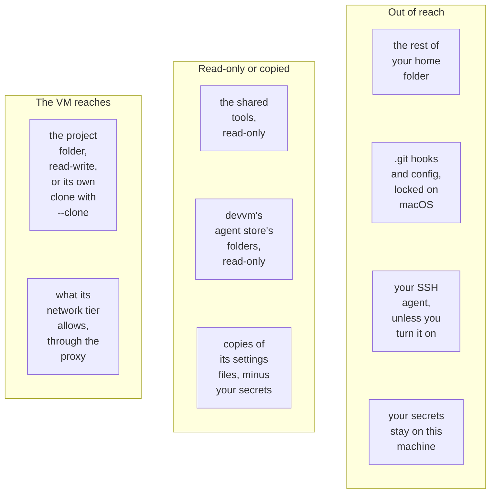

# Staying safe

devvm runs installs, project code and coding agents in a VM, so code you didn't write can't read your credentials, run git hooks on this machine or reach your other projects. On the allowlist tier, which new VMs get by default, that code can send data only to the hosts you allow. A few habits close most of what devvm can't close on its own, so read this page before you trust a VM with a project.

Some of what devvm protects are your secrets. A secret is a credential devvm keeps on this machine for VMs to use: your GitHub token, Claude Code's token, an agent's login or an API key.

## The habits

- **Use [`--clone`](../using/clone.md) for a repo or an agent you don't trust.** The VM then works on a clone of its own instead of your folder, so nothing it writes reaches your folder or its `.git` until you fetch the VM's work and review it. It's the safest way to run a repo you don't know or an agent with its checks off.
- **Run installs, project code and agents in the VM.** Whatever the VM writes into the project folder runs as you when a program on this machine runs it, so `npm install`, `make`, tests and agents belong in the VM ([files the VM writes](attack-vectors.md#files-the-vm-writes)).
- **Keep VMs on the [allowlist or none tier](network.md#network-tiers), and keep allowlists short.** New VMs get allowlist by default. On the allowlist tier stolen data can go only to the hosts you allowed, on the internet tier to any public host, and on the open tier code in the VM reaches everything this machine can.
- **Review the VM's changes before you run them on this machine or merge them.** Treat its commits as an untrusted contributor's.
- **Use a fine-grained GitHub token, and bind only the secrets a VM needs.** A VM can do whatever its secrets allow, even when it never sees them ([secrets and keys the VM may use](attack-vectors.md#secrets-and-keys-the-vm-may-use)).
- **Keep credentials out of the project folder and the settings folders of devvm's agent store.** The VM sees every file in them, including a `.env` file, whatever the VM's tier ([mounts](../using/coding-agents.md#mounts)).
- **Leave SSH agent forwarding off,** or use [devvm's own agent](../using/ssh.md#devvms-own-agent) with only the keys the VM needs.

## What a VM can reach

The diagram sorts what's on this machine by what a VM can do with it, and the table below gives the details.

| | |
| --- | --- |
| The project folder | The VM reads and writes it. With `--clone` the folder isn't mounted, and the VM has a clone of its own ([details](../using/clone.md)). |
| `.git` hooks and config | devvm locks them on macOS, and it reports what a lock can't stop without preventing it ([details](git-protection.md)). With `--clone` they're out of reach. |
| Your agents' settings and logins (skills, settings, logins) | The VM mounts the folders of devvm's agent store read-only and gets copies of its files, but never your agents' history, and never the agents' own files in your home folder ([details](../using/coding-agents.md#devvms-agent-store)). |
| The rest of your home folder, other projects | The VM doesn't mount them. |
| Your SSH keys | Only with `devvm ssh-agent on`, and only while you're connected. With `devvm ssh-agent devvm`, the VM can use only the keys you added to devvm's own agent ([details](../using/ssh.md#agent-forwarding)). |
| The network | On every tier but open, the VM reaches only its proxy on this machine, which lets it reach what [its tier](network.md#network-tiers) allows. On the open tier it reaches everything this machine reaches, including this machine's own services on `localhost` ([details](network.md#network-tiers)). |
| Your secrets | Your GitHub token, Claude Code's token, the coding agents' logins and API keys and Claude Code's MCP secrets stay on this machine on every network tier, and the proxy puts them into requests ([details](network.md#secrets)). opencode's and pi's keys that the proxy can't put in, such as a local model server's, stay on this machine too, unless you pass one to VMs in `config.toml` ([opencode logins](../using/coding-agents.md#codex-and-opencode-logins), [pi logins](../using/coding-agents.md#pi-logins)). |

> [!NOTE]
> Everything here rests on the VM's boundary: the VM runs its own kernel, apart from this machine's.

## More on staying safe

- [Network tiers](network.md): choosing a VM's tier, allowlists, logs and secrets.
- [.git protection](git-protection.md): what the lock stops, what still works and what it doesn't cover.
- [Attack vectors](attack-vectors.md): common attacks one by one, and what devvm does about each.
- [How it works › Security model](../internals/security.md): how devvm keeps each of these promises.

