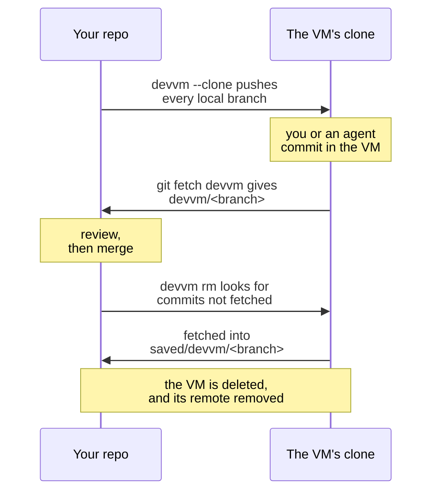

# Working on a clone

`devvm --clone` gives the VM its own clone of the repo instead of mounting your folder, so nothing in the VM can touch your working tree or `.git`. Use it when you don't trust what runs in the VM, such as an agent working unattended, and on Linux hosts that can't lock `.git`, such as Ubuntu 23.10 and newer, where devvm only names what changed after the fact ([when Linux can't lock](../safety/git-protection.md#when-linux-cant-lock)). On Linux hosts it's also the way to use SQLite in WAL mode, or a program that maps its files for writing, such as LMDB or the mold linker, in the repo, because those fail in the 9p share that VMs there mount the folder with, while the clone is on the VM's own disk, which is also far faster ([programs that map files](../backends/lima.md#programs-that-map-files-for-writing)). [Files the VM writes](../safety/attack-vectors.md#files-the-vm-writes) lists what `--clone` keeps away from this machine.

```sh
devvm --clone              # create the VM, copy your branches into it and open a shell in its clone
git fetch devvm            # later, on this machine, fetch the VM's work as devvm/<branch>
git log -p main..devvm/main
```



When the folder holds several repos, such as a `frontend` and a `backend` beside each other, `devvm --clone` gives the VM a clone of each repo you choose, at the same paths as on this machine ([folders of repos](#folders-of-repos)).

## Requirements

- The folder is the top folder of a git repo that has at least one commit and a branch checked out, not a detached HEAD, or it's a folder of repos ([folders of repos](#folders-of-repos)).
- The repo is the folder's own, or the folder is a worktree that `git worktree add` made. devvm refuses a `.git` that points into another repo, because the push would copy that repo's branches into the VM. That includes a `.git` file that isn't a worktree's, a worktree whose link back to this folder doesn't match, a `commondir` that leads to another repo, and objects or refs that are symlinks, or that sit in a folder that is one. devvm also refuses a repo that borrows objects from another repo through `objects/info/alternates`. To use such a repo, run `git repack -a -d` in it, then delete that file.
- git is installed on this machine. The VM's images already have it.
- No other VM mounts the folder, such as the VM of a folder it's in. Code in that VM could swap the repo under the git commands devvm runs here as it copies your branches, so devvm refuses `--clone` and `devvm clone on` there and names that VM. Delete that VM, or move the repo out of its folder.
- You choose `--clone` when the VM is created, and once a VM is a `--clone` VM you don't need to pass `--clone` again. devvm refuses `--clone` for an existing VM that mounts its folder, and `devvm clone on` switches that VM instead ([switching a VM that exists](#switching-a-vm-that-exists)).

## What's copied

From this machine, the VM mounts only the shared tools and its [agents' config folders](coding-agents.md#mounts). Once the VM is running, devvm creates a repo in it at the same path as your folder and pushes every local branch into it. When the folder is a git worktree, devvm pushes only the worktree's branch and that branch's upstream, if it has one, and leaves the repo's other branches on this machine. The push goes over ssh to the VM itself and checks the host keys devvm pinned for it. No setting in your repo's config, such as a `url.*.insteadOf` that rewrites the VM's URL, can send the push anywhere else ([how the push connects](../internals/git-protection.md#what-a-lock-cant-stop)). devvm checks out your current branch in the clone, and your shell opens there.

Apart from a worktree's upstream, which can be a remote-tracking branch such as `origin/main`, devvm copies only your local branches. Tags, uncommitted changes, and untracked or ignored files such as `.env` and `node_modules` stay on this machine. devvm warns you about uncommitted changes, so you can commit them and send them later with `git push devvm BRANCH`.

If the copy fails, for example because the VM can't be reached, devvm tries again the next time you run it in the folder.

## The remote

devvm adds a git remote for the VM to your repo. It's named `devvm`, or `devvm-<folder>` if `devvm` is already taken, or the VM's full name if both are. The remote's URL is the VM's full name followed by the clone's path, so git connects through devvm's ssh config, and fetching needs two things:

- Your `~/.ssh/config` needs devvm's `Include` line ([SSH access by name](ssh.md#ssh-access-by-name)). devvm offers to add it when it creates the clone, and again when you run `devvm host` or `devvm code`. Until the line is there, or when devvm had no terminal to ask in, fetch with `GIT_SSH_COMMAND='ssh -F ~/.local/share/devvm/ssh_config' git fetch devvm`.
- The VM must be running. A stopped VM has no SSH entry, so `git fetch` fails because it can't resolve the name. Run `devvm` or `devvm host` in the folder first.

## Fetching the VM's work

`git fetch devvm` in the repo fetches the VM's branches as `devvm/<branch>`, as for any remote. `devvm clone fetch` does the same for every repo the VM has a clone of, which is one repo here, or each repo of a [folder of repos](#folders-of-repos), and then lists the branches that are new or have moved since the last fetch, each with the repos it's in:

```console
$ devvm clone fetch
agent/search: backend, frontend
main: backend
==> Review each branch in its repo before you merge it, such as with git log -p main..devvm/main.
```

`devvm clone fetch` starts the VM if it's stopped. It connects to the VM itself, as the copy does, so it needs neither devvm's `Include` line in `~/.ssh/config` nor the VM's name in your ssh config. It fetches every branch of each clone into its repo's remote, as `devvm/<branch>`, and never changes your own branches or tags. When a repo's remote is gone, `devvm clone fetch` adds it again. When you've pointed the remote at another URL, or the folder on this machine isn't that repo any more, for example because its `.git` is gone, devvm leaves that repo alone and says so.

Fetching runs nothing from the VM on this machine. git only receives objects and updates the `devvm/*` branches, or creates new `saved/devvm/*` branches when `devvm rm` does the fetch. The commits themselves are untrusted, though, so treat them as you would a contributor's branch and review them before you merge them, check them out or run anything they change.

## Subfolders

When you run devvm in a subfolder of the repo's folder, devvm uses the `--clone` VM as it uses any parent folder's VM ([a subfolder](vms.md#a-subfolder)). The clone is at the repo folder's path, so the subfolder's path in the VM is the same subfolder in the clone. When the clone has that subfolder, the shell opens there, and `devvm host` and `devvm code` give it as the folder to open. When the clone lacks it, for example because the subfolder is untracked or ignored and so never copied, they use the clone's top folder instead.

`devvm --clone` in a subfolder never uses a parent folder's VM. It makes a new `--clone` VM for the subfolder, as `devvm --here` does, and doesn't take `--parent`, so the subfolder must be the top folder of a repo of its own.

## Several agents in one VM

Several agents can work in one `--clone` VM, each on a branch of its own in a git worktree of its own, so each agent edits its own copy of the files. Put the worktrees inside the clone, such as in `.worktrees/NAME`, because the clone's parent folders in the VM belong to root, and so `git worktree add ../NAME` fails there. In the VM, in the clone:

```sh
echo .worktrees/ >> .git/info/exclude         # once, so git status in the clone leaves the worktrees out
git worktree add -b agent/api .worktrees/api  # a worktree on a new branch, agent/api
cd .worktrees/api                             # then start the agent here
```

Every worktree shares the clone's repo, so the agents' branches are all in it. One `git fetch devvm` on this machine brings every agent's branch back, such as `devvm/agent/api`, and you review each one as you would any of the VM's work ([fetching the VM's work](#fetching-the-vms-work)). Before `devvm rm` deletes the VM, it also checks each worktree inside the clone for uncommitted changes ([deleting the VM](#deleting-the-vm)).

Install each worktree's dependencies in that worktree, and never share one `node_modules` folder between worktrees, because each branch can need different packages, and two agents installing at once can break it. pnpm and bun keep one package store in the VM and hard-link packages from it into each worktree's `node_modules` when both are on the same disk, so another worktree costs little download or disk.

The agents also share the VM's ports, so two servers on the same port collide. Give each worktree's server a port of its own, such as with `PORT=3001`. A VM that forwards every port, as new VMs do by default, forwards each of them to this machine's `localhost` ([ports](ports-size.md#ports)).

The agents in one VM share its network tier and rules, its secrets, and its CPUs, memory and disk, and each agent can read and change every other agent's worktree. When the agents need different network tiers or rules, secrets or sizes, or when one agent mustn't reach another's work, give each agent a folder of its own on this machine, such as a separate clone of the repo, and run `devvm --clone` in each, so each gets a VM of its own.

## Folders of repos

A project is often several repos in one folder, such as a `frontend` that uses `file:../shared` in its `package.json`, or a .NET solution whose projects point at `../Lib/Lib.csproj`. `devvm --clone` in that folder gives one VM a clone of each repo you choose, each at the same path as on this machine, so the paths between them work in the VM as they do here. The folder can be a repo itself or not, and when it is one, you ask for this with `--repos`, because without it `devvm --clone` there gives the VM a clone of the folder's own repo alone, as for any repo, whatever repos are below it.

```text
my-repos/
├── docker-compose.yml
├── frontend/   (a repo)
├── backend/    (a repo)
└── shared/     (a repo)
```

```sh
cd my-repos
devvm --clone                          # choose the repos, then create the VM and open a shell in my-repos
devvm --clone --repos frontend,shared  # or choose them on the command line, as a script must
```

devvm looks for repos up to four folders below this one, as [`.git` protection](../safety/git-protection.md#nested-repos) does, and skips the folders of packages and build tools, such as `node_modules` and `vendor`. In a terminal, it lists the repos it found in a picker, each ticked, and you untick those the VM doesn't need. A repo that `--clone` can't copy is listed under its own heading with the reason, such as a repo without commits or one whose `.git` points into another repo, and it can't be ticked. devvm lists at most 100 repos, and it names how many more it found. A linked worktree of a repo in the folder, such as one in `.worktrees/NAME`, isn't a repo of its own, so devvm doesn't list it. Its repo's clone gets that repo's current and default branches only, not the worktree's own branch, so push that one yourself with `git push devvm BRANCH` in the worktree once the VM is made. A repo whose folder's name has a character a terminal can't show, such as a line break or a bidi control, can't be ticked.

A repo that another VM mounts, because that VM is a subfolder's that holds the repo, or the repo's own, or, for a linked worktree, the VM of the repo it belongs to, can't be ticked either, because code in that VM could swap the repo for another while devvm's git works in it. devvm names that VM, and `devvm clone add` refuses the repo too. Delete that VM, or move the repo out of its folder, to give this VM a clone of it. A folder of repos inside another repo's working tree is refused, because devvm would copy that repo's files. To clone repos in it, run `devvm --clone --repos LIST` in that repo's top folder, and choose them there.

Without a terminal, or with `--no-input`, give `--repos`, or devvm refuses without creating anything. `--repos all` takes every repo `--clone` can copy, `--repos none` takes none of them, and a list such as `--repos frontend,backend` takes those repos, by their folders relative to this one, with `.` for this folder's own repo. devvm names each repo you chose that it can't copy, and leaves it out. devvm records your choice in the VM's state, never in the folder.

When devvm finds no repo below this folder that it can copy, `devvm --clone` gives the VM a clone of this folder's own repo, as for a folder that holds no other, and the folder must then be one ([requirements](#requirements)).

When the folder's own repo is one of those you choose, its clone in the VM leaves the other repos' clones out of its `git status`, and what your repo's `.git/info/exclude` leaves out too, such as `.worktrees/`, so the other clones aren't changes `devvm rm` asks about.

Each repo's clone gets the repo's current branch and its default branch, which is the branch `origin/HEAD` points to, else `main`, else `master`, whichever the repo has, as a local branch or as `origin`'s. devvm copies no other branches, which keeps the copy fast for big repos, and you send any other branch later with `git push devvm BRANCH` in that repo. When a repo's HEAD is detached, its clone checks out the default branch, and devvm says so. A repo with a detached HEAD and no default branch has nothing to check out, so `--clone` can't copy it.

Each repo gets a remote of its own for the VM, named as for one repo's clone ([the remote](#the-remote)): `devvm`, or `devvm-<folder>` when that repo already has a `devvm` remote, for example from a VM of its own. One repo's remote names never change the others'. When a repo has all three names taken, devvm leaves that repo out and names it.

As the copy is made, a repo that no longer passes the checks, for example because its last commit went, is left out and named, and the others are copied. When the copy fails, devvm copies what's left the next time you run it in the folder.

### The folder's own files

A folder of repos often has files of its own at its top, outside every repo, such as a `docker-compose.yml`, a `Makefile` or an `.envrc`. When the folder isn't a repo itself, devvm copies these into the VM once, when it creates the clone, at the same paths. It never copies them again, and nothing comes back from the VM, so a later change on either side stays there. To change one in the VM, edit it there, and to bring a change back, copy it out yourself, for example with `devvm host` and `scp`.

devvm copies the files and folders outside every repo, whether the VM has a clone of that repo or not, and never a `.git`, a folder shaped like one, such as a bare repo's, or the folders of packages and build tools, such as `node_modules`, `vendor` and `.venv`. It keeps each file's permissions but its set-user-id and set-group-id bits, and a link that leads to a path in the folder, as a link. It reads only beneath the folder, one folder at a time, and never through a link, so a link that leads out of it stays on this machine, as do a bare repo, a file with another hard link, sockets and other special files, anything on another disk, a file over 10 MiB, and the files past 64 MiB or 5,000 entries in all. devvm says how many of the files it left out. When the folder is a repo itself, its files are its repo's, so devvm copies none of them this way.

A secret in one of these files, such as an `.env` at the folder's top, reaches the VM as any other file does, so move it out of the folder before `devvm --clone` when the VM mustn't have it. devvm refuses the folders it refuses to mount, such as your home folder ([folders devvm refuses](settings.md#project-folders-devvm-refuses)), because it would copy their files.

### Opening a repo's folder

In a folder of one of the VM's repos, such as `my-repos/frontend`, `devvm` opens the folder's VM at that repo's path, as it opens any parent folder's VM in a [subfolder](vms.md#a-subfolder). A repo of its own in a subfolder usually gets a VM of its own, but the folder's VM has this repo's clone at the same path and mounts nothing of this machine, so the VM can't reach the repo's folder here. `devvm --here` in the repo's folder still creates or opens that repo's own VM. In a repo the VM has no clone of, `devvm` doesn't use the folder's VM.

### Adding a repo

`devvm clone add PATH` copies one more repo into the VM, such as a repo you cloned into the folder after the VM was made, or one that you left out. PATH is the repo's folder, relative to the folder you run it in, and it must be inside the VM's folder. devvm checks the repo as it checks each repo it copies, starts the VM if it's stopped, copies the repo's current and default branches to the same path in the VM and adds its remote. When the copy fails, for example because the VM can't be reached, devvm keeps the repo in the VM's list, so `devvm rm` still checks what reached the VM, and running `devvm clone add PATH` again copies it again.

```sh
git clone git@github.com:me/docs.git
devvm clone add docs
```

A repo made in the VM stays in the VM, because the VM can't add a repo to this machine. To bring it out, clone it from the VM with `git clone devvm-my-repos-<hash>:/path/to/my-repos/new`, using the VM's full name from `devvm ls`.

### Agents across repos

An agent that works on one change across repos uses one branch name in each repo, such as `agent/search` in `frontend` and in `backend`, so `devvm clone fetch` lists that change as one line with both repos. For several agents at once, give each its own folder with a worktree of each repo, inside the VM's folder:

```sh
for r in frontend backend; do git -C "$r" worktree add -b agent/search "../.worktrees/search/$r"; done
cd .worktrees/search   # the change's own copy of the folder's repos, then start the agent here
```

devvm copies the folder's own files only into the folder itself, so copy those the agent needs into the change's folder too. `devvm rm` checks each worktree inside the VM's folder for uncommitted changes, whichever repo it belongs to ([deleting the VM](#deleting-the-vm)).

## Deleting the VM

Before `devvm rm` deletes a `--clone` VM, it checks the clone for work you'd lose. It starts a stopped VM for the check as a launch does, so the VM's confinement is checked first:

1. If the clone has branches with commits this repo hasn't fetched, devvm names them and offers to fetch them into new local branches named `saved/devvm/<branch>`. It skips a branch whose name git on this machine refuses and names it, and that branch goes with the VM. To keep such a branch, rename it in the VM with `git branch -m` before you run `devvm rm`.
2. If the clone or a worktree inside its folder has uncommitted changes, devvm lists the first 20 of them in all, with each worktree's changes under its path, and asks before deleting them along with the VM. devvm skips a worktree whose folder is gone or that git would prune, and it doesn't check worktrees outside the clone's folder. When the clone has more than 100 worktrees inside its folder, devvm checks the first 100 and asks before deleting the VM, even if none of them has changes. Worktrees outside the folder don't count towards the 100.

For a [folder of repos](#folders-of-repos), devvm checks every repo the VM has a clone of, reading them all from the VM at once, and names the repo of each branch and each change it lists. It asks once whether to fetch the unfetched branches of every repo, each into that repo's `saved/<remote>/<branch>` branches, and once before the uncommitted changes go, with the first 20 changes in all the repos shown. When a repo's clone isn't at its path in the VM, for example because something in the VM moved it, devvm says so and asks before deleting the VM, as for uncommitted changes. A repo whose copy didn't finish is checked too when its clone is in the VM. When another VM mounts one of the repos, devvm still reads its clone in the VM and checks every other repo, but it leaves that repo on this machine alone, so it can't fetch the VM's work in it: it names that VM and asks before deleting, as for uncommitted changes. When a repo on this machine isn't the repo the VM has a clone of any more, for example because its `.git` is gone, devvm refuses and keeps the VM, because git there would read another repo; put the repo back, or give `--no-clone-check`. devvm doesn't check the VM's copy of the folder's own files, nor anything else outside the repos, so copy out what you need of those first.

If either check finds something and there's no terminal to ask in, or you give `--no-input`, devvm refuses and keeps the VM. These questions are asked only in a terminal, because only you can judge the work, so `--force` never answers them ([questions devvm asks](command-line.md#questions-devvm-asks)).

Without a terminal, when a folder of repos has unfetched branches, devvm's refusal names `devvm clone fetch`: run it first, and the check finds them fetched.

Once the checks pass, devvm deletes the VM. If the remote still points at the VM, devvm then removes it with `git remote remove`, in each repo of a folder of repos too, which also deletes its `devvm/*` branches and their upstream settings. Before it does, devvm keeps every `devvm/*` branch that has commits no other branch has as a new local branch under `saved/devvm/`, whoever fetched it. devvm names each branch it creates, and they're yours to review, merge or delete, as with `git branch -D saved/devvm/main`.

The saved branches are named after the remote, as `saved/<remote>/<branch>`, and devvm never overwrites a branch. When a branch is in the way, devvm uses `saved/<remote>-2`, then `-3` and so on, and if it finds no free name, `devvm rm` refuses and keeps the VM ([saved branches](../internals/overview.md#saved-branches)).

`devvm rm --force` skips only the question whether to delete the VM at all, and both checks still run. `devvm rm --no-export` skips the export of the agents' history, and it also leaves both checks as they are.

When another VM mounts the repo, such as the VM of a folder the repo is in, code in that VM could swap the repo under devvm's git, so devvm runs no git in it on this machine. It checks the clone in the VM, names that VM and asks before deleting, as for uncommitted changes, because it can't fetch the clone's work into the repo; without a terminal it refuses and keeps the VM. Fetch the work by hand first if you need it, then give `--no-clone-check`.

`devvm rm --no-clone-check` skips both checks, so the VM goes with the commits this repo hasn't fetched and the uncommitted changes, and devvm warns you of that first. Use it when a check can't read the clone, such as when git in the VM is broken, and devvm refuses and keeps the VM. Use it too when the VM doesn't start for the check, such as when its tier isn't enforced, because devvm then says what kept it from starting and keeps the VM. devvm still asks whether to delete the VM unless you also give `--force`, and it still keeps the `devvm/*` branches you fetched as `saved/devvm/` branches.

## Switching a VM that exists

`devvm clone` shows whether this folder's VM has its own clone of the repo, which is `on`, or mounts the folder, which is `off`. `devvm clone on` and `devvm clone off` switch the VM by making it again from the image it has, as [`devvm layer add`](images.md#adding-layers-to-a-vm) does, and then open a shell in it:

```sh
devvm clone       # show on or off
devvm clone on    # make the VM again with its own clone of the repo, after asking
devvm clone off   # fetch the clone's work, then make the VM again with this folder mounted
```

The VM keeps its home folder and its settings, as [a VM made again](images.md#what-a-vm-made-again-keeps) does, and everything else on its disk is lost. So in a terminal devvm asks first, with no as the default, and without one it refuses unless you give `--force`. `--no-export` skips the export of the agents' history, and `--clean-home` gives the VM the image's home folder instead of its own, as for `devvm layer add`. When the VM is in the mode you ask for already, devvm says so and changes nothing.

`devvm clone on` needs a folder that `--clone` takes ([requirements](#requirements)), and devvm refuses before it changes anything when the folder isn't one. In a [folder of repos](#folders-of-repos), devvm asks which repos the new VM gets in the picker before it asks to make the VM again, and `devvm clone on --repos LIST` answers that without a terminal. Your work is in the folder, so only the VM's disk is lost. The new VM mounts nothing of the folder, and as it starts, devvm copies your branches into its clone and adds [the remote](#the-remote), as for a new `--clone` VM ([what's copied](#whats-copied)). Once the new VM is ready and the old one is deleted, devvm takes the [`.git` locks](../safety/git-protection.md) off the folder, because no VM mounts it any more. First it names what the old VM changed that the locks can't stop, as a launch does ([when devvm reports .git](../safety/git-protection.md#when-devvm-reports-git)).

`devvm clone off` loses the clone, which is on the VM's disk, so first it checks the clone as `devvm rm` does ([deleting the VM](#deleting-the-vm)), every repo of a folder of repos included. It offers to fetch the branches this repo hasn't fetched into `saved/devvm/<branch>` branches, and it asks before the clone's uncommitted changes go. Only a terminal can answer these questions, and `--force` never does, so without a terminal, or with `--no-input`, devvm refuses and keeps the VM as it is. `devvm clone off --no-clone-check` skips the check after a warning, and the clone's unfetched commits and uncommitted changes are lost. The new VM mounts the folder again with `.git` protection as a new VM gets it, which is `on` on macOS and `off` on Linux hosts. Before the new VM first starts, and before devvm locks `.git`, it removes the remote and keeps each `devvm/*` branch that has commits no other branch has as a `saved/devvm/` branch, as `devvm rm` does. If the switch is then undone, devvm adds the remote back.

When a step fails, or you press Ctrl+C, before the new VM has its home folder, devvm puts the old VM back as it was, in its old mode, as it does for [any remake](images.md#adding-layers-to-a-vm).

A `--clone` VM keeps its clone on its own disk, so `devvm layer add`, `devvm layer rm` and `devvm update` refuse it. To change its layers or bring it up to date, run `devvm clone off`, then that command, then `devvm clone on`.

### devvm clone --json

`devvm clone --json` prints one JSON object with `clone`, which is `on` or `off`, as [output for scripts](command-line.md#output-for-scripts) describes. With `--json` the command only shows, so devvm refuses `on` or `off` with it, and the flags that go with them.

```json
{
  "version": 1,
  "clone": "on"
}
```

### devvm clone fetch --json

`devvm clone fetch --json` fetches as `devvm clone fetch` does, then prints one JSON object instead of the list. `repos` has each repo with new or moved branches, by its folder relative to this one (`.` for this folder's own repo), with its remote and those `branches`. `branches` has the same by name, each with its `repos`, sorted by name. Both are empty when nothing is new.

```json
{
  "version": 1,
  "repos": [
    {
      "path": "backend",
      "remote": "devvm",
      "branches": ["agent/search"]
    },
    {
      "path": "frontend",
      "remote": "devvm",
      "branches": ["agent/search"]
    }
  ],
  "branches": [
    {
      "name": "agent/search",
      "repos": ["backend", "frontend"]
    }
  ]
}
```

