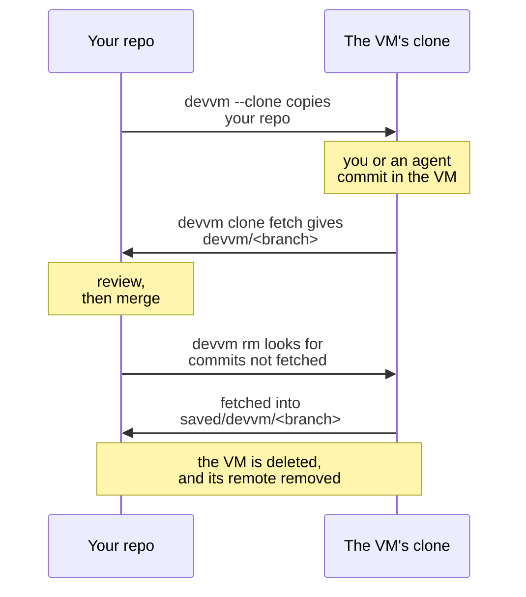

# Working on a clone

`devvm --clone` gives the VM its own clone of the repo instead of mounting your folder, so nothing in the VM can touch your working tree or `.git`. Use it when you don't trust what runs in the VM, such as an agent working unattended, and on Linux hosts that can't lock `.git`, such as Ubuntu 23.10 and newer, where devvm only names what changed after the fact ([when Linux can't lock](../safety/git-protection.md#when-linux-cant-lock)). On Linux hosts it's also the way to use SQLite in WAL mode, or a program that maps its files for writing, such as LMDB or the mold linker, in the repo, because those fail in the 9p share that VMs there mount the folder with, while the clone is on the VM's own disk, which is also far faster ([programs that map files](../backends/lima.md#programs-that-map-files-for-writing)). [Files the VM writes](../safety/attack-vectors.md#files-the-vm-writes) lists what `--clone` keeps away from this machine.

```sh
devvm --clone              # create the VM, copy your repo into it and open a shell in its clone
devvm clone fetch          # later, on this machine, fetch the VM's work as devvm/<branch>
git log -p main..devvm/main
```



When the folder holds several repos, such as a `frontend` and a `backend` beside each other, `devvm --clone` gives the VM a clone of each repo you choose, at the same paths as on this machine ([folders of repos](#folders-of-repos)).

## Requirements

- The folder is the top folder of a git repo that has at least one commit, or it's a folder of repos ([folders of repos](#folders-of-repos)).
- The repo is the folder's own, or the folder is a worktree that `git worktree add` made. devvm refuses a `.git` that points into another repo, because the copy would take that repo's branches into the VM. That includes a `.git` file that isn't a worktree's, such as a submodule's, which `devvm --clone` in its parent repo's folder copies ([submodules](#submodules)), a worktree whose link back to this folder doesn't match, a `commondir` that leads to another repo, and objects or refs that are symlinks, or that sit in a folder that is one. devvm also refuses a repo that borrows objects from another repo through `objects/info/alternates`. To use such a repo, run `git repack -a -d` in it, then delete that file.
- The repo has no `info/grafts` file, which gives some commits other parents than their own, because devvm copies each commit with its own parents. `git replace --convert-graft-file` turns the file into replace refs, which git supports in its place. devvm copies each commit's real parents even then, so the history the grafts cut off has to be in the repo on this machine.
- git is installed on this machine. The VM's images already have it. A repo that names its objects with SHA-256 also needs git 2.29 or newer in the VM, which devvm's images have. An image you made with `--from` might not, and then devvm stops before it copies anything and names the VM's git version.
- No other VM mounts the folder, such as the VM of a folder it's in. Code in that VM could swap the repo under the git commands devvm runs here as it copies your branches, so devvm refuses `--clone` and `devvm clone on` there and names that VM. Delete that VM, or move the repo out of its folder.
- You choose `--clone` when the VM is created, and once a VM is a `--clone` VM you don't need to pass `--clone` again. devvm refuses `--clone` for an existing VM that mounts its folder, and `devvm clone on` switches that VM instead ([switching a VM that exists](#switching-a-vm-that-exists)).

## What's copied

From this machine, the VM mounts only the shared tools and its [agents' config folders](coding-agents.md#mounts). Once the VM is running, devvm creates a repo in it at the same path as your folder and copies your repo into it, so `git status`, `git log` and `git stash list` in the VM's clone show what they show here. What goes into the VM:

- **Every local branch,** your `saved/devvm/*` branches included, which hold a deleted VM's work.
- **Every tag,** an annotated one staying annotated, and your notes and replace refs. Refs are the repo's data, so what a tool keeps in them goes too, such as an agent tool that stores its transcripts in git notes or branches.
- **The remote-tracking branches of your remotes,** such as `origin/main`, with `origin/HEAD` still pointing at its branch. That includes the branches of another private repo that you fetched as a remote.
- **What you have checked out,** your current branch or, when HEAD is detached, the same commit, detached, and your shell opens there.
- **Your uncommitted changes.** What you've staged is staged in the VM, and what you haven't is changed in its working tree, deleted files and files added with `git add -N` included. Each working copy goes as it is, but only a regular file or a symbolic link, where git tracks one of those.
- **A rebase, a merge, a cherry-pick, a revert or a bisect** that you're in the middle of ([an operation in progress](#an-operation-in-progress)), and your repo's `info/exclude`, `info/sparse-checkout` and `info/attributes`.
- **Your stash,** each entry with its message and the commits it was made on, at most your 1,000 newest, and devvm names the rest. An entry made with `git stash -u` holds untracked files, so those files reach the VM inside it.
- **Your repo's own settings,** such as its remotes, its hooks as they are and your `user.name` ([the settings](#the-settings)), each [submodule](#submodules) you've initialised, and the content of your [Git LFS](#git-lfs) files.

What stays on this machine:

- **Untracked and ignored files,** such as `.env` and `node_modules`.
- **Anything that isn't a tracked file of its kind any more.** A tracked file that you turned into a folder is missing in the VM, nothing in that folder goes, and devvm names it. A file whose folder is a symbolic link here goes as deleted, as git sees it, never as the file the link leads to.
- **An embedded repo's contents,** and an uninitialised submodule's. Its folder is empty in the VM, without its `.git`, its own changes or its untracked files.
- **The change you haven't committed to a filtered file,** one that goes through a git filter, such as git-crypt's or Git LFS's. The file goes as git stores it, because devvm's git runs no filter, though `git-lfs` in the VM then checks a Git LFS file out with its content ([Git LFS](#git-lfs)), and devvm names it as one that may differ, because without the filter devvm can't tell whether it changed. Such a file that you deleted is deleted in the VM too.
- **Your edits to a file marked with `git update-index --skip-worktree`,** which git hides and which are often local settings or secrets. The file goes as git's index has it, and devvm names it. A file marked `--assume-unchanged` also goes as the index has it, and a sparse checkout's files outside it stay out of the VM, as they're out of your working tree.
- **A stash entry made with `git stash --all`,** which may hold ignored files, such as `.env`. devvm can't tell such an entry from a `-u` one for sure, so it keeps back any entry that may be one, such as one whose untracked files your `.gitignore` ignores, now or when you made it, and it names each one.
- **Another devvm VM's work,** the remote-tracking branches of its remote, such as an older `--clone` VM's `devvm/*`.
- **Refs outside those namespaces,** such as `refs/original/`, where `git filter-branch` keeps what it rewrote. So does `ORIG_HEAD`, with any commit that only it still reaches, such as one a reset took back, except during `git am`, whose `--abort` needs it.
- **Your global git config,** and every setting of your repo that [the settings](#the-settings) doesn't list, such as `credential.helper`.

devvm copies all this without `git push`, over the same channel that carries every other command devvm runs in the VM, so the copy goes to that VM alone, and no setting in your repo's config, such as a `url.*.insteadOf` that rewrites the VM's URL, can send it anywhere else. It also takes a shallow clone, which gets its shallow history in the VM, and a repo that names its objects with SHA-256, which gets a SHA-256 repo there ([how the copy works](../internals/git-protection.md#the-copy-into-a-clone-vm), [the working tree](../internals/git-protection.md#the-working-tree-in-the-copy), [the state](../internals/git-protection.md#the-state-in-the-copy)). A partial clone, which `git clone --filter` makes, gets the objects it has, and the VM's git fetches the rest from its remote when a command needs one, where the VM's network policy and credentials let it ([a partial clone](#a-partial-clone)).

### A git worktree

When the folder is a git worktree, devvm copies what's published and the worktree's own work: its branch, that branch's upstream, if it has one, the repo's default branch, the remote-tracking branches and the tags. It leaves the repo's other local branches on this machine, because they're other worktrees' work, and it says so. The default branch is the branch `origin/HEAD` points to, else `main`, else `master`, whichever the repo has, so you can rebase onto it or diff against it in the VM. The worktree's VM gets no stash, because the stash is the whole repo's, not the worktree's, and none of the submodules ([submodules](#submodules)).

### An operation in progress

When you're in the middle of a rebase, a merge, a cherry-pick, a revert or a bisect, the VM's clone is in the middle of it too, so you or an agent can go on with it there. Resolve a conflict, then go on as you would here:

```sh
git rebase --continue        # in the VM's clone, for a rebase
git commit                   # for a merge
git cherry-pick --continue   # for a cherry-pick
```

A rebase started with `--autostash` brings its autostashed changes back in the VM. When the rest of a rebase or a cherry-pick names a commit that the VM won't have, devvm names it, as that step will fail there ([the state in the copy](../internals/git-protection.md#the-state-in-the-copy)).

### The settings

Your repo's own settings go too, from its `.git/config` and, when git keeps settings for each worktree, as `git sparse-checkout` does, from the worktree's `config.worktree`, never from your global config or a file they include ([the settings in the copy](../internals/git-protection.md#the-settings-in-the-copy)):

- Its remotes, so `git fetch origin` and `git pull` work in the VM wherever its network policy reaches the remote and it has the credentials the remote needs:
  - Each URL goes as git resolves it, after any `url.*.insteadOf`, without the user name, password, query or fragment of an `http` or `https` URL, any of which can hold a token, and without the password of an `ssh` URL, whose user name goes.
  - A `file://` URL or a path goes as it is, though it names a folder on this machine that the VM can't reach.
  - When git pushes somewhere else, because of a push URL or a `url.*.pushInsteadOf`, the push URLs go too, cleaned the same way.
  - A remote whose URL is of any other kind, such as `git://` or `ext::`, or a scp-like URL that may hold a token, stays on this machine, and devvm names it. A push URL of those kinds, or one that reaches a devvm VM, stays too, and when none of a remote's push URLs goes, `git push` in the VM pushes to the remote's URL, and devvm says so.
- The upstream of each branch the copy sends, the submodules' URLs, cleaned as a remote's, and their `active`, `branch` and `update` settings, but an `update` that runs a command.
- `core.sparseCheckout`, `core.sparseCheckoutCone` and `index.sparse`, so a sparse checkout is one in the VM too.
- `core.hooksPath` when it's a folder inside the repo, such as husky's, as the setting alone. The hooks in that folder are files of your working tree, so the tracked ones reach the VM with the checkout, and the untracked ones, such as husky's `_` folder, stay here, as every untracked file does, until a tool in the VM makes them, such as `npm install`.
- The repo's own `user.name` and `user.email`, so a commit in the VM has your name on it.
- Its hooks, as they are, the secrets in them included, so a hook that calls a tool only this machine has fails in the VM, as it would on a new machine. Only the files named as git's hooks go, each a regular file of at most 1 MiB and 16 MiB in all, from the repo's hooks folder, and only when git here runs them, which it doesn't once a `core.hooksPath` is set, in the repo or in your global config. A hook that's a link, a folder or bigger stays and is named, and so do the hooks of a `core.hooksPath` outside the repo. devvm also names a hooks folder that's missing, a link or unreadable.

Every other setting stays on this machine, such as `credential.helper`, `http.extraHeader`, `core.sshCommand`, aliases and filters. Your remotes' URLs are real, though, so when the VM may use your GitHub token, which its proxy puts into requests to `github.com` ([secrets](../safety/network.md#secrets)), and its network policy reaches GitHub, code in the VM can push to `origin` there. To keep a VM from pushing to GitHub or changing anything through its API:

```sh
devvm network deny github.com --path '/*/*/git-receive-pack'      # no git push over HTTPS
devvm network deny api.github.com --method POST,PUT,PATCH,DELETE  # no changes through GitHub's API
```

### Submodules

Each submodule you've initialised here, nested ones too, gets a clone of its own in the VM, at its path, copied as the repo is, at the commit you have checked out in it, so `git submodule status` in the VM shows what it shows here:

```sh
git submodule status --recursive   # in the VM's clone, as on this machine
```

Its repo here gets a `devvm` remote for the VM, chosen as the repo's is, so `devvm clone fetch` fetches each submodule's branches into it, and `devvm rm` checks each one for work you haven't fetched ([how the copy works](../internals/git-protection.md#submodules-in-the-copy)). The rest:

- **One you remove or deinitialise here later:** devvm remembers each submodule it copied, so `devvm rm` names it as one it can't check, and asks before the VM goes.
- **One you haven't initialised,** with `git submodule update --init`, stays an empty folder in the VM, as it is here, and so does one you initialise after the copy, or in a VM made before devvm copied submodules.
- **One that devvm can't copy,** such as one whose `.git` doesn't lead to its own git folder inside the repo's, stays on this machine, with its own submodules, and devvm names it, while the rest of the copy goes on.
- **A git worktree's VM** gets none of its submodules, which devvm names.

### Git LFS

Every VM has `git-lfs`, and the copy sets up its filter in each clone it makes, so a repo that uses Git LFS works in its clone as it does here. A VM that mounts its folder gets no filter, so its LFS files are the pointers git stores. `devvm clone fetch` brings back the LFS objects of the VM's work too:

```sh
git lfs ls-files    # in the VM's clone: the files, with their content
devvm clone fetch   # on this machine: the VM's branches and their LFS objects
```

- **Into the VM,** the copy sends the LFS objects that the files you have checked out point to, when your repo has them, and `git-lfs` in the VM checks those files out with their content. One that isn't what its pointer names stays on this machine, and devvm names it, and when your repo keeps its objects outside `.git`, with `lfs.storage`, none go and devvm says so. A file whose object your repo hasn't fetched stays a pointer in the VM, as `git lfs pull` would fetch it, where the VM's network policy and credentials let it.
- **Back from the VM,** when `devvm clone fetch`, `devvm rm` or `devvm clone off` brings the VM's work back, devvm also brings the LFS objects that the work's pointers name and your repo lacks, each checked against its pointer before it goes into your repo, without `git-lfs` running on this machine. A plain `git fetch devvm` brings none, but `devvm clone fetch` later brings those of the commits it fetched too, even once you've merged them. When the objects come to more than 2 GiB, devvm asks first, and without a terminal it refuses. One that the VM's clone lacks, or that isn't what its pointer names, stays out, and devvm names it. Before the VM goes, `devvm rm` and `devvm clone off` name the LFS objects that only the VM's clone has and ask, and an object they couldn't bring back keeps the VM ([how it works](../internals/git-protection.md#git-lfs-in-the-copy)).

### A partial clone

When the VM's network policy blocks the remote a partial clone fetches its missing objects from, devvm names the remote's host, and on the allowlist tier you let the VM reach it:

```sh
devvm network allow github.com
```

- **A remote reached over ssh:** devvm names the host with its port, such as `github.com:22`, which you allow as it's named.
- **The none tier:** move the VM to the allowlist tier with `devvm network allowlist` first.
- **The internet tier:** devvm names a host that one of your deny rules blocks, or that's a private address, which that tier never reaches.
- **What the VM can't reach or doesn't get:** devvm also names a remote that's on this machine, a `file://` URL or a path, a remote that stays here because its URL is of a kind devvm doesn't copy, and a branch or tag that points to an object the clone never fetched, which the VM's clone doesn't get.

Fetching the VM's work back needs every object that work names, and git in the VM never fetches a missing object just to send it, so when the work names one the clone lacks, such as a file restored from an old commit, `devvm clone fetch` fails and says so. In the VM's clone, run a command that reads the work's objects, which fetches the missing ones from the remote, then fetch again from this machine:

```sh
git show agent/search      # in the VM's clone, for each commit of the work
devvm clone fetch          # then on this machine
```

### A copy that didn't finish

If the copy fails, for example because the VM can't be reached or its disk is full, devvm copies again in full the next time you run it in the folder:

```sh
devvm   # in the folder, to copy again
```

The VM's repo counts as copied only once the whole copy is done, so a copy that stopped part way never leaves a clone that devvm thinks is complete. `devvm rm` and `devvm clone off` check a clone whose copy didn't finish as they check any other, so its commits and changes are never lost without a question ([deleting the VM](#deleting-the-vm)). A copy that runs again keeps what the VM did meanwhile, and devvm names what it kept:

- **A branch that has commits from the VM** stays as it is instead of moving to this machine's.
- **HEAD stays where the VM put it** when the VM checked out something else, such as a branch of its own, or moved its detached HEAD. That includes the case where you switched this repo between a branch and a detached HEAD since the copy that didn't finish. Your uncommitted changes, and a rebase or other operation in progress, would then apply to something else, so they stay on this machine.
- **A file in the clone's folder that the VM wrote** stays as it is, even where you have a change of your own. devvm names it when it's at a path you changed or deleted, or when it differs from what you've staged, and `git status` in the VM shows it as changed.

Running devvm in the folder again is also how a VM that an older devvm made, whose copy failed, gets its clone. An older devvm made every VM's repo with SHA-1 object names. When such a VM's copy failed and your repo uses SHA-256, its empty repo can't take your commits, so devvm asks before it deletes that empty repo's `.git` and makes it again. Only the repo is made again, never the VM. Without a terminal devvm leaves it and says what to run, which is devvm in a terminal, or devvm rm, then `devvm --clone`.

## The remote

devvm adds a git remote for the VM to your repo. It's named `devvm`, or `devvm-<folder>` if `devvm` is already taken, or the VM's full name if both are. The remote's URL is the VM's full name followed by the clone's path, so git connects through devvm's ssh config, and fetching needs two things:

- Your `~/.ssh/config` needs devvm's `Include` line ([SSH access by name](ssh.md#ssh-access-by-name)). devvm offers to add it when it creates the clone, and again when you run `devvm host` or `devvm code`. Until the line is there, or when devvm had no terminal to ask in, fetch with `GIT_SSH_COMMAND='ssh -F ~/.local/share/devvm/ssh_config' git fetch devvm`.
- The VM must be running. A stopped VM has no SSH entry, so `git fetch` fails because it can't resolve the name. Run `devvm` or `devvm host` in the folder first.

## Fetching the VM's work

`git fetch devvm` in the repo fetches the VM's branches as `devvm/<branch>`, as for any remote. `devvm clone fetch` does the same for every repo the VM has a clone of, which is one repo here, or each repo of a [folder of repos](#folders-of-repos), and then lists the branches that are new or have moved since the last fetch, each with the repos it's in:

```console
$ devvm clone fetch
agent/search: backend, frontend
main: backend
==> Review each branch in its repo before you merge it, such as with git log -p main..devvm/main.
```

`devvm clone fetch` starts the VM if it's stopped. It connects to the VM itself, as the copy does, so it needs neither devvm's `Include` line in `~/.ssh/config` nor the VM's name in your ssh config. What it fetches:

- **Every branch of each clone** into its repo's remote, as `devvm/<branch>`, and it never changes your own branches or tags.
- **A detached HEAD's commits.** When a clone's HEAD is detached at commits that no branch of the clone has and this repo hasn't fetched, such as an agent's work done without a branch, which `git fetch devvm` doesn't fetch, `devvm clone fetch` fetches them into a new local branch, `saved/devvm/HEAD`, and names it.
- **Each stash entry the VM made,** the same way, into `saved/devvm/stash-N`, after the entry's place in the VM's `git stash list`, but not the entries devvm copied in from this machine. An entry's untracked files go to a branch of their own, `saved/devvm/stash-N-untracked`, which devvm names, along with any of them that git ignores here, so `git stash apply saved/devvm/stash-N` never writes them. Look at them with `git show saved/devvm/stash-N-untracked` before you use them.
- **The work's [Git LFS](#git-lfs) objects,** which `git fetch devvm` never brings.

It never writes over a branch, so when `saved/devvm/` is taken, even by an earlier fetch's, it uses `saved/devvm-2/` and on, and it fetches nothing it has saved before. When a repo's remote is gone, `devvm clone fetch` adds it again. When you've pointed the remote at another URL, or the folder on this machine isn't that repo any more, for example because its `.git` is gone, devvm leaves that repo alone and says so.

```sh
git log -p main..devvm/main   # review each branch before you merge it
```

Fetching runs nothing from the VM on this machine. git only receives objects, checking each one, and updates the `devvm/*` branches, or creates new `saved/devvm/*` branches, for a detached HEAD's commits, the VM's stash entries, or when `devvm rm` does the fetch. The commits themselves are untrusted, though, so treat them as you would a contributor's branch and review them before you merge them, check them out or run anything they change.

## Subfolders

When you run devvm in a subfolder of the repo's folder, devvm uses the `--clone` VM as it uses any parent folder's VM ([a subfolder](vms.md#a-subfolder)). The clone is at the repo folder's path, so the subfolder's path in the VM is the same subfolder in the clone. When the clone has that subfolder, the shell opens there, and `devvm host` and `devvm code` give it as the folder to open. When the clone lacks it, for example because the subfolder is untracked or ignored and so never copied, they use the clone's top folder instead.

```sh
cd src/api        # a subfolder of the repo
devvm             # the repo's --clone VM, its shell in src/api in the clone
devvm --clone     # a VM of the subfolder's own, when it's a repo's top folder
```

`devvm --clone` in a subfolder never uses a parent folder's VM. It makes a new `--clone` VM for the subfolder, as `devvm --here` does, and doesn't take `--parent`, so the subfolder must be the top folder of a repo of its own.

## Several agents in one VM

Several agents can work in one `--clone` VM, each on a branch of its own in a git worktree of its own, so each agent edits its own copy of the files. Put the worktrees inside the clone, such as in `.worktrees/NAME`, because the clone's parent folders in the VM belong to root, and so `git worktree add ../NAME` fails there. In the VM, in the clone:

```sh
echo .worktrees/ >> .git/info/exclude         # once, so git status in the clone leaves the worktrees out
git worktree add -b agent/api .worktrees/api  # a worktree on a new branch, agent/api
cd .worktrees/api                             # then start the agent here
```

What the agents in one VM share:

- **One repo.** Every worktree shares the clone's repo, so the agents' branches are all in it. One `git fetch devvm` on this machine brings every agent's branch back, such as `devvm/agent/api`, and you review each one as you would any of the VM's work ([fetching the VM's work](#fetching-the-vms-work)). Before `devvm rm` deletes the VM, it also checks each worktree inside the clone for uncommitted changes ([deleting the VM](#deleting-the-vm)).
- **Not their dependencies.** Install each worktree's dependencies in that worktree, and never share one `node_modules` folder between worktrees, because each branch can need different packages, and two agents installing at once can break it. pnpm and bun keep one package store in the VM and hard-link packages from it into each worktree's `node_modules` when both are on the same disk, so another worktree costs little download or disk.
- **The VM's ports,** so two servers on the same port collide. Give each worktree's server a port of its own, such as with `PORT=3001`. A VM that forwards every port, as new VMs do by default, forwards each of them to this machine's `localhost` ([ports](ports-size.md#ports)).
- **The rest of the VM,** its network tier and rules, its secrets, and its CPUs, memory and disk, and each agent can read and change every other agent's worktree.

When the agents need different network tiers or rules, secrets or sizes, or when one agent mustn't reach another's work, give each agent a folder of its own on this machine, such as a separate clone of the repo, and run `devvm --clone` in each, so each gets a VM of its own.

## Folders of repos

A project is often several repos in one folder, such as a `frontend` that uses `file:../shared` in its `package.json`, or a .NET solution whose projects point at `../Lib/Lib.csproj`. `devvm --clone` in that folder gives one VM a clone of each repo you choose, each at the same path as on this machine, so the paths between them work in the VM as they do here. The folder can be a repo itself or not, and when it is one, you ask for this with `--repos`, because without it `devvm --clone` there gives the VM a clone of the folder's own repo alone, as for any repo, whatever repos are below it.

```text
my-repos/
├── docker-compose.yml
├── frontend/   (a repo)
├── backend/    (a repo)
└── shared/     (a repo)
```

```sh
cd my-repos
devvm --clone                          # choose the repos, then create the VM and open a shell in my-repos
devvm --clone --repos frontend,shared  # or choose them on the command line, as a script must
```

devvm looks for repos up to four folders below this one, as [`.git` protection](../safety/git-protection.md#nested-repos) does, and skips the folders of packages and build tools, such as `node_modules` and `vendor`. In a terminal, it lists the repos it found in a picker, each ticked, and you untick those the VM doesn't need. A repo that `--clone` can't copy is listed under its own heading with the reason, such as a repo without commits or one whose `.git` points into another repo, and it can't be ticked. devvm lists at most 100 repos, and it names how many more it found. A linked worktree of a repo in the folder, such as one in `.worktrees/NAME`, isn't a repo of its own, so devvm doesn't list it, and its repo's clone gets every branch of that repo, the worktree's own included. A repo can't be ticked when:

- **`--clone` can't copy it,** such as a repo without commits or one whose `.git` points into another repo. It's listed under its own heading with the reason.
- **Its folder's name has a character a terminal can't show,** such as a line break or a bidi control.
- **Another VM mounts it,** because that VM is a subfolder's that holds the repo, or the repo's own, or, for a linked worktree, the VM of the repo it belongs to. Code in that VM could swap the repo for another while devvm's git works in it, so devvm names that VM, and `devvm clone add` refuses the repo too. Delete that VM, or move the repo out of its folder, to give this VM a clone of it.

Without a terminal, or with `--no-input`, give `--repos`, or devvm refuses without creating anything:

- `--repos all` takes every repo `--clone` can copy.
- `--repos none` takes none of them.
- A list, such as `--repos frontend,backend`, takes those repos, by their folders relative to this one, with `.` for this folder's own repo.

devvm names each repo you chose that it can't copy, and leaves it out, and it records your choice in the VM's state, never in the folder. When devvm finds no repo below this folder that it can copy, `devvm --clone` gives the VM a clone of this folder's own repo, as for a folder that holds no other, and the folder must then be one ([requirements](#requirements)). A folder of repos inside another repo's working tree is refused, because devvm would copy that repo's files. To clone repos in it, run `devvm --clone --repos LIST` in that repo's top folder, and choose them there. Each repo's clone:

- **Gets the same refs as a single repo's** ([what's copied](#whats-copied)), every branch, tag and remote-tracking branch, checked out as the repo is here. When a repo's HEAD is detached, its clone is detached at the same commit, and devvm says so. A repo that is a linked worktree of a repo outside the folder gets what [a worktree's clone](#a-git-worktree) gets.
- **Gets a remote of its own for the VM,** named as for one repo's clone ([the remote](#the-remote)): `devvm`, or `devvm-<folder>` when that repo already has a `devvm` remote, for example from a VM of its own. One repo's remote names never change the others'. When a repo has all three names taken, devvm leaves that repo out and names it.
- **Leaves the other repos' clones out of its `git status`,** when it's the folder's own repo's, and what your repo's `.git/info/exclude` leaves out too, such as `.worktrees/`, so the other clones aren't changes `devvm rm` asks about.
- **Is left out and named** when its repo no longer passes the checks as the copy is made, for example because its last commit went, and the others are copied. When the copy fails, devvm copies what's left the next time you run it in the folder.

### The folder's own files

A folder of repos often has files of its own at its top, outside every repo, such as a `docker-compose.yml`, a `Makefile` or an `.envrc`. When the folder isn't a repo itself, devvm copies these into the VM once, when it creates the clone, at the same paths. It never copies them again, and nothing comes back from the VM, so a later change on either side stays there. To change one in the VM, edit it there, and to bring a change back, copy it out yourself, for example with `scp` and the VM's name, which `devvm host` shows:

```sh
devvm host                                                       # start the VM and show its name
scp devvm-my-repos-<hash>:/path/to/my-repos/docker-compose.yml .  # copy the VM's version back
```

devvm copies the files and folders outside every repo, whether the VM has a clone of that repo or not. It keeps each file's permissions but its set-user-id and set-group-id bits, and a link that leads to a path in the folder, as a link. It reads only beneath the folder, one folder at a time, and never through a link. It leaves out:

- a `.git`, a folder shaped like one, such as a bare repo's, and the folders of packages and build tools, such as `node_modules`, `vendor` and `.venv`
- a link that leads out of the folder, a file with another hard link, sockets and other special files, and anything on another disk
- a file over 10 MiB, and the files past 64 MiB or 5,000 entries in all

devvm says how many of the files it left out. When the folder is a repo itself, its files are its repo's, so devvm copies none of them this way. A secret in one of these files, such as an `.env` at the folder's top, reaches the VM as any other file does, so move it out of the folder before `devvm --clone` when the VM mustn't have it. devvm refuses the folders it refuses to mount, such as your home folder ([folders devvm refuses](settings.md#project-folders-devvm-refuses)), because it would copy their files.

### Opening a repo's folder

In a folder of one of the VM's repos, such as `my-repos/frontend`, `devvm` opens the folder's VM at that repo's path, as it opens any parent folder's VM in a [subfolder](vms.md#a-subfolder). A repo of its own in a subfolder usually gets a VM of its own, but the folder's VM has this repo's clone at the same path and mounts nothing of this machine, so the VM can't reach the repo's folder here. `devvm --here` in the repo's folder still creates or opens that repo's own VM. In a repo the VM has no clone of, `devvm` doesn't use the folder's VM.

### Adding a repo

`devvm clone add PATH` copies one more repo into the VM, such as a repo you cloned into the folder after the VM was made, or one that you left out. PATH is the repo's folder, relative to the folder you run it in, and it must be inside the VM's folder. devvm checks the repo as it checks each repo it copies, starts the VM if it's stopped, copies the repo's current and default branches to the same path in the VM and adds its remote. When the copy fails, for example because the VM can't be reached, devvm keeps the repo in the VM's list, so `devvm rm` still checks what reached the VM, and running `devvm clone add PATH` again copies it again.

```sh
git clone git@github.com:me/docs.git
devvm clone add docs
```

A repo made in the VM stays in the VM, because the VM can't add a repo to this machine. To bring it out, clone it from the VM with `git clone devvm-my-repos-<hash>:/path/to/my-repos/new`, using the VM's full name from `devvm ls`.

### Agents across repos

An agent that works on one change across repos uses one branch name in each repo, such as `agent/search` in `frontend` and in `backend`, so `devvm clone fetch` lists that change as one line with both repos. For several agents at once, give each its own folder with a worktree of each repo, inside the VM's folder:

```sh
for r in frontend backend; do git -C "$r" worktree add -b agent/search "../.worktrees/search/$r"; done
cd .worktrees/search   # the change's own copy of the folder's repos, then start the agent here
```

devvm copies the folder's own files only into the folder itself, so copy those the agent needs into the change's folder too. `devvm rm` checks each worktree inside the VM's folder for uncommitted changes, whichever repo it belongs to ([deleting the VM](#deleting-the-vm)).

## Deleting the VM

```sh
devvm clone fetch                # fetch the VM's work first, so the check finds it fetched
devvm rm                         # check for unfetched work and uncommitted changes, then ask
devvm rm --no-clone-check        # skip both checks, so the VM's work goes with it
git branch -D saved/devvm/main   # delete a saved branch once you've reviewed it
```

Before `devvm rm` deletes a `--clone` VM, it checks the clone for work you'd lose. It starts a stopped VM for the check as a launch does, so the VM's confinement is checked first:

1. **Work this repo hasn't fetched.** devvm names it and offers to fetch it into new local branches:
   - **Branches with commits this repo hasn't fetched** go into `saved/devvm/<branch>`. devvm skips a branch whose name git on this machine refuses and names it, and that branch goes with the VM. To keep such a branch, rename it in the VM with `git branch -m` before you run `devvm rm`.
   - **A detached HEAD's commits,** when the clone's HEAD is detached at commits that no branch of the clone has and this repo hasn't fetched, such as an agent's work done without a branch, are named as `HEAD` and go into `saved/devvm/HEAD`.
   - **A stash entry the VM made,** which this repo hasn't fetched, is named as `stash-N`, after its place in the VM's `git stash list`, and goes into `saved/devvm/stash-N`, from which `git stash apply saved/devvm/stash-0` applies it here, its untracked files apart, as `devvm clone fetch` saves them ([fetching the VM's work](#fetching-the-vms-work)). When devvm can't fetch an entry, it keeps the VM. The stash entries devvm copied in from this machine don't count.
2. **Uncommitted changes** in the clone or a worktree inside its folder. devvm lists the first 20 of them in all, with each worktree's changes under its path, and asks before deleting them along with the VM:
   - **The changes devvm copied in** from this machine don't count while the VM leaves them as they came, because they're your work, not the VM's, even if you've changed or undone them here since. Once the VM changes one of those files, its permissions or what's staged for it, devvm lists it as the VM's work.
   - **A worktree whose HEAD is detached** at commits that nothing else in the clone has, no branch, tag or remote-tracking branch, counts the same way: devvm names it and asks, because those commits go with the VM. To keep them, run `git switch -c NAME` in that worktree, then fetch the branch.
   - **Worktrees it skips:** one whose folder is gone or that git would prune, and those outside the clone's folder. When the clone has more than 100 worktrees inside its folder, devvm checks the first 100 and asks before deleting the VM, even if none of them has changes. Worktrees outside the folder don't count towards the 100.

If either check finds something and there's no terminal to ask in, or you give `--no-input`, devvm refuses and keeps the VM. These questions are asked only in a terminal, because only you can judge the work, so `--force` never answers them ([questions devvm asks](command-line.md#questions-devvm-asks)). Without a terminal, when the clone has work this repo hasn't fetched, devvm's refusal names `devvm clone fetch`: run it first, and the check finds every branch, a detached HEAD's commits and the VM's stash entries fetched, in every repo of a folder of repos too. Two cases check more:

- **A [folder of repos](#folders-of-repos).** devvm checks every repo the VM has a clone of, reading them all from the VM at once, and names the repo of each branch and each change it lists. It asks once whether to fetch the unfetched branches of every repo, each into that repo's `saved/<remote>/<branch>` branches, and once before the uncommitted changes go, with the first 20 changes in all the repos shown. A repo whose copy didn't finish is checked too when its clone is in the VM. Beyond that:
  - When a repo's clone isn't at its path in the VM, for example because something in the VM moved it, devvm says so and asks before deleting the VM, as for uncommitted changes.
  - When a repo on this machine isn't the repo the VM has a clone of any more, for example because its `.git` is gone, devvm refuses and keeps the VM, because git there would read another repo, so put the repo back, or give `--no-clone-check`.
  - devvm doesn't check the VM's copy of the folder's own files, nor anything else outside the repos, so copy out what you need of those first.
- **A repo that another VM mounts,** such as the VM of a folder the repo is in. Code in that VM could swap the repo under devvm's git, so devvm runs no git in it on this machine. It still checks the clone in the VM, and every other repo of a folder of repos, but it can't fetch the clone's work into the repo, so it names that VM and asks before deleting, as for uncommitted changes, and without a terminal it refuses and keeps the VM. Fetch the work by hand first if you need it, then give `--no-clone-check`.

Once the checks pass, devvm deletes the VM. If the remote still points at the VM, devvm then removes it with `git remote remove`, in each repo of a folder of repos too, which also deletes its `devvm/*` branches and their upstream settings. Before it does, devvm keeps every `devvm/*` branch that has commits no other branch has as a new local branch, named after the remote as `saved/<remote>/<branch>`, whoever fetched it. devvm never overwrites a branch, so when one is in the way, it uses `saved/<remote>-2`, then `-3` and so on, and if it finds no free name, `devvm rm` refuses and keeps the VM ([saved branches](../internals/overview.md#saved-branches)). devvm names each branch it creates, and they're yours to review, merge or delete.

| Flag | What it skips |
| --- | --- |
| `--force` | only the question whether to delete the VM at all, so both checks still run |
| `--no-export` | the export of the agents' history, and it leaves both checks as they are |
| `--no-clone-check` | both checks, so the VM goes with the commits this repo hasn't fetched and the uncommitted changes, and devvm warns you of that first |

Use `--no-clone-check` when a check can't read the clone, such as when git in the VM is broken, and devvm refuses and keeps the VM. Use it too when the VM doesn't start for the check, such as when its tier isn't enforced, because devvm then says what kept it from starting and keeps the VM. devvm still asks whether to delete the VM unless you also give `--force`, and it still keeps the `devvm/*` branches you fetched as `saved/devvm/` branches.

## Switching a VM that exists

`devvm clone` shows whether this folder's VM has its own clone of the repo, which is `on`, or mounts the folder, which is `off`. `devvm clone on` and `devvm clone off` switch the VM by making it again from the image it has, as [`devvm layer add`](images.md#adding-layers-to-a-vm) does, and then open a shell in it:

```sh
devvm clone       # show on or off
devvm clone on    # make the VM again with its own clone of the repo, after asking
devvm clone off   # fetch the clone's work, then make the VM again with this folder mounted
```

The VM keeps its home folder and its settings, as [a VM made again](images.md#what-a-vm-made-again-keeps) does, and everything else on its disk is lost. So in a terminal devvm asks first, with no as the default, and without one it refuses unless you give `--force`. `--no-export` skips the export of the agents' history, and `--clean-home` gives the VM the image's home folder instead of its own, as for `devvm layer add`. When the VM is in the mode you ask for already, devvm says so and changes nothing.

`devvm clone on`:

- **Needs a folder that `--clone` takes** ([requirements](#requirements)), and devvm refuses before it changes anything when the folder isn't one. In a [folder of repos](#folders-of-repos), devvm asks which repos the new VM gets in the picker before it asks to make the VM again, and `devvm clone on --repos LIST` answers that without a terminal.
- **Loses only the VM's disk,** because your work is in the folder. The new VM mounts nothing of the folder, and as it starts, devvm copies your branches into its clone and adds [the remote](#the-remote), as for a new `--clone` VM ([what's copied](#whats-copied)).
- **Takes the [`.git` locks](../safety/git-protection.md) off the folder** once the new VM is ready and the old one is deleted, because no VM mounts it any more. First it names what the old VM changed that the locks can't stop, as a launch does ([when devvm reports .git](../safety/git-protection.md#when-devvm-reports-git)).

`devvm clone off`:

- **Checks the clone first,** as `devvm rm` does ([deleting the VM](#deleting-the-vm)), every repo of a folder of repos included, because the clone is on the VM's disk and goes with it. It offers to fetch the branches this repo hasn't fetched into `saved/devvm/<branch>` branches, and it asks before the clone's uncommitted changes go. Only a terminal can answer these questions, and `--force` never does, so without a terminal, or with `--no-input`, devvm refuses and keeps the VM as it is. `devvm clone off --no-clone-check` skips the check after a warning, and the clone's unfetched commits and uncommitted changes are lost.
- **Mounts the folder again** with `.git` protection as a new VM gets it, which is `on` on macOS and `off` on Linux hosts.
- **Removes the remote** before the new VM first starts, and before devvm locks `.git`, and keeps each `devvm/*` branch that has commits no other branch has as a `saved/devvm/` branch, as `devvm rm` does. If the switch is then undone, devvm adds the remote back.

When a step fails, or you press Ctrl+C, before the new VM has its home folder, devvm puts the old VM back as it was, in its old mode, as it does for [any remake](images.md#adding-layers-to-a-vm).

A `--clone` VM keeps its clone on its own disk, so `devvm layer add`, `devvm layer rm` and `devvm update` refuse it. To change its layers or bring it up to date, switch it off first:

```sh
devvm clone off   # fetch the clone's work, then mount the folder
devvm update      # or devvm layer add or devvm layer rm
devvm clone on    # its own clone again
```

### devvm clone --json

`devvm clone --json` prints one JSON object with `clone`, which is `on` or `off`, as [output for scripts](command-line.md#output-for-scripts) describes. With `--json` the command only shows, so devvm refuses `on` or `off` with it, and the flags that go with them.

```json
{
  "version": 1,
  "clone": "on"
}
```

### devvm clone fetch --json

`devvm clone fetch --json` fetches as `devvm clone fetch` does, then prints one JSON object instead of the list. `repos` has each repo with new or moved branches, or with its detached HEAD's commits or stash entries saved, by its folder relative to this one (`.` for this folder's own repo), with its remote, those `branches`, and `saved`, the local branches the detached HEAD's commits and the stash entries went into, when there are any. `branches` has the same branches by name, each with its `repos`, sorted by name. Both are empty when nothing is new.

```json
{
  "version": 1,
  "repos": [
    {
      "path": "backend",
      "remote": "devvm",
      "branches": ["agent/search"]
    },
    {
      "path": "frontend",
      "remote": "devvm",
      "branches": ["agent/search"]
    }
  ],
  "branches": [
    {
      "name": "agent/search",
      "repos": ["backend", "frontend"]
    }
  ]
}
```

