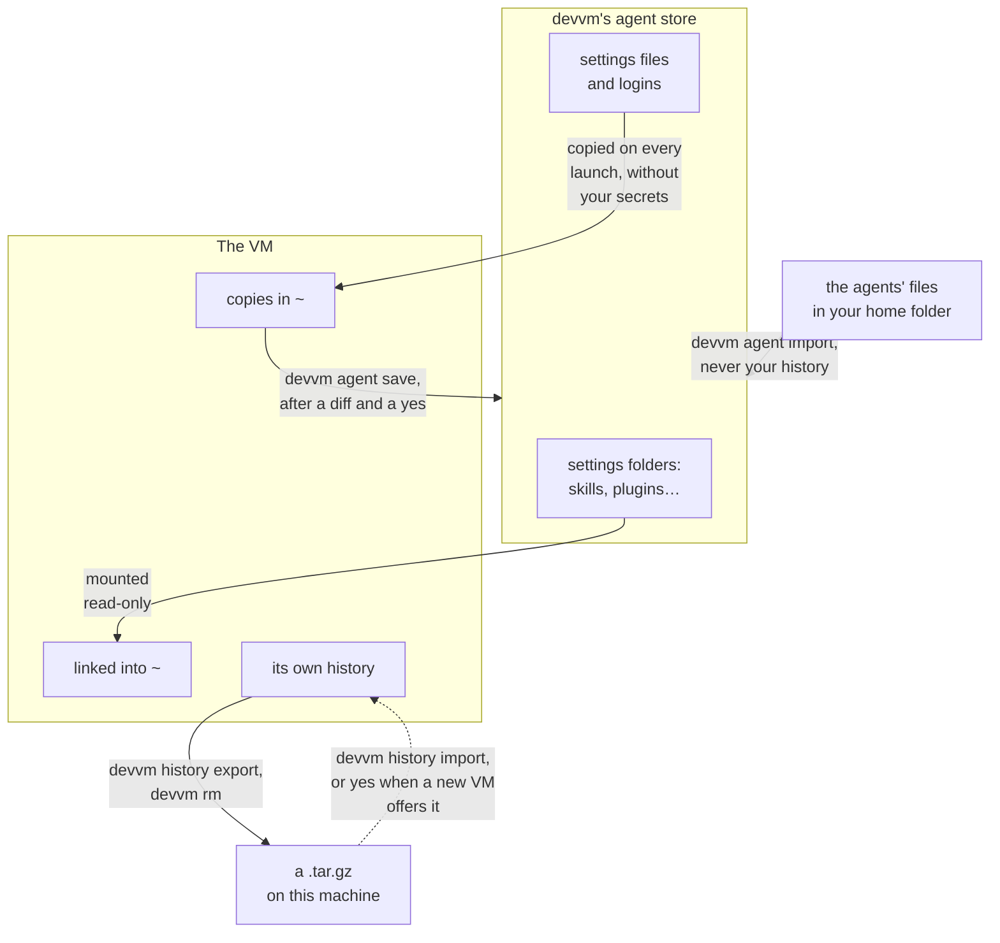

# Coding agents

## Running an agent

An agent runs where you start it, so you start it in the VM's shell, not on this machine. On this machine, devvm opens the VM's shell, and the VM's prompt starts with `(devvm)`:

```console
~/some-project $ devvm
(devvm) ~/some-project $ claude
```

In the VM the agent sees only your project folder, and your agents' settings from [devvm's agent store](#devvms-agent-store), which it gets read-only. Whatever it runs, such as a script a package installs, runs in the VM too. You don't install any agent on this machine, because devvm installs each one in the VMs that have it. How devvm gives each agent its settings, logins and history is in [how it works](../internals/agents.md).

### The guide in every VM

Every VM has a guide to devvm for the agents in it, at `/usr/share/doc/devvm/README.md`, and `devvm-help` in the VM prints it:

```sh
devvm-help   # in the VM: print the guide to devvm
```

It tells an agent what a devvm VM is, how its network tiers and secrets work, where its installs go, and which commands to ask you to run on this machine, such as `devvm network allow` for a blocked host or `devvm agent login` for a login. The guide is the same in every VM, so it says nothing about the VM's own tier, ports or layers, and nothing in the VM can change it for long ([the guide](../internals/agents.md#the-guide-in-every-vm)). Ask your agent to read it, or to run `devvm-help`, when it doesn't know where it's running. devvm adds nothing about it to the agents' instruction files.

## Supported agents

A new VM gets an agent when you choose it as you customize the VM, or when you name it with `--agents`. A VM that exists gets one from `devvm tools`, which shows the same list with the VM's agents already chosen, or from `devvm tools add`:

```sh
devvm                          # a new VM: customize it, then choose its agents in the list
devvm --agents claude,codex    # a new VM with Claude Code and Codex, without the list
devvm tools                    # the VM that exists: choose its agents in the list
devvm tools add opencode       # the VM that exists: add opencode without the list
```

In the VM, you run each agent by its name in the table, such as `claude`.

<!-- the agents' table, generated from internal/agents and the hosts in assets/shared-tools/<name>.policy by mise run cli-docs -->

| Name | Agent | What devvm adds | Allowlist, on the allowlist and none tiers |
| --- | --- | --- | --- |
| `claude` | Claude Code | the newest release, with its auto-update off, since the shared copy is read-only, and its telemetry off | Anthropic's API, Claude's login and Claude Code's downloads: `api.anthropic.com`, `claude.ai`, `downloads.claude.ai`, `platform.claude.com` and `mcp-proxy.anthropic.com` |
| `codex` | Codex | the newest release, with its analytics and metrics off unless your config sets them | the OpenAI API and the ChatGPT login: `api.openai.com`, `chatgpt.com` and `auth.openai.com` |
| `opencode` | opencode | the newest 2.x release, because opencode marks its 1.x releases as its latest on GitHub | opencode's own service and its model catalog: `opencode.ai` and `models.opencode.ai` |
| `pi` | [pi](https://pi.dev) | the newest release, with its check for a newer pi and its install report off, and `fd`, which pi finds files with, in base | pi's model catalog: `pi.dev` |
| `cursor` | [Cursor CLI](https://cursor.com/cli) | the release devvm pins, run as `cursor-agent` or `agent`, with its self-update off through its static channel | Cursor's API, its agent's hosts and its codebase indexing: `api2.cursor.sh`, `api5.cursor.sh`, `*.api5.cursor.sh` and `repo42.cursor.sh` |

<!-- end of the agents' table -->

- opencode and pi talk to the model provider you choose, so on the allowlist tier you allow that provider's API host yourself, such as `devvm network allow api.anthropic.com` ([changing rules](../safety/network.md#changing-rules)), unless devvm keeps the agent's login or API key for that provider, because the VM's proxy then allows its host.
- Claude Code's telemetry hosts aren't on its allowlist, because blocking them costs nothing. Every VM turns off each agent's self-update and telemetry with the agent's own variables, in every shell ([each agent's variables](../internals/agents.md#each-agents-variables)).
- pi's releases are built for glibc alone, so a VM made `--from` an Alpine-based container image can't have pi, and devvm refuses it there ([shared tools and glibc](from.md#shared-tools-and-glibc)). Every other agent runs on Alpine too.
- Agents are [shared tools](images.md#shared-tools), like the toolchains, so you can combine them with any layers and with each other, as in `devvm --tools node --agents claude,codex`. devvm follows each agent's newest release, because agents release several times a week, and `devvm update` or `devvm tools update` moves a VM to newer versions ([adding and removing tools](toolchains.md#adding-and-removing-tools)).

### Setup's default agents

`devvm setup` chooses the agents that the list checks for every new VM, and that a new VM gets without a terminal. devvm asks for them on its first run in a terminal and again in `devvm setup`'s questions, and `devvm setup --agents claude,codex` or `devvm setup --agents none` sets them without asking. They're a setting for new VMs only, so a VM that exists keeps its agents ([devvm setup](settings.md#devvm-setup)).

## devvm's agent store

devvm keeps the agents' settings and logins on this machine in a store of its own, and every VM with an agent gets that agent's settings and logins from there. devvm never reads the agents' own files in your home folder for a VM, such as `~/.claude`, `~/.claude.json`, `~/.codex`, `~/.config/opencode`, `~/.local/share/opencode` or `~/.pi/agent`, so a VM gets the same settings and logins whether or not this machine has the agent. The one command that reads those files is [`devvm agent import`](#importing-from-this-machine), which copies them into the store when you run it, and [`devvm agent save`](#saving-a-vms-settings) copies the settings you changed in a VM into the store.

The store has two folders for each agent, and each one holds the agent's files at the same paths below it as the agent keeps them in a home folder:

- **Settings** go in `~/.config/devvm/agents/<agent>/`, such as `~/.config/devvm/agents/claude/.claude/settings.json` and `~/.config/devvm/agents/claude/.claude/skills`. You can edit these files and make or delete these folders yourself, and a VM gets the change on its next launch, as [mounts](#mounts) and [copies](#copies) describe.
- **Logins** go in `~/.local/share/devvm/logins/<agent>/`, such as `~/.local/share/devvm/logins/codex/.codex/auth.json` and `~/.local/share/devvm/logins/claude/.claude.json`, and so does a login that you make inside a VM, such as Codex's ([Codex and opencode logins](#codex-and-opencode-logins)) or Claude Code's in `~/.local/share/devvm/logins/claude/.claude/.credentials.json` ([Claude Code login](#claude-code-login)). Only you can read them, because devvm makes each agent's logins folder yours alone (mode 700) and each login file mode 600. On macOS, devvm keeps each agent's logins folder out of Time Machine's backups.

Each VM gets its agents' settings and logins from the store, but never your history. Transcripts, sessions and databases aren't in the store, and each VM's own stay in that VM. Before you leave an agent running unattended, read [staying safe](../safety/index.md#the-habits) and [rogue agents](../safety/attack-vectors.md#rogue-agents).



Each row lists the agent's paths in the VM's home, and the store keeps each one at the same path below the agent's settings or logins folder:

| | Mounted read-only, linked into `~` | Copied in on every launch |
| --- | --- | --- |
| claude | `~/.claude/{skills,agents,commands,output-styles,plugins}` | `~/.claude/settings.json`, `~/.claude/CLAUDE.md`, and from the logins `~/.claude.json` ([merged](#copies), only its settings, account state and MCP servers) |
| codex | `~/.codex/{prompts,skills}` | `~/.codex/{config.toml,AGENTS.md}`, and from the logins `~/.codex/auth.json` |
| opencode | the subfolders of `~/.config/opencode` (not `node_modules`) | the files in `~/.config/opencode` (not lock files), and from the logins `~/.local/share/opencode/auth.json` |
| pi | `~/.pi/agent/{extensions,skills,prompts,themes}` | `~/.pi/agent/{settings.json,keybindings.json,models.json,mcp.json,AGENTS.md,SYSTEM.md,APPEND_SYSTEM.md}`, and from the logins `~/.pi/agent/auth.json` |

### Importing from this machine

When you already use an agent on this machine, `devvm agent import` copies its settings and logins from your home folder into the store, so your VMs get them. With no argument it imports every agent that your home folder has files of, and `devvm agent import claude codex` imports only the agents you name:

```sh
devvm agent import              # copy every agent's settings and logins into the store
devvm agent import codex        # copy only Codex's
devvm agent import --force      # replace what the store has without asking
```

devvm says which agents it imported and where, and an agent you named that your home folder has nothing of gets a warning. What the import copies and asks:

- The import copies only the paths in the table above, so it never copies your history or `~/.claude/.credentials.json` ([what it copies](../internals/agents.md#importing)). From `~/.claude.json` it keeps only the settings, account state and MCP servers, so your API key and your per-project entries stay out of the store.
- devvm reads each agent's settings inside the agent's own folder, such as `~/.claude`, and it never follows a link out of it. A link to a file inside the folder becomes a copy of that file, and a link that leads out of the folder, by a relative or an absolute path, or to a folder, is left out with a warning that names it. A login file that's a link is left out with a warning too. So when your settings live elsewhere, such as in a dotfiles repo with links into `~/.claude`, copy them into the store yourself.
- When the store already has settings or a login of an agent you import, devvm asks in a terminal whether to replace them, with no as the default. Without a terminal, or with `--no-input`, devvm refuses and names `--force`, which replaces them without asking. An agent whose settings aren't in your home folder keeps the store's settings, and one without a login there keeps the store's login.
- On macOS, Claude Code keeps its own login in the Keychain, and devvm neither reads it nor copies it. You log Claude Code in from a VM instead, with `devvm agent login claude`, and every VM with Claude Code gets that login ([Claude Code login](#claude-code-login)).
- When this machine's opencode is version 2 or later, devvm saves the API key of each provider, and your OpenAI login when you made it with one of opencode's Codex logins, the browser or the headless one. Any other login is left out with a warning that names it, such as opencode's Sign in with ChatGPT, whose tokens a VM can't use, or another provider's OAuth login, and you log in from a VM instead, with `devvm agent login opencode` ([logging in with devvm agent login](#logging-in-with-devvm-agent-login)). When `opencode auth export` fails, the import fails too, and the store keeps the login it had.

### Saving a VM's settings

When you change an agent's settings in a VM, for example by installing a plugin or writing a skill there, `devvm agent save` copies them into the store, so every VM with that agent gets them. With no argument it saves every agent that the folder's VM has, and `devvm agent save claude` saves only the agents you name. devvm starts a stopped VM for it. It reads only the settings, never the logins or your history, treats everything the VM sends as untrusted, and puts your secrets back where the VM's copies hold placeholders ([how](../internals/agents.md#saving-a-vms-settings)). It reads at most 128 MiB from the VM, in at most 20,000 files, folders and links, none of the files larger than 16 MiB, and when the VM sends more, or sends a path outside the agents' settings, devvm saves nothing.

```sh
devvm agent save          # show what changed in the VM's agents' settings, then save them
devvm agent save codex    # save only Codex's
```

Before it saves anything, devvm shows what would change:

- For each folder it lists the files it adds (A), changes (M) and removes (D), and then it shows a diff of each file it adds or changes against the store's copy, with a line when a file's mode changes.
- The diff shows the settings files and `~/.claude.json` as a VM gets them, written out again with `devvm-redacted` in place of the values that look like secrets, so it never prints your secrets, and it says so when only those values or the file's layout changed.
- Every character that a terminal wouldn't show, such as a control character, a zero-width character or a character that reverses the text, appears in the diff as its code, such as `\u{200b}`, so a VM can't hide a line from you.
- The diff names a binary file without showing it, and it shows a file of more than 1 MiB or 10,000 lines, and every line past the first 20,000 of the whole diff, only as a count.

Then devvm says that every VM with these agents runs the hooks, the MCP servers' commands and the plugins you save, and it asks whether to save them, with no as the default. Read the diff before you answer, because a hook or a plugin that a [rogue agent](../safety/attack-vectors.md#rogue-agents) added in one VM runs in every VM once you save it. devvm agent save always asks, and no flag answers for you, so without a terminal, or with `--no-input`, it shows what would change and then refuses. When a VM changed what's around a placeholder, devvm leaves that file out and warns you, so make that change in the store's file yourself.

## Mounts

devvm mounts the store's settings folders that exist when it creates the VM read-only, at the same path as in the store on this machine, and links them from the VM's home. This machine enforces read-only, so even root in the VM can't write to them ([links and paths in them](../internals/agents.md#mounts)).

- devvm mounts each folder whole, whatever the VM's network tier, so the VM reads every file in it, a `.env` or a key file in a plugin's folder included, and the git config of a private plugin marketplace whose URL holds a password. devvm takes no secrets out of these folders, because they hold plugins, skills and their scripts that the agent runs as they are. So keep secrets out of these folders, as you keep them out of the project folder ([why devvm mounts them whole](../internals/network.md#what-stays-in-the-vms-copies)).
- devvm doesn't mount a folder whose path has a comma, on any backend, and it warns you.

When you make or delete one of these folders in the store later, by hand or with `devvm agent import`, devvm notices on the VM's next launch and names the folder. A VM's mounts change only when it starts, so a stopped VM gets the new mounts as the launch starts it. For a running VM, devvm asks in a terminal whether to restart it now, which stops anything running in it, in the one question that covers every change waiting for the VM's next start, and because the mounts are among those changes, the default answer is yes ([restarting](vms.md#restarting-and-stopping)). If you answer no, or there's no terminal, or you pass `--no-input`, the mounts change when the VM next starts, for example with `devvm restart`:

```sh
devvm restart   # give a running VM the store's new folders now
```

## Copies

devvm copies the store's files into the VM's home on every launch, over the VM's own. On every [network tier](../safety/network.md#network-tiers), the copies of the logins and settings files have your secrets taken out, and the VM's proxy puts them into requests instead ([agents' logins and settings](../internals/network.md#agents-logins-and-settings)). devvm merges the store's `.claude.json` into the VM's own, so servers added in the VM stay, writes `devvm-redacted` in place of each secret in the settings files, names what it replaced in each file, and names each file it didn't copy ([what it takes out](../internals/agents.md#copies)).

### Claude Code login

You log Claude Code in once, from inside any VM that has it, and devvm keeps the login on this machine for every VM with Claude Code, so this machine never needs Claude Code:

```sh
devvm agent login claude                # log Claude Code in to your Claude subscription
devvm agent login claude --setup-token  # get a long-lived Claude Code token with claude setup-token instead
```

devvm starts the folder's VM first if it's stopped, as `devvm host` does, and then runs Claude Code's own login in the VM, on your terminal: `claude auth login --claudeai`, or `claude setup-token` with `--setup-token`. Claude Code shows an address, which you open in a browser on any machine. When you approve the login there, the browser shows a code, which you paste back at Claude Code's prompt, so devvm forwards no port. The VM uses the login at once, and every other VM with Claude Code gets it from its next launch ([how](../internals/agents.md#claude-codes-login)). When the login ends without a new login in the store, devvm says so and fails.

devvm keeps one Claude Code login, either your subscription's login or a Claude Code token, and the newest replaces the other, so every VM uses the account you logged in to last:

- **Your subscription's login**, from `devvm agent login claude` or a `claude /login` that you run in a VM yourself, goes in devvm's agent store, in `~/.local/share/devvm/logins/claude/.claude/.credentials.json`, only yours to read. The VM's `~/.claude/.credentials.json` holds placeholders, with no refresh token and an expiry in 2099, so Claude Code in the VM never refreshes the login itself. The VM's proxy puts the login into the VM's requests to `api.anthropic.com`, and refreshes it on this machine when it's due, through the company proxy when `config.toml` names one. devvm keeps only a login that can use Claude's models and can't make API keys, so a login to an Anthropic Console account, which Claude Code uses to make an API key, fails in a VM, and no API key reaches it. Only a VM that has Claude Code can log it in.
- **A Claude Code token**, from `devvm agent login claude --setup-token` or a `claude setup-token` that you run in a VM yourself, goes with the other [secrets](../safety/network.md#saving-and-binding-secrets). You can also save one with `devvm secret set claude` and paste the token that `claude setup-token` printed on another machine (`sk-ant-oat01-…`), not the code the browser shows. devvm neither saves nor sends a Claude Code token that isn't a setup token. Every VM with Claude Code gets the token in its environment as `CLAUDE_CODE_OAUTH_TOKEN`, holding a placeholder of its own, and its proxy puts the token into its requests. When you set up a token in a VM, `claude setup-token` prints that VM's placeholder, not the token, because devvm already saved it.

A `CLAUDE_CODE_OAUTH_TOKEN` in devvm's own environment on this machine wins over both, as it does in Claude Code, so VMs get that token, and `devvm agent login claude` warns you when it's set. Anthropic doesn't document the requests that Claude Code's login sends, so devvm follows the ones Claude Code sends today, and a new Claude Code release can change them. When a login in a VM stops working, run `devvm agent login claude` again, or save a Claude Code token instead.

### Codex and opencode logins

You log Codex and opencode in from inside a VM, with [`devvm agent login`](#logging-in-with-devvm-agent-login), and devvm keeps the login on this machine for every VM with that agent:

```sh
devvm agent login codex      # log Codex in to ChatGPT in a browser on this machine
devvm agent login opencode   # log opencode in with its Codex login, the same way
```

On every network tier, the VM's `auth.json` holds placeholders, and its proxy holds the real API keys and logins, so when the agent in the VM stops getting answers, the proxy's own log, `proxy.log` in `~/.local/share/devvm/vms/<hash>/logs/`, may say that refreshing a login failed or that you're no longer logged in that way. To log in again, run [`devvm agent login codex` or `devvm agent login opencode`](#logging-in-with-devvm-agent-login) in the VM's folder, which also gives that VM the new login's placeholders, and the other VMs get them on their next launch. Some logins stay on this machine, and devvm names each at every launch ([how](../internals/agents.md#codexs-and-opencodes-logins)):

- Codex's other logins, such as a personal access token or an Amazon Bedrock key, so to use Codex in a VM, log in with ChatGPT or an OpenAI API key ([logging in with devvm agent login](#logging-in-with-devvm-agent-login)).
- opencode's other entries, such as another provider's API key or an OAuth login, which the VM gets without its key or its tokens. To use an OAuth login's provider in the VM, log in to it with an API key on this machine and import the login again.
- Claude Code's account fields in `~/.claude.json` other than the ones it writes there today.

To give the VM one provider's API key as it is, such as a local model server's that the VM's proxy can't put in, list the provider under `opencode` in `config.toml`'s `[pass-keys]` table ([config.toml](settings.md#configtoml)), as you would for [pi](#pi-logins). The provider is its entry's name in opencode's `auth.json`, such as `ollama`. Every VM with opencode then gets that entry whole, its `metadata` included, and opencode 2 in the VM imports it into its database too, and devvm says so at each launch. It applies only to entries with an API key, because a VM never gets a login's tokens, and only to providers whose keys the proxy doesn't put in, because a key the proxy puts in is always its placeholder:

```toml
[pass-keys]
opencode = ["ollama"]
```

So when opencode in a VM can't reach a provider whose key works on this machine, such as a local model server's, and devvm's warning at launch names that provider, add it to `[pass-keys]` and run devvm in the folder again.

#### Logging in with devvm agent login

`devvm agent login` logs Codex or opencode in from inside this folder's VM, so this machine never needs either agent, and devvm's agent store keeps the login for every VM with that agent. Claude Code's login is `devvm agent login claude` ([Claude Code login](#claude-code-login)), and pi's is an API key alone ([pi logins](#pi-logins)):

```sh
devvm agent login codex                                    # log Codex in to ChatGPT in a browser on this machine
devvm agent login opencode --device-code                   # log opencode in with a code, in a browser on any machine
devvm agent login codex --api-key                          # save Codex's OpenAI API key, asking for it
devvm agent login codex --api-key --stdin < key.txt        # save it from a file or a pipe
devvm agent login opencode --api-key --provider anthropic  # save opencode's Anthropic API key
```

devvm starts the folder's VM first if it's stopped, as `devvm host` does, and the VM must have the agent, which `devvm tools add codex` gives it. Then devvm logs the agent in one of three ways:

- **In a browser on this machine**, by default: `codex login` for Codex, and `opencode auth login openai --method chatgpt-browser`, opencode's Codex browser login, for opencode. The agent shows an address, which you open in a browser on this machine, and devvm forwards this machine's `localhost:1455` to the VM while the login runs ([how](../internals/agents.md#logging-in)). When another program on this machine has port 1455, devvm refuses and names `--device-code`.
- **With `--device-code`**, the agent shows a code instead, which you type into a browser on any machine, and devvm forwards nothing. Codex's device code login is `codex login --device-auth`, which your ChatGPT account's security settings must allow, and opencode's is `opencode auth login openai --method chatgpt-headless`, its Codex device code login.
- **With `--api-key`**, devvm asks for the API key without showing it, or reads it from a line of input with `--stdin`, and saves it in the store itself, so the key never goes into the VM. Codex's key is an OpenAI key, and it replaces Codex's ChatGPT login in the store, as `codex login --with-api-key` does. opencode's key is for the provider that `--provider` names, by one of the IDs in [API keys the proxy puts in](#api-keys-the-proxy-puts-in), and the store keeps opencode's other providers beside it.

opencode's Anthropic login is an API key, because opencode itself has no other way to log in to Anthropic. opencode's Claude Agent provider uses Claude Code's own login instead, so it works in a VM that has Claude Code too, with the login that `devvm agent login claude` saves. When the agent logs in, the VM's proxy saves the login in the store, and the agent in the VM gets placeholders, as [the next section](#logins-made-in-a-vm) describes. devvm then says what the store saved and the account's email, and the VM uses the login at once. When the login ends without a new login in the store, for example because you chose another way to log in, devvm says so and fails, and `devvm network log` shows each login the proxy saved.

#### Logins made in a VM

A login that Codex or opencode makes in a VM, whether `devvm agent login` runs it or you run it yourself, is saved in devvm's store, and every VM with that agent gets it from its next launch. A login that shows a code to type into a browser works in a VM as it is, but opencode's Sign in with ChatGPT doesn't, so choose one of opencode's Codex logins instead, as `devvm agent login opencode` does ([how a VM's logins are saved](../internals/agents.md#logins-made-in-a-vm)). On the open tier, a program that goes around the VM's proxy gets the login's tokens itself, and devvm saves nothing ([logins made in a VM](../internals/network.md#logins-made-in-a-vm)).

### pi logins

pi in a VM uses API keys that devvm keeps on this machine, for the providers whose keys the VM's proxy puts in, which [API keys the proxy puts in](#api-keys-the-proxy-puts-in) lists. You save one with `devvm agent login pi --api-key --provider PROVIDER`, because pi's login always takes both flags, or you import the API keys in your own `~/.pi/agent/auth.json` with `devvm agent import pi`:

```sh
devvm agent login pi --api-key --provider anthropic   # save pi's Anthropic API key, asking for it
devvm agent import pi                                  # copy pi's settings and auth.json from this machine
```

- The login needs a VM with pi in this folder, which it gives its copy of the login at once, and every other VM with pi gets it at its next launch.
- The VM gets a placeholder in place of each key, and devvm keeps pi's other entries on this machine, such as a local model server's API key, a key that's a command for pi to run and a key that pi fills in from a variable, even for a provider whose key the proxy puts in, and warns you about each ([how](../internals/agents.md#pis-logins)).

To give the VM one provider's API key as it is, such as a local model server's that the VM's proxy can't put in, list the provider under `pi` in `config.toml`'s `[pass-keys]` table ([config.toml](settings.md#configtoml)). Every VM with pi then gets that entry whole, its `env` included, and devvm says so at each launch. It applies only to entries with an API key, because a VM never gets a login's tokens, and only to providers whose keys the proxy doesn't put in, because a key the proxy puts in is always its placeholder:

```toml
[pass-keys]
pi = ["ollama"]
```

pi's own logins with an account, which `/login` and `pi auth login` make for a subscription, such as Claude's, ChatGPT's or GitHub Copilot's, aren't among the logins devvm keeps, so save the provider's API key instead. Don't log pi in with an account inside a VM either, because the VM's proxy would save it as another agent's login or refuse it ([pi's logins](../internals/agents.md#pis-logins)).

#### pi's settings

Two of pi's settings act differently in a VM:

- The VM's copy of pi's `settings.json` leaves out three keys, because each would undo what devvm sets in the VM, and devvm names the ones it left out. `httpProxy` would send pi around the VM's proxy, `sessionDir` would keep pi's sessions outside `~/.pi/agent/sessions`, where history exports look for them, and `selfUpdateCommand` would run a command of the file's on `pi update`. When `devvm agent save pi` saves the VM's `settings.json`, its diff shows those keys as taken out, so save it only when you mean to drop them from the store's copy too.
- When the store's `settings.json` sets `defaultProjectTrust` to `always`, devvm warns you at each launch. That setting makes pi load a project folder's own `.pi` extensions, settings and MCP servers without asking, and they run in the VM with pi, so set it to `ask` in devvm's agent store unless you trust every project you open.

### Cursor CLI login

Cursor's CLI runs in the VM as `cursor-agent`, or `agent`, its other name. You log it in once, from inside any VM that has it, and devvm keeps the login on this machine for every VM with the CLI:

```sh
devvm agent login cursor
```

devvm starts the folder's VM first if it's stopped, as `devvm host` does, and then runs `cursor-agent login` in the VM, on your terminal, with `NO_OPEN_BROWSER=1`, so the CLI prints an address rather than opening a browser in the VM. You open that address in a browser on any machine and approve the login, and the CLI waits for it, so devvm forwards no port. The VM's proxy saves the login as Cursor's API hands it to the CLI, in `~/.local/share/devvm/logins/cursor/.config/cursor/auth.json`, only yours to read, and the CLI in the VM gets placeholders. A `cursor-agent login` that you run in a VM yourself is saved in the same way, and every VM with the CLI gets the login from its next launch.

- Cursor's CLI never refreshes a login, so devvm doesn't either. When the login expires, the proxy puts nothing in, and its own log says to log in again with `devvm agent login cursor`. devvm doesn't keep a Cursor API key, so `devvm agent login cursor` takes neither `--api-key` nor `--device-code`.
- `devvm agent import cursor` copies the CLI's settings from `~/.cursor` on this machine, which are `cli-config.json`, `mcp.json` and the `rules` and `commands` folders. On Linux it copies the CLI's login from `~/.config/cursor/auth.json` too. On macOS the CLI keeps its login in the Keychain, which devvm doesn't read, so log in from a VM instead.
- The CLI would update itself in the VM, but every VM sets its channel to `static` in `~/.cursor/cli-config.json` at each launch, which the CLI never updates on, so it stays the release that devvm pins. Cursor's CLI has no setting that turns off its reports to Cursor, so its allowlist leaves out its metrics host, and the reports it sends to Cursor's API go with the rest.
- In a VM, Cursor's CLI can't install, update or remove plugins and marketplaces, change automations or cloud agents' environments, or start a cloud agent, because each of those changes your Cursor account in a way that outlasts the VM and acts outside it. Do them from Cursor on your machine. Cursor's agent store isn't available in a VM either, so use it from Cursor on your machine. The CLI in a VM keeps its own chats without the store. Checking Amazon Bedrock keys doesn't work in a VM either, as devvm doesn't keep them.
- The VM's proxy puts the real login only into the requests that the CLI's own methods make, and cuts a reply off where a token starts, but a token in a shape devvm doesn't know could still reach the VM, so if you suspect that one did, log in again with `devvm agent login cursor` ([how](../internals/agents.md#cursors-cli)).

### API keys the proxy puts in

The VM's proxy puts in opencode's and pi's API keys for the providers in this table. The ID is the provider's entry in the agent's `auth.json` and the value that `devvm agent login --provider` takes. The VM's copy of the login holds a placeholder in place of each of these keys, and on every network tier the proxy swaps it for the key in the headers that the table names, in requests to the provider's hosts alone, so any other host gets only the placeholder. Where the table names a path, the proxy swaps it only in requests for paths that start with it, so the rest of that host gets the placeholder too. The proxy also allows those hosts on port 443, as it allows the hosts of every secret it puts in, so you don't allow them yourself:

| ID | Provider | Hosts | Paths | Headers |
| --- | --- | --- | --- | --- |
| `anthropic` | Anthropic | `api.anthropic.com` | any | `x-api-key` |
| `deepseek` | DeepSeek | `api.deepseek.com` | any | `Authorization` |
| `google` | Google Gemini | `generativelanguage.googleapis.com` | any | `x-goog-api-key` |
| `groq` | Groq | `api.groq.com` | any | `Authorization` |
| `mistral` | Mistral | `api.mistral.ai` | any | `Authorization` |
| `openai` | OpenAI | `api.openai.com` | any | `Authorization` |
| `openrouter` | OpenRouter | `openrouter.ai` | `/api/` | `Authorization`, `x-api-key` |
| `xai` | xAI | `api.x.ai` | any | `Authorization` |

The Google Gemini key is the Gemini API's, for Google AI Studio. Vertex AI logs in with a Google Cloud account or a service account instead, so devvm withholds its logins, as it does any other provider's. These providers' keys never need `[pass-keys]`, and when it lists one of them all the same, the VM still gets the key's placeholder, not the key, and devvm notes at each launch that you can take the provider out. With some of these keys, code in the VM can make a credential of its own that works without the proxy, or reach hosts that the allowlist doesn't have through the provider's own tools ([how the proxy puts them in](../internals/agents.md#api-keys)).

> [!WARNING]
> A VM that was given one of these keys as it was, before the launch that first gave it the placeholder, may still hold copies of it, and those copies still work wherever they are. So when you don't trust that VM, make a new key at the provider, save it with `devvm agent login AGENT --api-key --provider PROVIDER` and revoke the old one.

```sh
devvm agent login opencode --api-key --provider openai   # save the new key, then revoke the old one at the provider
```

## Pasting images

An agent in the VM can't see this machine's clipboard, so an image you copied, such as a screenshot, gets to it through devvm paste, which sends the image into the VM and copies its path there for you to paste:

1. Copy an image on this machine, such as a screenshot, copy pages in a PDF viewer such as Preview, or copy a file in Finder or your file manager.
2. In a terminal on this machine, run `devvm paste` in the project folder. devvm says where the image is in the VM, such as `/tmp/devvm-paste/paste-20261109-153012-7f3a9c01.png`, and puts that path on your clipboard. If putting it there fails, devvm warns you and still says where the image is, so you can paste that path yourself.
3. Paste the path into the agent with your terminal's paste shortcut, which is Cmd+V on macOS and usually Ctrl+Shift+V on Linux. Ctrl+V on its own asks the agent to read the VM's clipboard, and the VM has none. Claude Code, Codex and opencode attach an image whose path you paste, and pi reads it with its `read` tool.

The VM must be running, because devvm paste is for an agent that runs in it, and devvm refuses a stopped one.

```sh
devvm paste               # send what you copied, asking first about a copied file
devvm paste --send-file   # send a file in the project folder without asking, as a script must
devvm paste --json        # the same, and print what it sent
devvm paste rm            # delete the files devvm paste left in the VM, after asking
```

### What devvm paste sends

devvm reads only an image, a PDF or a copied file's reference from the clipboard, never text, so a password you copied never reaches it:

- **An image**: PNG, JPEG, GIF or WebP, and on macOS also a TIFF, which many Mac apps copy, sent as a PNG.
- **A PDF**, such as pages you copied in Preview, sent as it is, as a `.pdf` file, because most models read PDFs.
- **One copied file**, after devvm asks you about it.
- **Nothing over 64 MiB**, whether it's an image, a PDF or a file.

devvm checks that an image's or a PDF's bytes are the type the clipboard claims ([how](../internals/design.md#pasting-images)). Text is never sent, so paste text, such as an error message, into the agent's terminal yourself. The app you copied from hands over what you copied when devvm asks for it, and devvm waits for it at most 30 seconds, then stops waiting, sends nothing and says so, so copy it again, or wait until the app responds, then run devvm paste again. On macOS, devvm reads the clipboard of the session you're logged in to, so run devvm paste in a terminal on that Mac, not over ssh.

What devvm gets depends on the app you copied from:

- **A browser's Copy Image** hands over a PNG, never the original JPEG, GIF or WebP, and Safari hands over a TIFF, which devvm makes a PNG, so an animated GIF arrives as one still frame. To send the original, save it and copy the saved file instead.
- **A PDF viewer** puts a picture of what you copied beside the PDF, and devvm sends the PDF, never the picture. When you copy a page's thumbnail in Preview, Preview also puts a temporary file of its own on the clipboard, and devvm sends the PDF without asking about that file.
- **Finder**, on macOS, puts the copied file's icon on the clipboard as an image beside the file, and devvm sends the file, not the icon. If the file is gone by the time you run devvm paste, devvm says so and sends nothing, rather than the icon. Text is never taken for a file, even when it's a path, so copy the file itself in Finder.
- **Photos** puts a file of the Photos library beside a photo you copy, so devvm asks about that file, as it does about any copied file.

### Copied files

Before devvm sends a copied file, it shows the file's path on this machine and asks, [y/N], because the clipboard can name any file of yours, such as a key in `~/.ssh` that you didn't mean to copy. Answer no and nothing is sent. An image or a PDF is sent without a question, because it's only what you copied. devvm sends a copied file under a name of its own that keeps only the file's extension, when it's letters and digits alone and at most 16 of them, so `my shot (1).png` becomes `paste-20261109-153012-7f3a9c01.png`, and `Makefile` becomes `paste-20261109-153012-7f3a9c01` ([why](../internals/design.md#pasting-images)).

It sends one file at a time, and it refuses:

- several files;
- a folder;
- a file with a symbolic link anywhere in its path, your own included, because a link the VM planted in the project folder could point at a file of yours. The only links devvm follows are the system's own, which root owns, such as macOS's `/tmp`, so copy the file from the folder it's really in.

`devvm paste --send-file` answers the question for a file in the project folder, which it sends without asking, as a script must, because the VM can read that folder already. It doesn't answer for the rest:

- **A file anywhere else** is still asked about, so only you can send it, at a terminal.
- **A file whose path goes through a symbolic link** is asked about too, even through one of the system's that devvm follows, because the file may not be where its path says.
- **A clone VM's files**, because a clone VM, made with `--clone`, doesn't mount the folder.

Where devvm can't ask, such as without a terminal, it sends nothing, and it names `--send-file` for a file in the folder, the file and the folder for one outside it, and the file for one reached through a link. So don't bind `devvm paste --send-file` to a hotkey to send files from outside the project, because a hotkey has no terminal to ask in, and devvm refuses those files.

### devvm paste --json

`devvm paste --json` does the same and prints what it sent as one object, with `"version": 1` first. It has whether anything was `sent`, which is `false` when you answered no about a file, the VM, and the file's `path` in it (`""` when nothing was sent). Then its `kind` (`image`, `pdf` or `file`), an image's or a PDF's `type` (`image/png`, `image/jpeg`, `image/gif`, `image/webp` or `application/pdf`, and `""` for a file), and a copied file's `source`, its path on this machine (`""` otherwise). Last come its size in `bytes`, and whether the path was `copied` to the clipboard:

```json
{"version": 1, "sent": true, "vm": "devvm-website-3f9a1c2b4d5e6f", "path": "/tmp/devvm-paste/paste-20261109-153012-7f3a9c01.png", "kind": "image", "type": "image/png", "source": "", "bytes": 48213, "copied": true}
```

### The paste folder and your agent's settings

The files go into the VM's paste folder, `/tmp/devvm-paste` unless `config.toml`'s `paste-dir` names another ([the paste folder](settings.md#the-paste-folder)), and they keep their mode, 600, so only the VM's user reads them. The folder is a fixed path so that you can allow it once in an agent's settings. Claude Code refuses to read a path outside the project folder when its `permissions.blockReadsOutsideWorkingDirectories` setting is on, until you add the folder in Claude Code:

```text
/add-dir /tmp/devvm-paste
```

Or list it in `permissions.additionalDirectories` in your settings, which [devvm's agent store](#devvms-agent-store) keeps for every VM, in `~/.config/devvm/agents/claude/.claude/settings.json`:

```json
{ "permissions": { "additionalDirectories": ["/tmp/devvm-paste"] } }
```

Anything in the VM can read what you send, as it can read any file in the project folder, so paste nothing you wouldn't put in the folder.

### Deleting pasted files

```sh
devvm paste rm            # delete the files devvm paste left in the folder, after asking in a terminal
devvm paste rm --force    # delete them without asking, as a script must
```

devvm never deletes a pasted file on its own, because Codex reads the image when you submit your message and pi when the model calls `read`, which may be some time after the paste. devvm paste rm deletes only the files devvm paste named, and nothing else in the folder, so a `paste-dir` of your own, such as `/home/USER/pastes` where `USER` is your user in the VM, can hold other files. The VM's `/tmp` is emptied when the VM boots, so with the default folder the files are gone after a restart anyway. With a `paste-dir` of your own, they stay, and a command that starts a stopped VM and opens its shell offers to delete them, [y/N], once the VM is set up. Those commands are:

- `devvm` and `devvm restart`;
- `devvm tools`, `devvm tools add`, `devvm tools rm` and `devvm tools update`;
- `devvm layer add` and `devvm layer rm`;
- `devvm update`;
- `devvm clone on` and `devvm clone off`.

Without a terminal, devvm keeps the files and says nothing, and if deleting them fails, it warns you and opens the shell anyway. Commands that start a VM without opening its shell, such as `devvm code` and `devvm agent save`, don't ask, so run `devvm paste rm` when you want the files gone.

### On Linux

devvm reads and writes the clipboard with `wl-paste` and `wl-copy` in a Wayland session, which `WAYLAND_DISPLAY` names, and with `xclip` in an X11 session, which `DISPLAY` names. It tells you which one is missing, and installs nothing itself, so install `wl-clipboard` or `xclip` with your distribution's package manager:

```sh
sudo apt install wl-clipboard   # or xclip for X11; dnf, pacman and zypper have both
```

devvm looks for them only in the system's folders, never elsewhere on your `PATH` ([which folders, and why](../internals/design.md#pasting-images)). Run devvm paste from a terminal in your desktop session, because without either variable there's no clipboard to read. If `WAYLAND_DISPLAY` or `DISPLAY` names a session that's over, as in a tmux window left from an earlier login, devvm tells you that `wl-paste` or `xclip` failed and what it said, rather than that the clipboard is empty. Copying the path leaves `wl-copy` or `xclip` running until you copy something else, because a Linux clipboard's contents live in the program that copied them.

## History

Each VM's transcripts and sessions stay in that VM. `devvm history export [FILE]` saves them, and `devvm rm` saves them before it deletes a VM that has an agent. The export is a `.tar.gz` of the agents' history in the VM, <!-- the agents' history, generated from internal/agents by mise run cli-docs -->`~/.claude`, `~/.claude.json`, `~/.codex`, `~/.local/share/opencode`, `~/.local/state/opencode`, `~/.pi/agent/sessions` and `~/.cursor/chats`<!-- end of the agents' history -->, written to FILE or to `~/.local/share/devvm/exports/<vm>-<date>-<time>.tar.gz`. An export in that folder gets a `<vm>-<date>-<time>.folder` file beside it, which names the VM's project folder and the VM's [network tier](../safety/network.md#network-tiers) when devvm wrote the export. The agents' logins are never in an export, and an export holds at most 2 GiB ([what an export holds](../internals/agents.md#history-exports)). The commands:

```sh
devvm history                       # list the exports devvm saved
devvm history export                # save this folder's VM's agents' history
devvm history export ~/backup.tgz   # or save it to a file of your own
devvm history import                # put this folder's newest export into its VM
```

`devvm history` lists the exports in `~/.local/share/devvm/exports`, oldest first, in a table with a header. It shows each export's file, the VM it's of, that VM's folder, the date and time devvm wrote it, and its size, with `-` for a folder devvm has no record of. Exports you wrote to a FILE of your own aren't listed, and `devvm history` changes nothing and starts no VM.

### devvm history --json

`devvm history --json` prints the same list as one JSON object, as [output for scripts](command-line.md#output-for-scripts) describes. Each of the `exports` has its `file`, its `vm`, the VM's `folder`, which is `""` when devvm has no record of it, the `date` devvm wrote it in RFC 3339 with this machine's time zone, and its `size` in bytes.

```json
{
  "version": 1,
  "exports": [
    {
      "file": "/Users/you/.local/share/devvm/exports/devvm-website-71a99b1076d92c-20261001-120000.tar.gz",
      "vm": "devvm-website-71a99b1076d92c",
      "folder": "/Users/you/code/website",
      "date": "2026-10-01T12:00:00+02:00",
      "size": 1048576
    }
  ]
}
```

### Deleting exports

After `devvm rm`, an export is the only copy of that VM's history, so devvm keeps the exports until you ask it to delete them. `devvm gc --history` also deletes the exports in that folder, and `devvm gc --history --older-than 30d` deletes only those written 30 days ago or more. An export's age counts from the date and time in its name, which is this machine's local time when devvm wrote it, so across a change to or from daylight saving time an export reaches an age such as `30d` an hour earlier or later, for `--older-than` and for the `history.age` [retention setting](settings.md#retention) alike. gc lists each one by its VM and date first, and in a terminal it asks. Exports you wrote to a FILE of your own stay where they are. To delete only the older ones:

```sh
devvm gc --history --older-than 30d   # also delete the exports written 30 days ago or more, after asking
```

### Importing history

```sh
devvm history import                    # put this folder's newest export into its VM
devvm history import ~/backup.tar.gz    # or an export of your own
```

`devvm history import [FILE]` puts an export back into this folder's VM, so the agents' transcripts and sessions carry over when you delete a VM and make it again. Without FILE, it imports the newest export in `~/.local/share/devvm/exports` that devvm saved for this folder, going by the `.folder` file beside each one, and it never picks an export made for another folder. With FILE, it imports that `.tar.gz`, such as one you saved with `devvm history export FILE`. devvm starts a stopped VM for the import, as it does for an export, and the import works on every VM, whatever its base ([how](../internals/agents.md#importing-history)):

- When devvm makes a new VM that has an agent, and it saved an export for the same folder before, it offers that export. In a terminal it asks whether to import it into the new VM, with no as the default. Without a terminal, or with `--no-input`, it doesn't ask, and it says which export it found and that `devvm history import` in the folder puts it into the VM. devvm imports the export once the VM has started and before its setup, and if the import fails, devvm warns and makes the VM anyway, so you can run `devvm history import` later.
- An export holds what a VM wrote, so devvm treats it as untrusted, and when it comes from a VM on a less strict tier than the VM you import it into, devvm warns you before it imports. It treats an export with no tier recorded, or a FILE elsewhere, as if it came from an open VM. When an export holds a path outside the agents' history folders, devvm imports nothing.
- The import leaves out what devvm puts in the VM itself. That's the agents' logins, `~/.claude/.credentials.json`, `~/.codex/auth.json`, and opencode's `auth.json`, `account.json`, `mcp-auth.json` and `bin`. It's also `~/.claude.json`, whose copy in the old VM held that VM's own placeholders, and every agent's [mounted folders and copied files](#devvms-agent-store), which the new VM's setup links and copies from devvm's agent store.
- A file or folder the VM already has stays as it is, so importing into a VM that has history of its own adds the export's files without replacing any of its own.

## The VM's setup

Besides the agents' config, every launch sets the VM up from this machine's settings:

- its hostname, which is the folder's part of the VM's name;
- the timezone (`TZ`, else this machine's) and, when it's UTF-8, the locale (`LC_ALL`, else `LANG`);
- git's `user.name` and `user.email`, as git has them in the project folder;
- telemetry off where an environment variable can't turn it off, which is Go's, and Codex's analytics and metrics;
- every agent's environment variables, which turn off its self-update and its telemetry ([supported agents](#supported-agents));
- every toolchain's environment variables, such as the ones that turn off .NET's telemetry and send `npm i -g` into your home, and the folders where the toolchains' global installs go, on the `PATH` ([toolchains](toolchains.md));
- `(devvm)` at the start of the prompt.

On every network tier, the launch also installs the VM's own CA and the next one, points apt, sudo, ssh, the [docker layer](images.md#docker)'s Docker and the [nix layer](images.md#nix)'s Nix at the proxy, and adds `devvm-why`, which shows what the proxy blocked lately. It also tells the agents, in `~/.claude/CLAUDE.md` and `~/.codex/AGENTS.md`, why a request may fail ([inside the VM](../safety/network.md#inside-the-vm)). The VM's secrets go in `~/.config/devvm/env` in the VM, which login shells read, and that file holds their placeholders.

