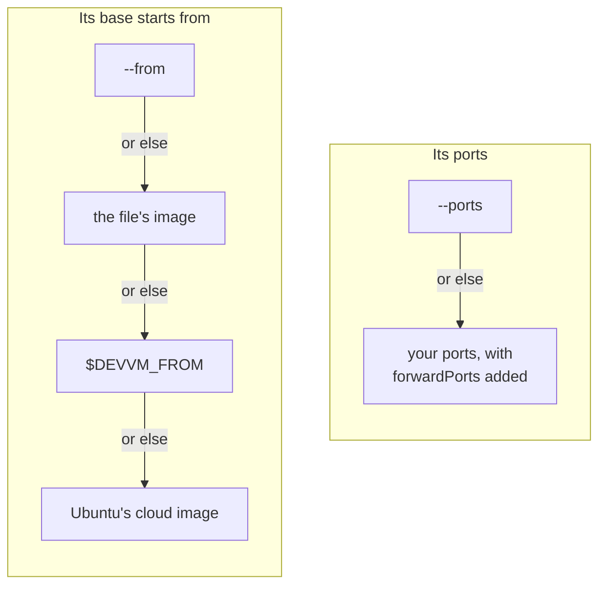

# devcontainer.json

devvm supports the [Dev Container specification](https://containers.dev/), so a project's `devcontainer.json` sets up its VM. When you run devvm in a folder with a `.devcontainer/devcontainer.json`, or else a `.devcontainer.json` at the folder's root, the new VM gets that file's settings by default, as far as devvm supports them. To make the VM without reading the file, run `devvm --no-devcontainer`.

The settings devvm supports are the container image to start from, the features devvm has layers for, the ports, the environment and the commands. devvm says in one line which file it read.

```jsonc
{
  "image": "mcr.microsoft.com/devcontainers/javascript-node:22",
  "features": { "ghcr.io/devcontainers/features/docker-in-docker:2": {} },
  "forwardPorts": [3000],
  "remoteEnv": { "PATH": "${containerEnv:PATH}:${containerWorkspaceFolder}/bin" },
  "postCreateCommand": "npm ci",
  "postStartCommand": "npm run db:start"
}
```

## When it's read

- **When the folder's VM is made, and again by `devvm update`.** Comments and trailing commas are allowed. devvm reads the file only within the folder, so it doesn't follow a link out of the folder, and it reads only a regular file of up to 1 MiB. devvm never writes anything to the project folder.
- **What you give on the command line wins.** `--from` wins over `image`, which wins over `$DEVVM_FROM`, and `--ports` wins over `forwardPorts`, and devvm says so in one line for each. The new VM gets the toolchains and layers that the features map to, which its summary shows, and when you customize the VM, they're already chosen in its list, each row naming the file, so you can leave them out there. `--tools` and `--layers` replace them, as they replace any part's default ([what a new VM gets](images.md#what-a-new-vm-gets)).
- **An existing VM changes only when devvm makes it again.** Its state records the file's SHA-256. When the file differs from it on a launch, or is gone, or has appeared since, devvm warns once and names `devvm update`. devvm doesn't check a VM made with `--no-devcontainer`, and `devvm update` doesn't read the file for it.

A new VM takes each of these from the first place that sets it.



When devvm refuses something in the file, it stops with one line that names the file, before it makes anything. For invalid JSON, it names the line and column.

## Updating a VM from the file

When you change the file, run `devvm update`. devvm reads the file as it is now, and before it changes anything, it refuses what it would refuse for a new VM. Then it asks to make the VM again from the file, keeping its home folder, the project folder and its settings, as for an [outdated VM](images.md#outdated-vms), and everything else on the VM's disk is lost. `devvm update --force` doesn't ask, and without a terminal devvm refuses unless you give `--force`.

devvm replaces only what the file gave the VM, and it keeps what you chose:

- **Toolchains and layers.** The ones the file's features gave the VM go when the file no longer has those features, and the ones the file's new features map to are added. The ones you chose yourself stay, whether you gave them with `--tools` or `--layers`, `devvm setup` chose them, or the folder's other files call for them. One you left out in the list, or took out later, stays out.
- **The container image.** The VM's base starts from the file's new `image`, pinned as for a new VM. When the file no longer has one, the base starts from `$DEVVM_FROM`, or else from Ubuntu's cloud image. A VM made with `--from` keeps its base, and devvm says that it ignores `image`.
- **The ports.** The ports the file added go when the file no longer lists them, and the ones it lists anew are added, as `devvm ports add` adds them. The ports you added with `devvm ports add` stay, and one of the file's that you took out with `devvm ports rm` stays out. A VM made with `--ports` gets the ports the file lists anew, but not the ones `--ports` won over.
- **The environment and the commands.** They're the file's new ones, and the commands that run once run again on the new disk.

When the file is gone, devvm makes the VM again without it, so what the file gave goes, and so do its environment and commands. When a file appears for a VM made without one, devvm makes the VM again as the file says, as it would a new VM.

## Properties

| Property | What devvm does |
| --- | --- |
| `image` | The VM's base starts from it, as with [`--from`](from.md). devvm uses only an image that its registry gives anyone who asks anonymously, pinned to that digest. It never uses an image only Docker has, one only your registry login reaches, or one on this machine or its network, which is `localhost` or a registry whose address is loopback, private or link-local, by name or as it resolves. |
| `features` | `ghcr.io/devcontainers/features/docker-in-docker` is devvm's [docker layer](images.md#built-in-layers). A feature under `ghcr.io/devcontainers/features/` named after one of devvm's [toolchains](toolchains.md), such as `ghcr.io/devcontainers/features/node`, is that shared toolchain. devvm ignores their options and says so in one line. It refuses `docker-outside-of-docker`, which is this machine's Docker, and every other feature. devvm never fetches or runs a feature's script. |
| `forwardPorts` | devvm forwards numbers, `localhost:N` and `127.0.0.1:N` to this machine's `localhost` alone, adding them to your ports as `devvm ports add` does ([ports](ports-size.md#ports)). With every port forwarded, which is the default, they're among them already. `devvm ports rm` takes one out, as for any port. It ignores other hosts' ports and says so in one line. |
| `containerEnv`, `remoteEnv` | The VM's environment, which login shells and the commands below get. `remoteEnv` wins over `containerEnv`, and devvm's own variables, such as `LANG` and secrets, win over both. A `remoteEnv` of `null` sets nothing. |
| `onCreateCommand`, `updateContentCommand`, `postCreateCommand` | They run once, in that order, once the VM is made and set up ([commands](#commands)). |
| `postStartCommand` | It runs at each start, on the first launch after the VM started. |
| `initializeCommand` | It never runs, because it would run on this machine, and devvm says so in one line. |
| `build`, `dockerFile`, `dockerfile`, `dockerComposeFile` | Refused, because devvm starts a VM only from an image. |
| `postAttachCommand`, `privileged`, `capAdd`, `securityOpt`, `mounts`, `runArgs`, `workspaceMount`, `workspaceFolder`, `remoteUser`, `containerUser`, `updateRemoteUserUID`, `init`, `shutdownAction`, `overrideCommand`, `hostRequirements`, `appPort`, `portsAttributes`, `otherPortsAttributes`, `userEnvProbe`, `waitFor`, `overrideFeatureInstallOrder`, `context`, `service`, `runServices` | Ignored, and named in one line. |
| `name`, `customizations`, `$schema` | Ignored. |
| anything else | Ignored, and named in one line. |

## Commands

A command is a string, which devvm runs with `sh -c`, an array, which it runs as it is, or an object of named commands, which it runs one by one, sorted by name. The commands run in the VM, as its user, in the project folder, in a login shell, and never on this machine. Their output goes to the [run log](troubleshooting.md#a-command-fails).

When a command fails, devvm names it in one line, and the commands after it that would run once, or at that start, don't run. devvm keeps the VM and opens it, because the command is the project's and not devvm's. The commands reach only what the VM's [network tier](../safety/network.md#network-tiers) allows, like anything else in the VM.

## Variables

| Variable | |
| --- | --- |
| `${containerWorkspaceFolder}`, `${containerWorkspaceFolderBasename}` | the project folder, at the same path in the VM, and its name |
| `${containerEnv:NAME}` | in a string command and in `containerEnv` and `remoteEnv`, the VM's own `NAME` |
| `${localEnv:NAME}`, `${env:NAME}` | refused, because devvm never puts this machine's environment in a VM |
| `${localWorkspaceFolder}`, `${localWorkspaceFolderBasename}`, `${devcontainerId}`, `${containerEnv:NAME}` elsewhere | refused |

devvm leaves any other `${…}` as it is, for the VM's shell, such as `${HOME}` in a command.

## Security

The file belongs to the project, so a VM can rewrite it for the folder's next VM, or for itself when you run `devvm update`, and devvm never lets it run anything on this machine, reach this machine's files or environment, add a mount or weaken confinement. An `image` from it can still be any public container image, whose own code runs as root while devvm builds the VM's base, as with `--from` ([security model](../internals/security.md#a-projects-devcontainerjson)).

Its `forwardPorts` open ports on this machine, even when you've narrowed your ports with `devvm ports -g` or `devvm ports`. devvm forwards them only to this machine's `localhost`, never to its other addresses, and never takes a port that a program on this machine already has, just as for `devvm ports add`. Anything on this machine that connects to such a port reaches what the VM serves there, including a web page in your browser, so for a repo you don't trust, check its file first, or run `devvm --ports none` or `devvm --no-devcontainer` ([ports the VM listens on](../safety/attack-vectors.md#network)).

