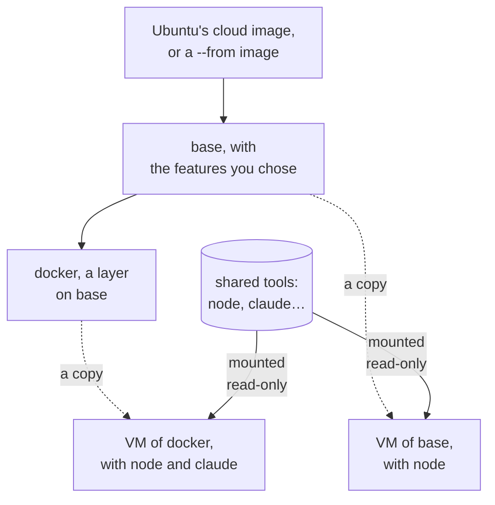
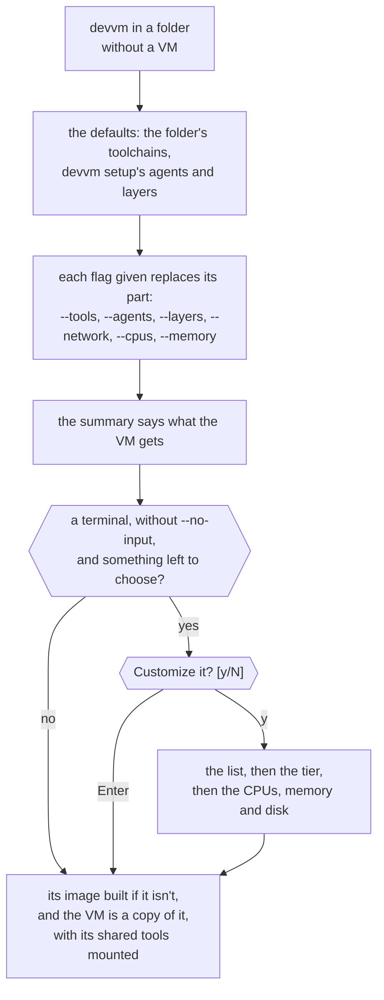

# Images and tools

Every VM is a copy of an image. An image is `base` with your choice of layers on it, and nothing else. A VM also gets the shared tools you chose for it, such as node or Claude Code, which are mounted into it and are never part of an image. This page covers what base and the layers bring, adding layers to a VM, how the shared tools work, what a new VM gets, and how to rebuild, list and delete images. [Images and caching](../internals/images.md) explains how devvm builds, pins and caches them, and [toolchains](toolchains.md) and [coding agents](coding-agents.md#supported-agents) list the shared tools.



## Base

`base` is the image that every other image is built on. It is Ubuntu 26.04's cloud image with git, build-essential, ripgrep, jq, sqlite3 and mise added, followed by the optional [features](customizing.md#base-image-features) you chose, such as oh-my-bash and fzf. Docker comes as a [layer of devvm's](#built-in-layers), so you choose it when you customize a new VM, or give `devvm --layers docker`. With `--from`, base starts from a container image instead of Ubuntu's ([details](from.md)).

A VM made from base gets 4 CPUs, 8 GiB of memory and a 100 GiB disk unless you give it another size, and on a small machine it gets fewer CPUs and less memory ([size and ports](ports-size.md#size-and-ports)).

base drops the server extras that Ubuntu's cloud image comes with, which are snapd, multipath, ModemManager, udisks, firmware updates, crash reporting, tracing tools, kernel headers, and apt's background updates and upgrades. That saves 0.9 GB of disk and 100 MB of memory per VM. The everyday tools stay, such as htop, tmux, lsof, strace, tcpdump, rsync and nano.

The first time devvm builds base on this machine, it starts from the newest release of Ubuntu's cloud image and installs the newest packages from Ubuntu's archive, or first from a [mirror you set](settings.md#an-ubuntu-mirror). devvm keeps a copy of each package it installed, so building the same base again, such as after `devvm images rm base`, installs exactly those packages from the copies, with no network for them. `devvm rebuild base` starts again from the newest image and packages. Your VMs use Ubuntu's live archive, and base keeps no package lists, so run `sudo apt update` in a VM before you install a package, and `apt upgrade` then gets the current updates.

## Layers

An image is base with layers on it, named bottom first and joined with `+`, so `foo+bar` is `bar` on `foo` on `base`. You can leave `base` itself out, which makes `base+foo` the same as `foo`. An image name never holds [shared tools](#shared-tools), which aren't layers, so `devvm build`, `devvm rebuild` and `devvm images rm` refuse a shared tool's name, such as `node`, and point you to `devvm tools`.

A layer is a script that bash runs in the image's VM as the VM's user, who has sudo. It is either one of devvm's [built-in layers](#built-in-layers) or one of yours, at `~/.config/devvm/layers/<name>.sh`. A layer's name is made of lowercase letters, digits and dashes, starts with a letter or digit, and is neither `base`, a built-in layer's name nor a shared tool's name. devvm refuses any other name in an image, and it refuses a layer whose script is missing. `devvm layer new NAME` starts a layer of your own ([details](customizing.md#your-own-layers)).

```sh
devvm build foo+bar   # builds base, foo and foo+bar, unless they're built
devvm rebuild foo     # builds foo again, and deletes the old foo and foo+bar
```

### Built-in layers

devvm ships three layers, `desktop`, `docker` and `nix`. You choose them like any other layer, in the list devvm shows for a new VM or as in `devvm --layers docker`, and you build one with `devvm build nix`. To give every new VM one, choose it with [`devvm setup --layers`](settings.md#layers-for-new-vms), and to give a VM you have one, run `devvm layer add` ([adding layers to a VM](#adding-layers-to-a-vm)). Their names are reserved, so devvm refuses `devvm layer new docker` and never reads a `desktop.sh`, `docker.sh` or `nix.sh` of yours. The hosts that each layer needs are in its own [allowlist](../safety/network.md#allowlists).

#### desktop

The `desktop` layer installs an Xfce desktop with TigerVNC's server, which [`devvm desktop`](desktop.md) opens in Screen Sharing, and adds about 370 MB to the image. Its packages come from the distribution's archive as it is when the layer builds, which on a base made `--from alpine` means Alpine's own packages, and they aren't pinned. It needs no hosts of its own on the allowlist tier, and a VM without the layer has no desktop.

#### docker

The `docker` layer installs Docker's engine, CLI, BuildKit and Compose from Docker's apt repository, adds the VM's user to the `docker` group, and starts the daemon at each boot. On a base made `--from alpine`, it installs Alpine's own packages instead. A VM without the layer has no Docker. A VM with the layer can be on any network tier like any other, because its containers' connections go through the VM's network, which devvm confines from outside the VM ([network tiers](../safety/network.md#network-tiers)).

#### nix

The `nix` layer installs [Nix](https://nixos.org) with flakes and the `nix` command turned on, and [direnv](https://direnv.net) with [nix-direnv](https://github.com/nix-community/nix-direnv), so a project's `flake.nix`, `shell.nix` or `devenv.nix` can supply its toolchain. Each VM has a Nix store and daemon of its own, which no other VM and nothing on this machine shares. VMs share their downloads from Nix's binary cache through a cache on this machine that only devvm fills. [Nix projects](toolchains.md#nix-projects) explains that cache, and how a flake's dev shell and the shared tools work together.

The `nix` layer works on a base from Ubuntu, Debian or Alpine. On a base made `--from alpine`, it installs Alpine's `xz` package, which isn't pinned, and runs Nix's daemon as an OpenRC service.

## Adding layers to a VM

A VM keeps the layers devvm made it with, because a layer's script changes the VM's disk. `devvm layer add LAYER...` gives a VM more layers by making it again. devvm builds an image with the new layers on top of the VM's own, in the order you give them, and gives the VM a new disk, copied from that image. A VM of `docker` with `desktop` added is made again from `docker+desktop`, so the images it already uses stay as they are. devvm names the layers the VM has already and leaves them where they are, and when the VM has all of them, devvm says so and changes nothing.

```sh
devvm layer add desktop          # make this folder's VM again with the desktop layer on top
devvm layer add docker nix       # docker, then nix on top of it
devvm layer add desktop --force  # the same without asking, as a script must
```

Everything on the VM's disk that devvm doesn't keep is lost, so in a terminal devvm names the image and asks first, with no as the default. Without a terminal, it refuses unless you give `--force`. When the VM has a coding agent, devvm first exports the agents' history, as `devvm rm` does, unless you give `--no-export` ([history](coding-agents.md#history)). In a subfolder of a folder with a VM, devvm asks in a terminal whether to make that folder's VM again, and refuses without one.

devvm refuses before it changes anything when a name isn't a layer, or is a shared tool's name, which `devvm tools add` adds instead. It also refuses when the VM's backend can't run one of the layers, when the VM's creation didn't finish, and for a `--clone` VM, whose clone of the repo is on its disk. To give a `--clone` VM more layers, run `devvm clone off`, which offers to fetch the clone's work first, then `devvm layer add` and `devvm clone on` ([switching a VM that exists](clone.md#switching-a-vm-that-exists)).

devvm then works in this order:

1. It builds the new image, so a build that fails leaves the VM as it was.
2. It exports the agents' history and saves the VM's home folder on this machine.
3. It stops the VM and sets its old disk aside under another name.
4. It makes the VM again from the new image, with the same name and settings, and starts it.
5. It copies the home folder onto the new disk and deletes the old disk, then opens a shell in the VM.

Until the new VM has started with its home folder, a step that fails, or Ctrl+C, deletes the new disk and puts the old one back as it was. While one devvm makes a VM again, another devvm that would make the same VM again refuses, and so does `devvm` in its folder, so wait for the first to finish. While devvm makes the VM again, the old disk, the new one and the saved home folder take room on this machine at the same time, and devvm checks for free space before it starts.

### What a VM made again keeps

devvm keeps the project folder, which is on this machine, and everything it keeps for the VM: its name, its shared tools, its size, its ports, its network tier and allowlist, its secrets' bindings, its SSH agent choice and its `.git` protection. It also keeps the VM's links, group and published ports, its desktop's password and port, and what its `devcontainer.json` gave it. The commands in its `devcontainer.json` that run once, such as `postCreateCommand`, run again on the new disk. The VM gets new SSH host keys, which devvm pins as it does for any new VM, and it keeps its identity, so [links](links.md#which-vm-a-link-reaches) to it still reach it.

devvm keeps the VM's home folder too. It reads the folder as the VM's user before it stops the VM, and copies it onto the new disk before devvm's own setup runs there. What other shells in the VM write after devvm reads the folder is lost, so close them first. A file that the new image puts in your home itself, such as `~/.bashrc`, stays the image's, so put shell settings of your own in a file of yours in `~/.bashrc.d`. devvm leaves out what the new VM gets from devvm itself: `~/.config/devvm`, `~/.ssh/authorized_keys`, the agents' logins, and the agents' folders and files that devvm links or copies from this machine. It leaves out `~/.cache` too. devvm keeps only files, folders and symlinks, without setuid bits, and nothing from a filesystem mounted inside your home. `--clean-home` gives the VM the new image's home folder instead.

Everything else on the VM's disk is lost: the packages you installed with apt, programs installed outside your home, Docker's images, containers and volumes, the Nix store, and the processes that ran in it. When saving the home folder fails, devvm keeps the VM as it was, and `--clean-home` goes ahead without it.

### A remake that stops halfway

If devvm itself is killed while it makes a VM again, such as when this machine loses power, the VM's state records the remake. The next `devvm`, `devvm layer add`, `devvm layer rm`, `devvm update`, `devvm clone on` or `devvm clone off` in the folder finishes it without asking. When the new VM already has its home folder, devvm only deletes the old disk. When the old disk is still set aside otherwise, devvm puts it back and makes the VM again from the start, and when it's gone, devvm makes the new VM with the home folder it saved. Until then, other commands on the VM refuse and name `devvm`, and `devvm rm` deletes the VM together with its old disk.

## Taking layers out of a VM

`devvm layer rm LAYER...` takes layers out of a VM by making it again, in the same way that `devvm layer add` puts them in. devvm builds an image of the VM's other layers, in the order they had, and gives the VM a new disk, copied from that image. A VM of `docker+nix+desktop` without `nix` is made again from `docker+desktop`, and a VM without any of its layers is made again from `base`. devvm names the layers that the VM doesn't have and leaves them out, and when the VM has none of them, devvm says so and changes nothing.

```sh
devvm layer rm desktop          # make this folder's VM again without the desktop layer
devvm layer rm docker nix       # take out docker and nix
devvm layer rm desktop --force  # the same without asking, as a script must
```

The VM keeps what [a VM made again keeps](#what-a-vm-made-again-keeps), its home folder included, and everything else on its disk is lost, such as what the layers you took out installed and Docker's images. So devvm asks first in a terminal, with no as the default, and refuses without one unless you give `--force`. It takes the same flags as `devvm layer add`, works in the same steps and refuses the same VMs, before it changes anything: a `--clone` VM, one whose creation didn't finish, and one whose backend can't run the layers left. It also refuses `base`, a shared tool's name, which `devvm tools rm` takes out instead, and a name that isn't a layer. You can still take out a layer of yours whose script you deleted, and that's the one way to make such a VM again with its home folder and settings, because `devvm layer add` and `devvm update` need every layer's script to build the VM's image.

## Shared tools

The toolchains and coding agents are shared tools, not image layers. A VM of any image can have them, in any mix, such as node and Claude Code on base, or go and Codex on `foo`. A VM's state lists its shared tools apart from its image. [Toolchains](toolchains.md) lists the toolchains, with what each brings, and [supported agents](coding-agents.md#supported-agents) lists the coding agents.

devvm builds each tool version once and mounts it read-only into every VM that has it, so any mix of tools works without building anything new, and ten VMs with node share one copy of it. The builds are in `~/.local/share/devvm/tools`. Each C library gets a build of its own, so when an Alpine VM and an Ubuntu VM both have node 24, `devvm images` lists two builds of that version ([what devvm keeps](space.md#shared-tools)). An Alpine VM's builds are only ever shared with VMs on the same container image, as [shared tools and glibc](from.md#shared-tools-and-glibc) explains. [mise](https://mise.jdx.dev) runs the tools:

- **They work as usual.** Each toolchain's commands, such as `npm i -g` (into `~/.npm-global`) or `go install` (into `~/go/bin`), work from any shell, including `bash -c` from agents and from editors over SSH. Global installs go into your home, as [each toolchain's section](toolchains.md) says.
- **A project's own version files win.** A toolchain's version files, such as `.nvmrc` for node, pick its version, which installs into the VM the first time it's used, and [each toolchain's section](toolchains.md) names its files. mise also reads a `mise.toml` in the project folder, and devvm trusts it without asking, because the folder is yours.
- **They're read-only.** A VM can't change the shared tools, even as root. The tools can't update themselves, and `rustup component add` can't change the shared toolchain.
- **They're mounted, or the launch stops.** When one of a VM's tools is missing or the VM can't mount it, devvm stops the launch and names the tool, and the VM never downloads its own copy in its place ([a shared tool doesn't mount](troubleshooting.md#a-shared-tool-doesnt-mount)). Only the versions that a project's own version files pick install into the VM.

devvm doesn't pin the tools' versions, because agents like Claude Code release several times a week. It follows the newest release of each tool, with Node 24 for node and opencode 2 for opencode. The first time a tool is needed, devvm looks up its newest release, which needs this machine to be online once. When it makes a new VM, devvm also checks for newer releases if its last check was more than a day ago, and `DEVVM_NO_TOOL_CHECK=1` turns that check off.

A new VM gets the tools chosen for it when devvm makes it, and keeps those versions. `devvm tools` shows them, and in a terminal lets you choose them. `devvm tools add`, `devvm tools rm` and `devvm tools update` change them too, as does the first step of `devvm update`, and changing them never changes the VM's disk ([adding and removing tools](toolchains.md#adding-and-removing-tools)).

## What a new VM gets



Before devvm makes a new VM, it shows a summary of what the VM gets. The summary names each toolchain, coding agent and layer with why the VM gets it, such as `for package.json`, `from devvm setup` or `from --tools`, and then the VM's size, its network tier, its ports and the folder's `devcontainer.json`, when there is one:

```text
==> This folder's new VM, devvm-some-project-71a99b1076d92c, gets:
  toolchain node, for package.json
  agent claude, from devvm setup
  layers: none
  size: 4 CPUs, 8 GiB of memory and a 100 GiB disk
  network tier: allowlist
  ports: all
  devcontainer.json: .devcontainer/devcontainer.json, which devvm --no-devcontainer skips
Customize it? [y/N]
```

In a terminal, devvm then asks whether to customize the VM, with no as the default, so confirming makes it as shown. When you customize it, devvm shows the three parts in one list under three headings, Toolchains, Coding agents and Layers, with what the summary showed already chosen ([choosing in a list](#choosing-in-a-list)). The Layers heading says that a layer is extra software built into the VM's image:

```text
Choose what devvm-some-project-71a99b1076d92c gets. Use up and down to move, space to toggle and enter to confirm.
Toolchains
> [x] node       for package.json
  [ ] python
  [ ] rust
  [ ] go
Coding agents, which you start in the VM's shell
  [x] claude     from devvm setup
  [ ] codex
  [ ] opencode
  [ ] pi
Layers: extra software built into the VM's image, such as docker, nix or desktop
  [ ] desktop    an Xfce desktop, which devvm desktop opens
  [ ] docker     Docker's engine, CLI, BuildKit and Compose
  [ ] nix        Nix, direnv and nix-direnv
```

Then devvm lists the four network tiers, with `learn` after `internet` for a VM that [learns the hosts it needs](../safety/network.md#learning-the-hosts-a-vm-needs), each with what it reaches, unless you gave `--network`, and you choose one, starting from the tier the summary showed: allowlist, or the tier you saved for new VMs with `devvm network -g` ([choosing a tier](../safety/network.md#choosing-a-tier)). Next, unless you gave `--ports`, devvm lists the ports the VM can forward: every port, none, which you add later with `devvm ports add`, or the ports you type, which devvm checks as `--ports` checks them and asks for again when they aren't a list. The list starts on what the summary showed, every port unless `config.toml` or `devvm ports -g` set another ([size and ports](ports-size.md#size-and-ports)), and the ports you choose are this VM's alone. Last, it asks for the VM's CPUs, memory and disk, starting from the summary's, and confirming keeps each one. Each question is skipped when you gave its flag, `--cpus`, `--memory` or `--disk`. Before the disk's question, devvm says that the disk can grow later with `devvm size --disk` but never shrinks, and that it takes up only the space the VM writes. A disk smaller than the image's, 100 GiB for base, is refused as `--disk` refuses it, and devvm asks again, as it does for a value that isn't a size. The size you type is this VM's alone, and devvm saves it for no other VM.

Each part has a default:

- **Toolchains:** the ones the folder's files call for, each naming its file in the summary and the list, such as `package.json`.
- **Coding agents:** the ones you chose with [devvm setup](settings.md#coding-agents-for-new-vms), which the summary and the list say. The summary says `from config.toml` for the ones that `config.toml` sets. Until you choose some, there are none.
- **Layers:** the ones you chose with [devvm setup](settings.md#layers-for-new-vms), bottom first, which the summary and the list say in the same way. Until you choose some, there are none. A layer that a project file calls for, such as `nix` for a `flake.nix`, names the file in its row of the list but isn't chosen unless devvm setup chose it, so you choose it when you want it.

Three flags choose the parts on the command line. `--tools` takes the toolchains, as in `--tools node,python`, `--agents` takes the coding agents, as in `--agents claude,codex`, and `--layers` takes the layers bottom first, as in `--layers docker,mine`. Each is the exact list for its part and replaces that part's default, and `none` chooses none of it, as in `--agents none`. A part whose flag you leave out takes its default. devvm checks each name before it does anything. For a name that belongs to another part, such as `--tools claude`, it names the flag that takes it, and for a name it doesn't know, it suggests the closest one.

A part, tier or size that a flag gives is taken as given, and the summary says so. devvm still asks whether to customize the VM while anything is left to choose, because a flag answers only its own part. When you customize it, the list shows a part that a flag gave greyed out, and the cursor skips it. devvm skips the list when `--tools`, `--agents` and `--layers` give all three parts, skips the tier when you give `--network` or saved a tier, skips the ports when you give `--ports`, and skips the CPUs, the memory or the disk when you give `--cpus`, `--memory` or `--disk`. devvm doesn't ask at all when the flags give every part, the ports, the CPUs, the memory and the disk, and the tier is given or saved. It doesn't ask about the tier on a backend whose VMs can only be open, either.

Without a terminal, or with `--no-input`, devvm asks nothing and doesn't fail. The VM gets what the summary shows, and the summary ends with the flags that choose others.

devvm looks at the folder's top level for the files that call for a toolchain, in this order:

| Toolchain | Files |
| --- | --- |
| node | `package.json`, `bun.lock`, `bun.lockb` |
| python | `pyproject.toml`, `requirements.txt`, `uv.lock`, `setup.py`, `Pipfile` |
| rust | `Cargo.toml` |
| go | `go.mod` |

If more than one toolchain matches, the VM gets them all, so `package.json` and `pyproject.toml` give node and python. A Nix project's files call for the [`nix` layer](#nix), whose row names them. Those files are `flake.nix`, `shell.nix` and `devenv.nix`, and a `default.nix` that makes a shell with `mkShell`. In a folder with none of these files, the default is no toolchains, so a VM made without a terminal or flags gets devvm setup's layers and agents.

A folder's `devcontainer.json` adds what its features map to, such as toolchains or the `docker` layer, to the defaults, each naming the file in the summary and the list ([`devcontainer.json`](devcontainer.md)). Its layers go on top of devvm setup's.

The VM's image is base with its layers, in the order you give them, bottom first, so `--layers docker,mine` makes the image `docker+mine`. When you check layers in the list, devvm setup's stay in their order at the bottom, and the ones you add go on top in the list's order. Its shared tools are a list of their own, the toolchains first, then the agents.

If the image isn't built yet, devvm builds it first, then the shared tools the share lacks, and the VM is a copy of the image with its shared tools mounted. A VM keeps the image and tools it was made from, and the options for a new VM change nothing on a VM that exists, which ignores them with a warning. The warning names the command that changes the same on that VM, such as `devvm tools`, which [changes its shared tools](toolchains.md#adding-and-removing-tools), for `--tools`, `devvm layer add`, which [adds layers](#adding-layers-to-a-vm), for `--layers`, and `devvm size` for `--cpus`, and for `--from` and `--no-devcontainer` it names none. Only `devvm` takes these options, and another command given one fails as it does for any flag it doesn't know ([flags and values](command-line.md#flags-and-values)).

### Choosing in a list

devvm's lists work the same way everywhere: the new VM's list, its network tiers and ports, `devvm tools`, base's features in `devvm setup`, and the hosts in `devvm network lock`. Up and down, or `k` and `j`, move. In a list where you choose several, such as the toolchains, coding agents and layers, space chooses or unchooses the row under the cursor, and `a` chooses every row, or unchooses them all when they're all chosen already. In a list where you choose one, such as the network tiers, moving chooses it. Enter confirms. A row that's greyed out, such as a part a flag gave or a VM's layers in `devvm tools`, can't change, and the cursor skips it. A list longer than the terminal scrolls with the cursor, with a line above and below that says how many more rows there are, and each row is cut to the terminal's width. At a question with a value in brackets, such as a size, Enter keeps that value.

## Rebuilding

When you edit a layer's script, devvm builds that layer again the next time it's used, together with every layer built on it, and it reuses the layers below. A new choice of base's features rebuilds base and everything on it in the same way.

`devvm rebuild IMAGE` builds an image again from its parent as the parent is now, where IMAGE is base or a stack of layers, such as `docker` or `foo+bar`. That's how you get the newest packages that a script installs without a pin. On Lima, `devvm rebuild base` also starts base again from the newest release of Ubuntu's cloud image, which devvm otherwise picks only the first time it builds base on this machine. devvm also builds the images on it again, on the new image, the next time they're needed. When there are such images, devvm lists them first and, in a terminal, asks before it goes on. After the build, devvm deletes the old images that no VM uses.

Shared tools aren't images, so `devvm rebuild` refuses a shared tool's name, and `devvm update` and `devvm tools update` get their newer versions. [Rebuilding](../internals/images.md#rebuilding) explains how devvm tells which images to build again.

## Outdated VMs

A VM keeps the image it was made from. When that image, or one it's built on, changes after an edited script, another choice of base's features or a rebuild, the VM is outdated. devvm then warns on each launch, names the images that changed and `devvm update`, and leaves the VM as it is.

`devvm update` brings this folder's VM up to date in two steps. First it moves the VM to the newest shared tools, as `devvm tools update` does, and that needs no question, because the shared tools aren't part of the image and nothing on the VM's disk changes ([adding and removing tools](toolchains.md#adding-and-removing-tools)). Then, when the VM is outdated, devvm makes it again from its own image as it builds now, with the same layers, in the same way that `devvm layer add` makes a VM again with more layers. devvm builds the image first, then gives the VM a new disk copied from it, and keeps its home folder, the project folder and its settings ([what a VM made again keeps](#what-a-vm-made-again-keeps)). Everything else on its disk is lost, such as the packages you installed with apt and Docker's images, so in a terminal devvm names the images that changed and asks first, with no as the default. When the folder's `devcontainer.json` changed since devvm made the VM, or is gone, or has appeared, devvm also makes the VM again, after asking, as the file says now ([updating a VM from the file](devcontainer.md#updating-a-vm-from-the-file)).

```sh
devvm update               # move the VM to the newest shared tools, and to its image's new build after asking
devvm update --force       # the same without asking, as a script must
devvm update --clean-home  # the same, with the new image's home folder
```

When only the shared tools are newer, devvm moves the VM to them and opens a shell in it without asking, because newer tools don't need the VM made again. When you answer no, devvm keeps the VM with any newer shared tools it moved to, and opens a shell in it if there were some. Without a terminal, devvm refuses an outdated VM unless you give `--force`, and it refuses before it changes anything, the VM's shared tools included.

When the VM has the newest shared tools and nothing it was made from has changed, devvm says that the VM is current and changes nothing. To make a current VM again with the newest packages that a script installs without a pin, run `devvm rebuild` on its image first, which makes the VM outdated, then `devvm update` ([rebuilding](#rebuilding)). `devvm update` takes the same flags as `devvm layer add`, and it refuses the same VMs, before it changes anything: a `--clone` VM, one whose creation didn't finish, and one whose backend can't run its layers. It exports the agents' history first unless you give `--no-export`, and `--clean-home` gives the VM the new image's home folder instead of its own. In a subfolder of a folder with a VM, devvm asks in a terminal whether to make that folder's VM again, and refuses without one. The steps, and what happens when one fails, are those of [adding layers to a VM](#adding-layers-to-a-vm).

For a VM made with `--from`, devvm tells whether the VM is outdated from the container image's digest that it last recorded, without looking anything up. When devvm makes the VM again, the build looks up the digest as every build does, so a tag that has moved since gives the VM the container image's newer version too, and a pinned digest stays as it is ([`--from`](from.md)).

`devvm tools update` moves the VM to newer shared tools alone, and it never makes the VM again, even when the VM is outdated ([adding and removing tools](toolchains.md#adding-and-removing-tools)).

## Listing images

`devvm images` prints two tables, each with a header, and it shows what a row lacks as `-`. The first table lists the images by name, with unfinished builds last:

| Column | |
| --- | --- |
| `IMAGE` | its name, such as `base` or `foo+bar` |
| `FROM` | what its base started from: the `--from` image, or Ubuntu's cloud image with its release's date, `ubuntu 26.04 (20261001)` |
| `DIGEST` | the first 12 hex digits of that image's SHA-256 |
| `KEY` | its key, which `devvm images rm` also takes |
| `STATE` | `current`, `stale` when what it's built from has changed since it was built, `unfinished` for a build that didn't finish, or `building` while another devvm builds it |
| `SIZE` | the disk it takes, in powers of 1024 (`2.1G`). On macOS an image is a clone of its parent's disk, and the blocks they share count for both |

The second table lists the [shared tools](#shared-tools) that devvm has built, by the name you choose them by, such as `node` for node, pnpm and bun. The toolchains come first, then the agents, with each tool's versions newest first:

| Column | |
| --- | --- |
| `NAME` | a [toolchain](toolchains.md)'s name, such as `node`, or an agent's, such as `claude` |
| `TOOL`, `VERSION` | the tool and its version |
| `LIBC` | the C library (`gnu`, or `musl` for an Alpine base) that this build is for, because each gets a build of its own, or `-` when devvm can't tell |
| `SIZE` | the disk it takes |
| `VMS` | how many VMs have it |
| `STATE` | `current` for the version new VMs get, `in use` for another version a VM has, `unused` for neither, `not built` for the current version of a tool devvm has other versions of, and `not installed` when devvm has no version of it |

After the tables, devvm says on stderr how many images are stale or unfinished and how much disk the unused tools take, when there are any. It ends with the disk that the images and shared tools take together, and when the [shared Nix cache](toolchains.md#nix-projects) holds anything, the disk it takes of its cap. `devvm space` shows the rest of what devvm keeps ([what devvm keeps](space.md#devvm-space)).

### devvm images --json

`devvm images --json` prints the same as one JSON object, as [output for scripts](command-line.md#output-for-scripts) describes, and devvm still says the same on stderr. `images` and `tools` have the tables' columns as fields, with sizes in bytes, and each also names the [backend](../backends/index.md) that has it or built it, `lima`. An image's `digest` is the full SHA-256 of what its base started from, and `sized` says whether devvm knows its size. A tool image's `built` says whether devvm has built it, and only a built one has `backend` and `libc`. A value an image lacks, such as an unfinished build's name, is `""`. `total` is the disk the images and shared tools take together, `unused_tools` is the part the unused tool images take, and `nix_cache` has the shared Nix cache's files, the disk they take and its cap.

```json
{
  "version": 1,
  "images": [
    {
      "name": "base",
      "from": "ubuntu 26.04 (20261001)",
      "digest": "sha256:8eb876c2ccc4b6ff89e4a65d511815923b285e04503ba465809bf587f763da24",
      "key": "7a76021c46ef",
      "state": "current",
      "size": 2254857830,
      "sized": true,
      "backend": "lima"
    }
  ],
  "tools": [
    {
      "name": "node",
      "tool": "node",
      "version": "24.11.0",
      "built": true,
      "backend": "lima",
      "libc": "gnu",
      "size": 125829120,
      "vms": 1,
      "state": "current"
    }
  ],
  "total": 2380686950,
  "unused_tools": 0,
  "nix_cache": {
    "files": 0,
    "size": 0,
    "cap": 10737418240
  }
}
```

### Deleting images

`devvm images rm IMAGE|KEY...` deletes images. You name each one by its name or by the key that `devvm images` shows:

- A name means its image as it is now, on base from `--from` when you give it. A stale or unfinished image has only its key.
- Each image must be built, or devvm deletes nothing. Shared tools aren't images, so devvm refuses a name that has one, such as `node+foo`, and `devvm gc` deletes the shared tools no VM has.
- devvm also deletes nothing while another devvm is building one of the images, so run the command again once that build ends. `devvm gc` and `devvm rebuild` leave such an image alone too.
- A deleted image is built again the next time it's needed. VMs made from it keep working, because on macOS they're clones of its disk. On Linux hosts, devvm refuses to delete an image whose disk VMs are overlays of, and names those VMs.

### Cleaning up

`devvm gc` deletes four things. The first is what `devvm images` lists as stale or unfinished. The second is the shared tools it lists as `unused`. The third is the older versions of the mise that devvm runs on this machine to look up the tools' versions, which an upgrade of devvm leaves behind, except one that changed in the last hour, because another devvm may be downloading it. The fourth is the [shared Nix cache](toolchains.md#nix-projects)'s least recently used files, while it takes more than its cap, the `nix-cache.size` [retention setting](settings.md#retention), which is 10 GiB when it's off. devvm's mise and the shared Nix cache are both in `cache/` in [devvm's data folder](space.md#devvms-data-folder), which holds only what devvm makes again when it needs it, so you can also delete that folder yourself at any time. gc lists them all first and, in a terminal, asks. Without a terminal, it deletes nothing unless you give `--force`, which deletes without asking, in a terminal too.

- `devvm gc --tool-images` also deletes the current shared tools that no VM has, such as a toolchain you tried once, for every C library. `devvm gc --tool-images node claude` deletes only those tools' builds, by the names you choose them by, so `node` also covers pnpm and bun. A tool that a VM's state lists stays, including a stopped VM's, and a tool that no VM has goes however recently it was built. While devvm is making a VM, or giving one new shared tools through `devvm tools add` or `devvm tools update`, that VM may not list the tools it picked yet, so gc keeps every current shared tool that no VM has, names them, and deletes the rest of what it would. Run it again once that's done. A tool that devvm is still building never reaches gc, because gc waits for the build to finish before it lists anything. A VM that has a deleted tool builds it again when it needs it.
- The devvm making a VM holds a lock from before it picks the VM's tools until the VM's state lists them, and the system lets go of that lock as soon as that devvm ends, so one that crashed or that you killed never leaves gc keeping tools. A devvm that starts to make a VM while `devvm gc --tool-images` runs, or while retention deletes shared tools, waits for it to finish and says it's waiting. In a terminal, gc holds that lock while it asks you, so answer it first.
- When a shared tool that a new VM's state lists is gone before the VM's first shell, for example because you deleted it by hand, the VM's setup can't mount it. devvm then names the tools it couldn't mount and stops, and the VM stays. Run `devvm tools update` in the folder, which builds the missing tools again and opens the VM.
- `devvm gc --history` also deletes the [exports](coding-agents.md#history) of agents' history that `devvm history export` and `devvm rm` saved, which are the only copy of a deleted VM's history, and `--older-than DURATION` keeps those newer than that [duration](command-line.md#flags-and-values), such as `12h`, `30d` or `2w`. gc never deletes exports without `--history`.
- `devvm gc --nix-cache` also deletes the rest of the shared Nix cache. VMs download its packages again when they need them.
- `devvm gc --orphans` also deletes what devvm keeps for VMs that their backend no longer has, such as one you deleted with `limactl delete` instead of `devvm rm`, and with it the hold their state has on their shared tools ([leftovers](space.md#leftovers-of-a-vm-deleted-outside-devvm)).
- `devvm gc --caches` then frees devvm's share of Lima's own caches, such as its downloads of Ubuntu's cloud image, after asking, or without asking with `--force`, which it needs without a terminal ([Lima's caches](space.md#limas-caches)).
- `devvm gc --retention` then applies the [retention settings](settings.md#retention) at once, which devvm otherwise applies at most once a day. They're all off until you set them.
- When Lima can't list its images while one of your VMs uses it, for example because Lima isn't installed, gc warns and leaves Lima's images, shared tools, VM leftovers and caches alone. It also leaves the shared tools whose record doesn't name the backend that built them, because they may be Lima's. gc still succeeds, so run `devvm doctor` to see what's wrong with Lima, then run gc again once it answers. `devvm images` fails instead, because it lists all the images or none.
- gc never deletes VMs, and it keeps current images, which `devvm images rm` deletes ([deleting images](#deleting-images)). Without `--tool-images` it keeps the current shared tools. It always keeps every shared tool that any VM has, including a stopped VM's and that of a VM deleted outside devvm whose state is left, until `--orphans` deletes that state.
- On Linux hosts, a stale image whose disk VMs are overlays of stays, and devvm says which VMs use it.
- After an Alpine VM is gone, the shared tools built for Alpine are unused, unless you give gc that `--from`.

[Images and caching](../internals/images.md#listing-and-cleaning-up) has the details of what counts as current and unused. To see what gc would free before you run it, and what takes the rest of the space, run `devvm space` ([what devvm keeps](space.md#devvm-space)).

