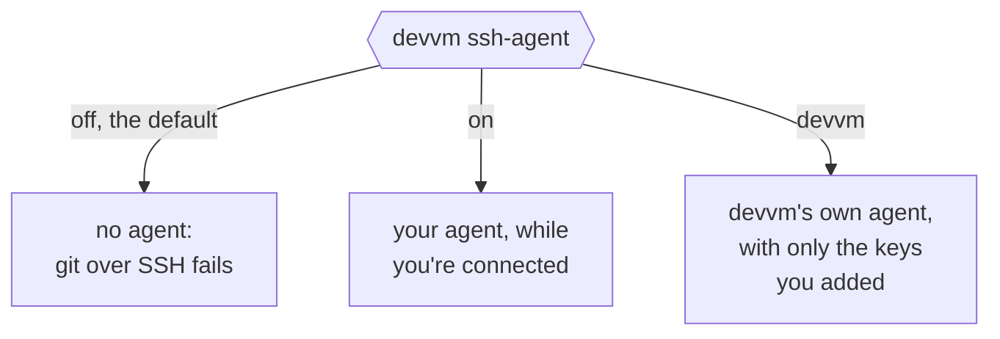

# SSH and editors

You can reach each running VM by name from ssh and from editors such as VS Code and Cursor, and you choose for each VM whether it can use your SSH keys. [ssh into VMs](../internals/security.md#ssh-into-vms) explains how devvm's ssh entries keep a VM away from the rest of this machine.

## SSH access by name

Each running project VM can be reached as `devvm-<folder>`, as in `ssh devvm-website` or VS Code's *Remote-SSH: Connect to Host*. devvm chooses this alias once, when it makes the VM, and records it, so it never changes. A VM gets `devvm-<folder>` unless another VM already has that alias, and then its alias is its full name. So when two folders share a name, the first VM made keeps `devvm-website`, and the second one's alias is its full name, whichever of them you delete first. The VM's full name (`devvm-website-<hash>`) always works as well.

devvm writes these entries to `~/.local/share/devvm/ssh_config` each time it launches or stops a VM, because a VM's SSH port can change each time it starts. To use them, add this line to the top of `~/.ssh/config`, before any `Host` block:

```text
Include ~/.local/share/devvm/ssh_config
```

You can also point ssh at the file, as in `ssh -F ~/.local/share/devvm/ssh_config devvm-website`. `devvm host`, `devvm code`, `devvm cursor` and a new [`--clone`](clone.md) VM offer to add the line in a terminal, and without one, they show it.

- **Only running VMs are listed.** A stopped VM's port is free for any program on this machine to take, so an entry for it could hand your connection, and your agent, to that program. Start the VM with `devvm host` or `devvm` before you connect from an editor.
- **Each entry checks the VM's own host keys,** which devvm reads from the VM once each time it starts and keeps in the VM's folder, `~/.local/share/devvm/vms/<hash>/run/known_hosts`. ssh refuses a host key that doesn't match, and a VM whose keys devvm can't read gets no entry.
- **Each entry reaches the VM on this machine's loopback, `127.0.0.1`,** as the VM's user with the VM's own key. A VM whose backend names any other address, or no user or key, gets no entry, so ssh never takes your connection somewhere else.
- **The entries need OpenSSH 8.7 or newer** (`ssh -V`), and an older ssh refuses them.
- **Keep remote forwards out of `Host *`.** The entries turn off what else your ssh config could share with a VM, but they can't turn off a `RemoteForward` of yours.

<!-- markdownlint-disable-next-line MD033 -- the section's anchor before its rename, which released versions' messages link to -->
<a id="devvm-host-and-devvm-code"></a>

## devvm host, devvm code and devvm cursor

```sh
devvm host     # get this folder's VM ready, and show the name ssh and editors reach it by
devvm code     # the same, then open its folder in VS Code over Remote-SSH
devvm cursor   # the same, then open its folder in Cursor over Remote-SSH
```

`devvm host` gets this folder's VM ready for ssh and editors, then shows its host name (`devvm-website`) and its folder in the VM. It does what [a launch of an existing VM](../internals/overview.md#an-existing-vm) does, without opening a shell. It checks `.git`, applies the size, ports and agent forwarding that a stopped VM's state asks for, starts the VM if it's stopped, runs the [self-check](../internals/network.md#the-self-check), sets the VM up and writes the ssh config. A VM whose tier isn't enforced is stopped, and it gets no name. The editors' commands start the same way:

- `devvm code` does the same, then opens the folder in VS Code over Remote-SSH with VS Code's `code` command, as in `code --remote ssh-remote+devvm-website ~/website`. VS Code gets the SSH agent that devvm was started with, not the one that devvm's own connections to the VM carry. Without `code` on `PATH`, devvm names the host to connect to with *Remote-SSH: Connect to Host*.
- `devvm cursor` does the same in Cursor, the editor, with its `cursor` command, as in `cursor --remote ssh-remote+devvm-website ~/website`. Cursor gets the SSH agent that devvm was started with too, and without `cursor` on `PATH`, devvm names the host to connect to from Cursor. Cursor installs its `cursor` command from its command palette, as VS Code does its `code`. Cursor's CLI agent, which runs in the VM, is another program, with commands of its own ([Cursor CLI login](coding-agents.md#cursor-cli-login)).

<!-- markdownlint-disable-next-line MD033 -- the section's anchor before its rename, which released versions' help links to -->
<a id="vs-code"></a>

### VS Code and Cursor

Over Remote-SSH, VS Code and Cursor reach further than ssh:

- **Ports.** They forward the ports that programs they start in the VM listen on to this machine's `localhost`, whatever `devvm ports` says. Those programs include their terminals, their tasks and an agent.
- **Git sign-in.** They answer git's credential prompts in the VM with your GitHub sign-in in the editor.
- **Your editor's own sign-ins.** The editor's extensions run in the VM, its AI features among them, such as GitHub Copilot in VS Code and Cursor's own AI and codebase indexing. They may get the editor's sign-ins to work there, such as Copilot's GitHub token or your Cursor login, and devvm's proxy doesn't hold those back. devvm hasn't checked what reaches the VM, so take it that a program in the VM could read them.

devvm turns the first two off in each editor's settings for the VM, which are `~/.vscode-server/data/Machine/settings.json` in the VM for VS Code and `~/.cursor-server/data/Machine/settings.json` for Cursor. Each time devvm sets the VM up, it sets `remote.autoForwardPorts`, `git.terminalAuthentication` and `github.gitAuthentication` to `false` in both files and keeps their other settings. A file with comments isn't plain JSON, so devvm leaves it as it is and says so in the run log. A file or folder that devvm can't write is said in the run log too, and the rest of the setup goes on.

Those settings only cover ordinary use:

- The VM can turn the three back on, and setting them in your own settings on this machine doesn't stop it: in VS Code, the settings on the remote machine and the opened folder's `.vscode/settings.json`, both of which the VM can write, take precedence over yours for all three. Only a policy that an administrator sets takes precedence over the VM's.
- Even with port forwarding off, an extension or a URL that the editor opens can still forward a port.
- Cursor is built on VS Code, so it most likely works the same way, though devvm hasn't checked it.

So don't open a VM you don't trust with `devvm code` or `devvm cursor`, and use `ssh` or devvm's shell instead, or sign out of the editor's AI features and its GitHub sign-in first. Programs in the VM can also open URLs in this machine's browser (`$BROWSER`).

### Cursor's Agent

Recent releases of Cursor run its Agent in the editor's server in the VM, not in the Cursor app on this machine. That server holds your Cursor sign-in in memory and uses it to talk to Cursor, so code in the VM could use your sign-in while the window is open.

The safest way to use `devvm cursor` is a VM on the allowlist or none tier without Cursor's CLI:

```sh
devvm --network allowlist --agents claude   # any agents but cursor
devvm cursor
```

- The VM can't reach Cursor's hosts, so its server can't use your sign-in.
- Agent and Tab still work: Cursor sends their requests through the app on this machine when the VM can't reach Cursor.
- `devvm network log` shows the VM's server trying `api2.cursor.sh` and `downloads.cursor.com`, blocked. The second is the server trying to download itself into the VM; Cursor then downloads it on this machine and copies it in.

A VM with Cursor's CLI has Cursor's hosts on its allowlist, so there the editor's server can use your sign-in. To send Agent's own requests through the app either way, add this line to your Cursor user settings, `~/Library/Application Support/Cursor/User/settings.json` on macOS or `Cursor/User/settings.json` in `$XDG_CONFIG_HOME`, by default `~/.config`, on Linux:

```json
"cursorAgentHost.remoteInferenceRoute": "always"
```

Once it finds Cursor's `cursor` command, `devvm cursor` reads that file, without changing it, and warns before it opens Cursor when the line isn't there, or when it can't read the file. Cursor reads the setting only from your user settings, never from the VM's. The setting doesn't take your sign-in out of the VM, though: the editor's server still signs in to Cursor where it can reach it, so open only VMs you trust with `devvm cursor`.

## Agent forwarding

SSH agent forwarding is off by default. While it's on and you're connected, anything in the VM, coding agents included, can *use* the agent's keys, for example to push or to log in to servers. It can't copy them. Turn it on for one VM when you need git over SSH there.

```sh
devvm --ssh-agent                       # a new VM that forwards your SSH agent
devvm ssh-agent                         # show this folder's VM's choice and devvm's agent's keys
devvm ssh-agent on                      # forward your SSH agent to this folder's VM from its next start
devvm ssh-agent add ~/.ssh/deploy_key   # or load one key into devvm's own agent
devvm ssh-agent devvm                   # and forward that agent instead of yours
devvm ssh-agent off                     # stop forwarding from the VM's next start
```



- `devvm --ssh-agent` creates the VM forwarding your agent. `devvm ssh-agent on`, `devvm` or `off` changes it for an existing VM from its next start, and `devvm ssh-agent` shows it. For a running VM, devvm asks in a terminal whether to restart it now, as `devvm restart` does, and otherwise, or without a terminal or with `--no-input`, the change waits for `devvm restart` or the VM's next start. Until then, each time devvm opens the running VM it asks in a terminal whether to restart it with the change, with no as the default unless an agent's new folders wait too ([restarting](vms.md#restarting-and-stopping)).
- The choice applies to devvm's shells and to the ssh entries alike, both as the VM's current start was made with, so a change reaches neither until the VM next starts, whichever folder devvm runs from. For a VM started outside devvm, such as with `limactl start`, they follow the current choice. When forwarding is off, an entry says `ForwardAgent no`, whatever your own `Host *` settings say, and none of devvm's own connections to the VM carry your agent.
- With forwarding off, git over SSH in the VM fails. devvm says so when it creates a VM for a repo whose `origin` is an SSH URL. Use an HTTPS remote with a GitHub token instead, or turn forwarding on.
- **No keys loaded.** When a VM forwards your agent, the agent has no keys and `~/.ssh` has one, devvm offers to load it (`ssh-add --apple-use-keychain` on macOS). To keep it loaded across reboots, add `AddKeysToAgent yes`, and `UseKeychain yes` on macOS, under `Host *` in `~/.ssh/config`.
- You can also use an agent that asks you to approve each use, such as 1Password's or Secretive.

GitHub's host keys are preinstalled in every VM, so a first connection to GitHub doesn't prompt.

### devvm's own agent

devvm's own agent keeps your other keys out of reach, because it holds only the keys you add to it, such as a deploy key or a key with access to fewer repos.

- `devvm ssh-agent add ~/.ssh/deploy_key` starts the agent and loads the key. The agent's socket is `~/.local/share/devvm/agent.sock`. `devvm ssh-agent devvm` makes this folder's VM forward that agent instead of yours, in devvm's shells and in the ssh entries alike. The entries name it as the agent, so an editor forwards it however the editor was started.
- `devvm ssh-agent` shows this folder's VM's choice, and once you've added a key, it then lists the keys devvm's agent holds, as `ssh-add -l` does, and each key you added, with its file, its fingerprint and how it's loaded. It loads the keys the agent lacks before it lists them.
- `devvm ssh-agent rm ~/.ssh/deploy_key` takes the key out of devvm's agent and out of `~/.local/share/devvm/agent-keys.json`, so devvm doesn't load it again. devvm finds the key in the agent by the fingerprint it recorded, so the key file can have changed or be gone, and devvm leaves the file itself as it is. devvm refuses a key you didn't add, and `devvm ssh-agent` lists the ones you did.
- devvm loads a key again when a VM that uses the agent launches without it, such as after a reboot or once the key's lifetime ran out, and it asks for the key's passphrase if it has one. It does so only while the file holds the key you added. `add` records the key's fingerprint, so devvm doesn't load a file that was replaced since, or a link that was swapped to another key. A key you replaced in place needs `devvm ssh-agent add` again.
- devvm refuses a key inside a folder a VM mounts, and doesn't load it, because that VM could read it. That's every folder that a VM's state says it mounts, whether the VM is running or stopped: its project folder, its agents' config folders and the shared tools. Keep the keys for devvm's agent outside project folders.
- An encrypted key in the old PEM format needs converting first, with `ssh-keygen -p -f KEY`, because devvm can't read its fingerprint without the passphrase.

The agent drops each key 12 hours after it loads it, so a VM can't keep using the key indefinitely. `--lifetime 30m` changes that for one key, and it takes a [duration](command-line.md#flags-and-values) in minutes, hours, days or weeks, such as `30m`, `8h` or `1d`, or `forever`. `--confirm` makes the agent ask you before each use, such as each push or each login, through an `ssh-askpass` program. macOS doesn't include one, so install one and put it on your `PATH`, or set `SSH_ASKPASS` to it. devvm keeps the keys and their options in `~/.local/share/devvm/agent-keys.json`, and running `devvm ssh-agent add` on the same key again replaces its options.

### devvm ssh-agent --json

`devvm ssh-agent --json` prints what `devvm ssh-agent` shows as one JSON object, as [output for scripts](command-line.md#output-for-scripts) describes. `mode` is this folder's VM's choice, `off`, `on` or `devvm`. Each of the `keys` is a key you added to devvm's agent, with its `file`, the `fingerprint` devvm recorded, `confirm`, its `lifetime` and `loaded`, which says whether the agent holds it. As without `--json`, devvm loads the keys the agent lacks first, and with no key added, `keys` is `[]` and devvm doesn't start its agent. With `--json` the command only shows, so devvm refuses `on`, `devvm` or `off` with it.

```json
{
  "version": 1,
  "mode": "devvm",
  "keys": [
    {
      "file": "/Users/you/.ssh/deploy_key",
      "fingerprint": "SHA256:mVPwvezndPv/ARoIadVY98vAC0g+P/5633yTC4d/wXE",
      "confirm": false,
      "lifetime": "12h",
      "loaded": true
    }
  ]
}
```

