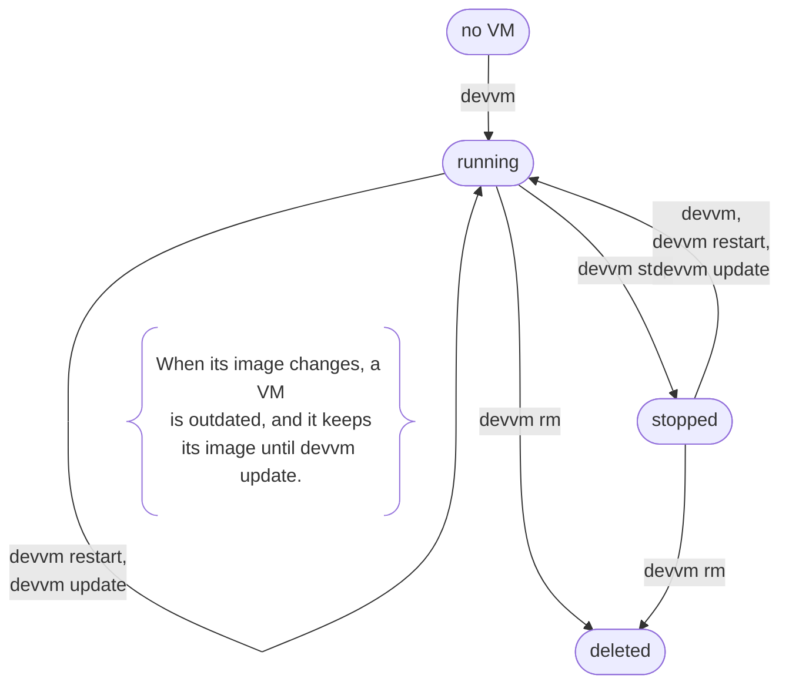

# Managing VMs

This page covers a VM from the time devvm makes it until you delete it: opening, restarting and stopping it, deleting it, listing your VMs, and what devvm does when you run a command in a subfolder or when the project folder is made again, moved, deleted or on a disk that isn't connected. [Overview](../internals/overview.md) has each step devvm takes for a new VM and an existing one.

## Opening a VM

devvm makes a new VM from its image of base and the layers you chose, building the image first if it isn't built yet, then starts the VM and opens a shell in it in devvm's place, so devvm ends when the shell does. The VM mounts only the project folder, read-write, and the shared tools and its [agents' config folders](coding-agents.md), read-only, or with `--clone` it gets its own clone of the repo instead of the folder. devvm also locks the `.git` hooks and config of the folder and of the repos nested in it against changes from the VM. On macOS it locks them with a file flag, and on Linux it makes them read-only in the VM where the kernel lets it and only watches them where it doesn't ([.git protection](../safety/git-protection.md)). For a VM that exists, devvm starts it if it's stopped and opens it as it is.

A VM is running or stopped from the time devvm makes it until you delete it.



## Restarting and stopping

```sh
devvm restart   # stop this folder's VM, start it again and open a shell in it
devvm stop      # stop it and its proxy
```

`devvm restart` stops this folder's VM, then starts it and opens a shell in it as devvm does. Some changes apply only when a VM starts, and a restart applies them:

- a new size for a running VM
- a change into or out of the open tier
- a change to its SSH agent forwarding
- the config folders of an agent that `devvm tools add` added

When you make one of these changes to a running VM with `devvm size`, `devvm network` into or out of open or `devvm ssh-agent`, or change its `.git` protection on macOS with `devvm git-protect`, which waits for the VM to stop, devvm asks in a terminal whether to restart the VM now, because anything running in it stops. If you answer yes, devvm restarts it as `devvm restart` does and opens a shell in it. If you answer no, devvm keeps the change and says that `devvm restart` applies it, and it does the same without asking when there's no terminal or you pass `--no-input`.

When devvm opens a running VM that still has changes waiting for its next start, it names them, such as its size and its agent folder mounts, and asks in a terminal once whether to restart the VM now. It names each change on a line of its own, and when more than two wait, it names the first and says how many more there are. The default answer depends on what waits:

- **Yes (`[Y/n]`)** when the VM's agent folder mounts are among the changes, because an agent you just added needs its folders.
- **No (`[y/N]`)** otherwise, because the VM is already running and you may only want its shell.

If you answer yes, devvm stops the VM, starts it with the changes and opens a shell in it. If you answer no, or there's no terminal, or you pass `--no-input`, devvm warns about each change and opens a shell in the running VM.

`devvm stop` stops this folder's VM and its proxy ([stopping a VM](../internals/overview.md#stopping-a-vm)). Once the VM is stopped, devvm locks its `.git` again and checks it, as a launch that finds the VM stopped does, and it takes the VM's entry out of devvm's [ssh config](ssh.md#ssh-access-by-name). devvm, `devvm restart`, and the commands that need the VM running, such as `devvm host`, start it again.

## Deleting a VM

```sh
devvm rm                               # delete this folder's VM, after asking
devvm rm --force                       # the same without asking, as a script must
devvm rm --no-export                   # without exporting its agents' history first
devvm rm devvm-web-71a99b1076d92c      # a VM whose folder is gone, by its name from devvm ls
```

`devvm rm` deletes this folder's VM together with what devvm keeps for it. That's the VM's state, its own allowlist, its network log, its `.git` locks or, for a `--clone` VM, the repo's `devvm` remote, and its ssh config entry ([deleting a VM](../internals/overview.md#deleting-a-vm)). It asks first in a terminal, and `--force` deletes without asking, which `devvm rm` needs when there's no terminal.

When the VM has an agent, devvm first exports the agents' history, unless you give `--no-export`, and when the export fails, devvm keeps the VM ([history](coding-agents.md#history)). For a `--clone` VM, devvm offers to fetch the branches this repo hasn't fetched, and it deletes the VM's uncommitted changes only after you confirm. `--no-clone-check` skips that check and warns you that the clone's unfetched commits and uncommitted changes go with the VM ([deleting the VM](clone.md#deleting-the-vm)).

Some VMs devvm deletes only after you confirm, and it asks these questions only in a terminal, where `--force` never answers them:

- the VM made for an earlier folder at this path ([a folder made again](#a-folder-made-again))
- in a folder without a VM of its own, the VM of the nearest folder with one that this folder is inside, which `devvm rm` acts on and names ([a subfolder](#a-subfolder))

To delete a VM whose folder you deleted or moved, give its name, as in `devvm rm devvm-web-71a99b1076d92c` ([a VM whose folder is gone](#a-vm-whose-folder-is-gone)).

## Listing VMs

`devvm ls` prints a table of the project VMs, sorted by name, with a header first. Images and build VMs aren't in it.

| Column | |
| --- | --- |
| `NAME` | the VM's name, `devvm-<folder>-<hash>` |
| `STATUS` | its state as its backend reports it, such as `Running` or `Stopped` |
| `IMAGE` | its image, base and its layers, with a base from a container image as `base (from node:24)` ([details](from.md)) |
| `TOOLS` | its shared tools, joined with commas, such as `node,claude`, or `-` for none |
| `GIT` | its [`.git` protection](../safety/git-protection.md), `on` or `off`, or `clone` for a [`--clone`](clone.md) VM |
| `NET` | its [network tier](../safety/network.md#network-tiers), `open`, `internet`, `allowlist` or `none`, or `unenforced` ([the self-check](../internals/network.md#the-self-check)), and `internet (learning)` while it [learns the hosts it needs](../safety/network.md#learning-the-hosts-a-vm-needs) |
| `LINKS` | how many [links](links.md) it has to ports of your other VMs, or `-` for none |
| `FOLDER` | its project folder, with `(gone)` after it when nothing is at that path, which `devvm rm VM` deals with ([a VM whose folder is gone](#a-vm-whose-folder-is-gone)), or `(not connected)` when the folder was on a disk that isn't connected ([details](#a-folder-on-a-disk-that-isnt-connected)) |

A value the VM's state doesn't have shows as `-`, so a VM whose creation didn't finish shows only its name and status.

### devvm ls --json

`devvm ls --json` prints the same list as one JSON object, as [output for scripts](command-line.md#output-for-scripts) describes. `vms` has a VM's columns as fields, sorted by name. `image` is the image alone, `tools` is the list of its shared tools, `[]` for none, and `from` is the container image its base started from, which is left out for a base from Ubuntu's cloud image. A value the VM's state doesn't have is `""`. `folder` is the folder alone, and `folder_state` is `there` when something is at its path, `gone` when nothing is, and `not_connected` when the folder was on a disk that isn't connected. `links` is how many links the VM has, `0` for none. `net` is the tier alone, and a VM that's learning the hosts it needs also has `learning_since`, the time it started learning.

```json
{
  "version": 1,
  "vms": [
    {
      "name": "devvm-website-71a99b1076d92c",
      "status": "Running",
      "image": "base",
      "tools": ["node", "claude"],
      "from": "node:24",
      "git": "on",
      "net": "internet",
      "learning_since": "2026-11-07T10:00:00Z",
      "backend": "lima",
      "folder": "/Users/you/code/website",
      "folder_state": "there",
      "links": 0
    }
  ]
}
```

## A subfolder

```sh
cd ~/some-project/src
devvm            # open the parent folder's VM, with the shell here
devvm --here     # make a VM for this subfolder instead
devvm --parent   # use the parent folder's VM even in a repo of its own
```

A VM mounts its whole project folder, so the folders inside it are in the VM at the same paths. When the folder you run a command in has no VM of its own, devvm looks for one in the folders it's inside, starting with the nearest. It stops before your home folder and the filesystem root, so it never uses a VM made for either. It stops at the nearest folder that has a VM, and when that VM was made for an earlier folder at its path ([a folder made again](#a-folder-made-again)), or its backend has lost it, the folder you're in has no VM, so devvm never reaches past it to a VM further out. Using a parent folder's VM mounts nothing new, because the subfolder is already inside the folder that VM mounts.

In such a subfolder, such as `~/some-project/src`, each command does this:

| Command | In a subfolder |
| --- | --- |
| `devvm` | opens the parent folder's VM there, with the shell at the subfolder's path, and first prints a line that names the VM and the folder it was made for. It does the same with or without a terminal, and it asks nothing. `--tools`, `--agents` and `--layers` change nothing on the parent folder's VM, as on any VM that exists, and devvm warns that they don't ([adding and removing tools](toolchains.md#adding-and-removing-tools)). In a parent folder's `--clone` VM, the shell opens in the subfolder when the clone has it ([subfolders](clone.md#subfolders)) |
| `devvm --here`, `devvm --clone` | make a new VM for the subfolder instead, and `devvm --clone` makes the subfolder's own clone VM. Once the subfolder has its own VM, devvm opens that one |
| `devvm stop`, `restart`, `tools`, `size`, `ports`, `host` and `code` | use the parent folder's VM in the same way, without asking. Each one first prints a line that names the VM and the folder it was made for. `devvm host` gives the subfolder as the folder to open in the VM, and `devvm code` opens the subfolder |
| `devvm rm` | never deletes a parent folder's VM unasked. In a terminal, it names the VM and its folder and asks before deleting it, with no as the default, and `--force` never answers that question. Without a terminal, it refuses and tells you to run `devvm rm` in the parent folder instead |
| `devvm adopt` | acts only on the VM made for this folder's own path, never on a parent folder's |

The commands that give the VM more access ask in the same way as `devvm rm`, because the parent folder's project may not expect them:

- `devvm secret use`
- `devvm ssh-agent on` and `devvm ssh-agent devvm`
- `devvm network` with a lower tier, such as `devvm network open`
- `devvm network allow`, and `devvm network rm` when it removes a deny
- `devvm git-protect off`

In a terminal, each one names the VM and its folder and asks before it changes the VM, with no as the default. Without a terminal, it refuses and tells you to run it in the parent folder, or in a terminal to confirm. The commands that take access away, such as `devvm secret unuse` and `devvm network deny`, ask nothing.

A subfolder that is a git repo of its own is treated as a separate project, and so is a subfolder inside such a repo, when the repo is below the folder with the VM. That covers a nested repo, a submodule and a worktree, which each have a `.git` folder or file of their own. When you run `devvm` there, devvm makes a new VM for the subfolder, with or without a terminal, and asks nothing. The other commands don't use the parent folder's VM there, and they say this folder has no VM, as in any folder without one.

Every command that acts on this folder's VM, `devvm` included, takes `--here` and `--parent`, and each finds the VM in the same way:

- `--here` uses only this folder's own VM, so `devvm --here` makes one when the folder has none, and the other commands say this folder has no VM.
- `--parent` uses the VM of the nearest folder with one that this folder is inside, even across a git repo of its own and even when this folder has a VM of its own, so `devvm --parent` in a repo of its own opens the project's VM there. When no folder that this folder is inside has a VM, a command given `--parent` fails and changes nothing.

You can't give the two together, or either of them with `-g`, and `devvm --clone` doesn't take `--parent`, because a clone VM is always the folder's own. `devvm rm VM` takes neither, because it deletes the VM you name, and neither does `devvm adopt`, because it acts only on this folder's own path. With `--parent`, `devvm rm` and the commands that give the VM more access still ask before they change the parent folder's VM.

## A nested project replaced

A project with a VM of its own inside a folder with another VM, such as a nested repo, is in both VMs, because the parent folder's VM mounts everything inside its folder. Code in the parent folder's VM can do two things to it:

- It can change the nested project's files, though not the hooks and config of its `.git` while the parent folder's VM protects it, as [`.git` protection](../safety/git-protection.md#nested-repos) does for the repos nested in a VM's folder.
- It can move the nested project folder aside and put a link in its place, or another folder. On Linux, if devvm then started the nested project's VM, the VM would mount whatever the link points to, such as your home folder. On macOS the VM mounts the project folder itself, wherever it was moved, and never what a link at its path points to.

On both, devvm checks the nested project folder just before it starts the VM and again once the VM runs. If the folder is now a link, sits below a link, or is another folder, devvm doesn't start the VM, or it stops the VM again, and it tells you which. Then:

1. Find what replaced the folder.
2. Move the project folder back to its path.
3. Run the command again.

Replacing the folder while the VM runs never shows the VM what the link points to. On Linux the VM keeps the folder it mounted when it started, and on macOS the VM gets "Operation not permitted" for its project folder, as it does when the folder was moved aside while the VM started and put back later, so run `devvm restart` once the folder is back. To keep a nested project out of the parent folder's VM altogether, move it out of the parent folder.

Each time `devvm` makes or opens the nested project's VM, it warns once and names the VM of the nearest parent folder that mounts the project. It warns whether that VM runs or not, because the VM can write to the folder whenever it runs. A `--clone` VM mounts nothing, so devvm doesn't warn when you open one, and a parent folder's `--clone` VM never counts. The other commands, `devvm restart` included, don't warn.

## A folder made again

A VM belongs to the folder it was made for, which devvm knows by its path and by the folder itself ([one VM per folder](../internals/security.md#one-vm-per-folder)). When that folder was deleted and a new one made at the same path, every command that opens, stops or changes the VM refuses it, such as `devvm`, `devvm stop`, `devvm restart` and `devvm tools`. Two commands deal with it, and each acts only after you confirm in a terminal:

- `devvm rm` deletes the VM and never exports its history, because its folder is gone. The VM may hold that project's work, so `--force` never answers this question.
- `devvm adopt` gives the VM to this folder, with its files, secrets and allowlist. Its `.git` protection starts again, as if `.git` had just appeared. `devvm adopt --force` gives it without asking, which `devvm adopt` needs when there's no terminal.

## A moved or renamed folder

```sh
mv ~/code/app ~/work/app
cd ~/work/app && devvm   # devvm asks whether to move the VM here
devvm adopt --force      # the same without asking, as a script must
devvm adopt VM           # give a copy on another disk the VM, by its name from devvm ls
```

When you move or rename a project folder on the same disk, as with `mv ~/code/app ~/work/app`, the folder keeps its VM once you say so. The first time you run a command on this folder's VM at the folder's new path, such as `devvm` or `devvm stop`, devvm finds the VM made for the folder at its old path, names the VM and that path, and asks whether to move the VM here, with no as the default:

- **Yes:** the VM belongs to the folder at its new path, with its home folder, secrets, allowlist, links and settings, and devvm finds it there from then on without asking.
- **No:** the folder has no VM, so `devvm` makes a new one, and the old VM stays with the old path, where `devvm rm VM` deletes it ([a VM whose folder is gone](#a-vm-whose-folder-is-gone)).
- **Without a terminal,** devvm refuses and tells you to run `devvm adopt` in a terminal, or `devvm adopt --force`, which moves the VM without asking.

Once the VM has moved, this is what changes:

- The VM mounts the folder at its new path from its next start. When the VM is running as you move it, it still mounts the old path, so devvm stops it before it moves it, and `devvm` then starts it with the folder at its new path. If a VM runs with its folder at another path all the same, devvm asks whether to restart it as it opens the VM, with yes as the default, and when you answer no, it warns that the VM mounts the folder at its new path only when it next starts.
- The folder's `.git` moves with it, locks and all, so its [.git protection](../safety/git-protection.md) goes on as before.
- Links to the VM and its group go by the VM's name, so they stay, and a link whose TARGET is the folder's path finds the VM at its new path.
- The folder's path in the VM changes with it.

Claude Code's history follows the folder. Claude Code keeps a folder's sessions and its settings for that folder, such as whether you trust it and the MCP servers you added there, by the folder's path. At the VM's next start, devvm moves them in the VM from the old path to the new one, so `claude --continue` and `claude --resume` offer the sessions from before the move. When Claude Code already has sessions at the new path, the old path's sessions join them, and a session the new path already has stays as it is. Settings that Claude Code already keeps for the new path stay as they are, and the old path's stay under the old path. devvm moves only what Claude Code keeps for the project folder itself, so sessions you started in one of its subfolders stay under that subfolder's old path.

Codex records each session's folder in the session, and `codex resume` and `codex resume --last` look only at the current folder's sessions, so they miss the ones from the old path. To find them:

```sh
codex resume --all   # list the sessions of every folder, the old path's included
codex resume ID      # resume a session by its ID, wherever it started
```

opencode keeps the sessions of a git repo by the repo's first commit, so they follow the folder without any change. In a folder that isn't a git repo, opencode keeps sessions by the folder's path, so they stay under the old path.

devvm offers the move only when the folder at the new path is the folder the VM was made for, which devvm knows by its device, inode and birth time ([one VM per folder](../internals/security.md#one-vm-per-folder)), and when nothing is at the old path any more, or only a symlink to the new path. There's no offer in these cases:

- **A copy:** a copy of the folder is another folder.
- **Some file systems:** a folder on a file system that may give a new folder the inode number of a deleted one, such as a network share, a FUSE file system or a USB drive formatted with FAT or exFAT, never gets the offer. [One VM per folder](../internals/security.md#one-vm-per-folder) lists the file systems that do.
- **Another user's folder:** devvm offers no VM for a folder that another user owns.
- **A `--clone` VM,** which keeps its own clone of the repo at the old path inside the VM.
- **Several VMs:** when more than one VM was made for the folder at paths it had before, devvm moves none of them and names them, so you can choose one with `devvm adopt VM`.

devvm refuses to move a VM to a folder that it wouldn't make a new VM for, such as your home folder ([project folders devvm refuses](settings.md#project-folders-devvm-refuses)). A new folder at the old path gets a new VM of its own, with another name.

Moving a folder to another disk copies it, so the folder at the new path is another folder, which devvm never offers the VM to on its own. To give the copy the VM, delete the folder at the old path or disconnect its disk, then run `devvm adopt VM` in the copy, with the VM's name as `devvm ls` lists it. devvm names the VM and its old path and asks first, with no as the default, and `--force` moves it without asking, which `devvm adopt VM` needs when there's no terminal. The VM's `.git` protection starts again, as if `.git` had just appeared, because the copy's `.git` is another folder too. devvm refuses a VM whose folder is still there, a `--clone` VM, and a folder that has a VM of its own, which you delete first with `devvm rm`.

## A VM whose folder is gone

When you delete or move a project folder, its VM stays, because the VM may hold work that's nowhere else and devvm never deletes a VM on its own. A folder you moved gets its VM back at its new path once you say so ([a moved or renamed folder](#a-moved-or-renamed-folder)), and until then the VM's folder counts as gone. `devvm ls` writes `(gone)` after the folder of each VM whose folder is gone ([listing VMs](#listing-vms)), and `devvm space` names each one with its folder. A folder on a disk that isn't connected isn't gone, and [a folder on a disk that isn't connected](#a-folder-on-a-disk-that-isnt-connected) covers it. A folder that was deleted and made again at the same path isn't gone, and devvm handles it as [a folder made again](#a-folder-made-again). [A VM whose folder is gone](../internals/overview.md#a-vm-whose-folder-is-gone) explains how devvm tells.

```sh
devvm ls                                         # the VMs, with (gone) after a folder that's gone
devvm rm devvm-web-71a99b1076d92c                # delete one by its name, after asking
devvm rm devvm-web-71a99b1076d92c --no-export    # a stopped one with an agent, without its history
```

`devvm rm VM` deletes a VM whose folder is gone, and you can run it in any folder. VM is the VM's name, as `devvm ls` lists it, or the alias that ssh reaches it by. In a terminal, devvm names the VM and its folder and asks before deleting it, with no as the default. `--force` deletes it without asking, which `devvm rm VM` needs when there's no terminal. Like `devvm rm`, it deletes what devvm keeps for the VM, and when the VM has an agent, devvm first exports the agents' history unless you give `--no-export` ([history](coding-agents.md#history)).

The export reads the history from the running VM. Starting a stopped VM would make its folder again, because Lima makes a missing folder that a VM mounts, so for a stopped VM with an agent devvm refuses and tells you to run `devvm rm VM --no-export`. If you moved the folder and want the history, run `devvm history export` or `devvm rm` in the folder at its new path, which moves the VM there first ([a moved or renamed folder](#a-moved-or-renamed-folder)). A `--clone` VM mounts no project folder, so devvm starts it to export the history. Its clone's work can't be fetched into a repo that's gone, though, so devvm refuses to delete it unless you give `--no-clone-check`, which deletes the VM and that work with it.

Given this folder's own VM, `devvm rm VM` does what `devvm rm` does. It refuses these:

- **A folder that's still there:** devvm refuses a VM whose folder is still there, including a VM made for an earlier folder at that path, and tells you to run `devvm rm` in that folder.
- **A state changed by hand:** a VM whose state names this folder while the folder has a VM of its own, which only a state changed by hand can do, is refused as a VM whose folder is still there, so `devvm rm VM` never deletes the folder's own VM in its place.
- **An unknown name:** devvm refuses a name that isn't one of your VMs.
- **A VM its backend lost:** devvm refuses a VM that its backend no longer has, for which `devvm gc --orphans` deletes what devvm keeps ([leftovers of a VM deleted outside devvm](space.md#leftovers-of-a-vm-deleted-outside-devvm)).

## A folder on a disk that isn't connected

When a project folder is on an external disk, a USB stick or a network share that isn't connected, nothing is at its path, but the folder may still hold the project's work, and so may the VM. devvm tells this apart from a deleted folder by the disk: it finds the nearest folder above the path that's still there, and when that folder is on another disk than the project folder was, the project folder isn't connected. `devvm ls` writes `(not connected)` after such a folder, and `devvm space` names each such VM with its folder. To use the VM again, connect the disk.

`devvm rm VM` refuses such a VM when there's no terminal, even with `--force`, and tells you to connect the disk, or to run `devvm rm VM` in a terminal to delete the VM anyway. In a terminal, devvm names the VM and its folder and asks before deleting it, with no as the default, and `--force` never answers that question. Otherwise it deletes the VM as it deletes one whose folder is gone. A folder that you moved to another disk and then deleted counts as not connected too, so devvm asks in that case as well.

